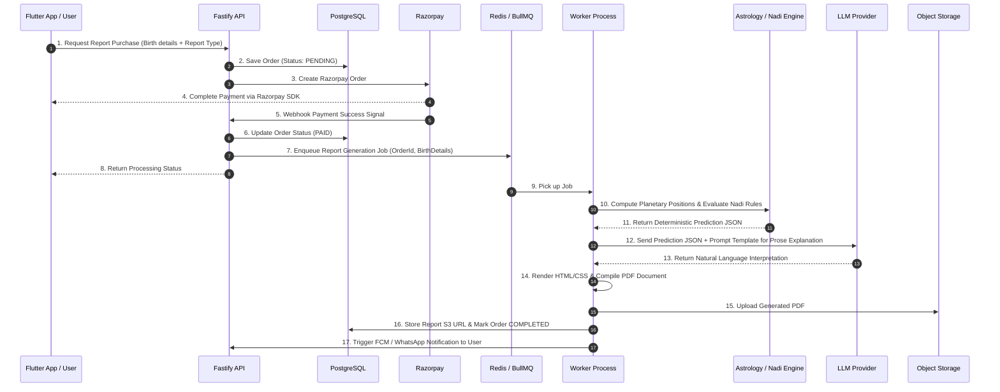

# Architecture Overview - Astro Sushil Platform

## 1. Architectural Principles

The **Astro Sushil** platform is designed around four core architectural principles:

1. **Modular Monolith**: Initial development is structured as a single monorepo containing a unified Fastify backend monolith with cleanly decoupled internal packages. Microservices are deliberately avoided unless strict technical scalability limits necessitate service extraction.
2. **Deterministic Computation**: Astrological chart calculations, planetary positions, divisional charts (Vargas), and Gupta Nadi rule matchers run deterministically.
3. **LLM as Formatting Layer**: Large Language Models (LLMs) format and enrich structured outputs into fluent prose. The LLM is never part of the calculation or prediction logic pipeline.
4. **Channel Agnostic Core**: Core business rules reside in backend modules and packages. Client channels (Mobile, Admin Web, WhatsApp) interface purely through secure API contracts.

---

## 2. System Component Categories

To ensure clear ownership and boundaries, system components are categorized into four distinct layers:

### A. Applications (`apps/`)
Deployable user-facing software and API entry points.
- **`apps/api`**: Node.js Fastify REST & WebSocket API service. Serves as the central application server orchestrating business logic, auth, and worker queues.
- **`apps/mobile`**: Cross-platform mobile client built with Flutter (iOS & Android). Interacts exclusively with `apps/api`.
- **`apps/admin`**: Web management dashboard built with Next.js (React). Interacts exclusively with `apps/api` for administrative and monitoring operations.

### B. Internal Packages (`packages/`)
Reusable internal TypeScript libraries compiled into the Fastify backend. These are **NOT separate deployed server processes**, but modular libraries maintaining domain encapsulation.
- **`packages/astrology-engine`**: Handles ephemeris calculations, planetary coordinates, Lagna calculation, house division, Vargas, Dashas, and Panchang.
- **`packages/gupta-nadi-engine`**: Implements Brihaspati Nandi Nadi (BNN) rule evaluation, planet-combination matrix, directional aspects, and transit overlays.
- **`packages/prediction-engine`**: Compiles raw chart calculations and Nadi rules into deterministic prediction output trees.
- **`packages/report-engine`**: Orchestrates PDF compilation, template rendering, and async job creation for generated reports.
- **`packages/shared`**: Data transfer objects (DTOs), interface definitions, utility helpers, and constants shared across backend services.

### C. Background Infrastructure & Data Store
- **PostgreSQL**: Primary transactional database storing users, birth profiles, orders, report metadata, rule configurations, and logs.
- **Redis**: In-memory cache for fast ephemeris lookup, session caching, rate-limiting, and queue storage.
- **BullMQ Queue System**: Job queue handling async workloads (PDF generation, LLM prompt formatting, WhatsApp notification delivery, email dispatch).
- **Background Workers (`workers/`)**: Processors executing heavy BullMQ jobs asynchronously off the main API HTTP thread.
- **Object Storage**: S3-compatible cloud storage for storing generated PDF reports and static user media.

### D. External Integrated Services
- **Razorpay**: Payment gateway for order creation, payment collection, signature verification, and refund processing.
- **Meta WhatsApp Business Platform**: External communication API channel (webhooks for incoming messages; REST for outgoing messages). **WhatsApp is an external integration channel, NOT a separate frontend application.**
- **Firebase Cloud Messaging (FCM)**: Native push notification platform for Android and iOS mobile devices.
- **LLM Provider**: OpenAI / Anthropic / Gemini API endpoint used strictly for converting prediction JSON structures into natural language explanations.

---

## 3. Architecture Diagram

```mermaid
graph TD
    subgraph Client Channels
        FlutterApp["Flutter Mobile App (iOS/Android)"]
        AdminApp["Next.js Admin Panel"]
        WhatsAppMsg["WhatsApp Client (Meta Platform)"]
    end

    subgraph API & Domain Core (Modular Monolith)
        FastifyAPI["Fastify Backend API (apps/api)"]
        
        subgraph Domain Packages (packages/)
            AstroEng["astrology-engine"]
            NadiEng["gupta-nadi-engine"]
            PredEng["prediction-engine"]
            RepEng["report-engine"]
        end
    end

    subgraph Data & Queue Infrastructure
        Postgres[(PostgreSQL DB)]
        Redis[(Redis Cache & Queue Store)]
        Workers["BullMQ Background Workers"]
        ObjectStore["Object Storage (S3 / Cloud Storage)"]
    end

    subgraph External Services
        Razorpay["Razorpay Payments"]
        MetaWA["Meta WhatsApp API"]
        LLM["LLM Provider (Explanation Only)"]
        FCM["Firebase Cloud Messaging"]
    end

    %% Client Connections
    FlutterApp -->|REST / WebSockets| FastifyAPI
    AdminApp -->|REST API| FastifyAPI
    WhatsAppMsg <-->|Webhooks / Delivery| FastifyAPI

    %% Backend Internal Interactions
    FastifyAPI --> AstroEng
    FastifyAPI --> NadiEng
    FastifyAPI --> PredEng
    FastifyAPI --> RepEng

    %% Data Infrastructure Connections
    FastifyAPI <--> Postgres
    FastifyAPI <--> Redis
    FastifyAPI -->|Enqueue Jobs| Redis
    Redis <--> Workers
    Workers <--> Postgres
    Workers -->|Upload PDFs| ObjectStore

    %% Worker External Interactions
    Workers -->|Format Prose| LLM
    Workers -->|Send Push| FCM
    Workers -->|Send Message| MetaWA
    FastifyAPI <--> Razorpay
```

---

## 4. End-to-End Data Flow

### Scenario 1: Paid Report Generation Pipeline



---

## 5. Architectural Boundaries & Restrictions

1. **Separation of Execution**: Expensive calculations and document generation tasks MUST be delegated to BullMQ workers to prevent blocking Fastify HTTP request loop.
2. **No Direct DB Access**: Client applications (Flutter, Next.js Admin) must never access PostgreSQL or Redis directly. All interactions go through Fastify API routes with authentication and DTO validation.
3. **Stateless Backend**: The Fastify API nodes must remain stateless to support horizontal scaling behind a cloud load balancer.
