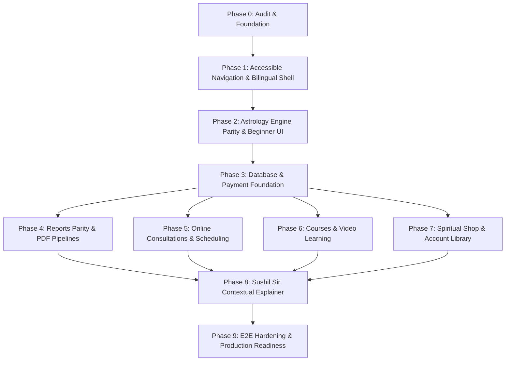

# Astro Sushil Mobile Product Roadmap
**From Web Parity to Next-Gen Mobile Experience**  
**Architecture:** Monorepo Modular Monolith (`apps/api`, `apps/mobile`, `packages/`, `workers/`)  
**Design Principle:** Accessible, bilingual, high-trust, and deterministic.

---

## 1. Roadmap Architecture & Phase Sequencing

This roadmap establishes a dependency-aware, phased sequence to bring all core commercial and astrological services from [https://astrosushil.com/](https://astrosushil.com/) into the native Flutter mobile client.

---

## 2. Detailed Phase Specifications

---

### Phase 0: Audit & Architectural Foundation (Completed)
- **Objective:** Exhaustive discovery of website offerings, prices, data flows, and code verification across the monorepo.
- **Deliverables:**
  - `docs/audits/WEBSITE_APP_FEATURE_PARITY.md`
  - `docs/audits/ACCESSIBILITY_AND_USABILITY_AUDIT.md`
  - `docs/architecture/MOBILE_PRODUCT_ROADMAP.md`
- **Dependencies:** None.
- **Complexity:** Low (Analytical & Auditing).

---

### Phase 1: Accessible Navigation, Bilingual Shell & Design Foundation (Completed & Verified — PASS)
- **Status:** PASS (Audit Report: `docs/audits/PHASE_1_ACCESSIBLE_NAVIGATION_REPORT.md`)
- **Verified Evidence:**
  - 4-Destination Navigation Shell (`Home`, `Reports`, `Consult`, `Account`) fully implemented with 48dp minimum touch targets.
  - Complete English (`app_en.arb`) and Hindi (`app_hi.arb`) localization (134 keys, 0 untranslated strings) with instant switching and secure storage persistence.
  - Responsive layout verified on 320px viewport without overflow; 1.5x dynamic text scaling verified without clipping.
  - Test Results: 22/22 Phase 1 unit and widget tests passed (`phase1_localization_test.dart`, `home_screen_test.dart`, `phase1_navigation_and_accessibility_test.dart`).
- **Objective:** Modernize the app shell for a mature audience (40–75+ years) by removing cognitive overload from the Home screen, establishing Hindi/English localization, and enforcing accessibility standards.
- **Deliverables:**
  - **4-Tab Navigation Shell:** Restructure bottom navigation into:
    1. *Home (मुख्य)* — Today's Panchang, Daily Rashi Bhavishya, Active Dasha, and Quick Actions.
    2. *Reports (रिपोर्ट्स)* — Central catalog and download shelf for all personalized PDF dossiers.
    3. *Consult (परामर्श)* — 1-on-1 audio/video appointments with Astro Sushil.
    4. *Account (खाता)* — Saved family profiles, language switcher, cache management, and WhatsApp support.
  - **Bilingual Infrastructure:** Add `flutter_localizations` to `pubspec.yaml`; create `app_en.arb` and `app_hi.arb`; add persistent language switch in the Account screen.
  - **Accessibility Hardening:** Set base font sizes to 16sp; enforce minimum 48×48 dp hit targets; implement safe text scaling clamps; eliminate low-contrast gold-on-white text.
  - **Astrology Tools Hub:** Move advanced calculation tiles (Ashtakavarga, Shadbala, KP, Jaimini, etc.) from Home into a dedicated, organized "All Astrology Tools" screen.
- **Files/Modules Affected:**
  - `apps/mobile/pubspec.yaml`
  - `apps/mobile/lib/app/app.dart`
  - `apps/mobile/lib/home/screens/home_screen.dart`
  - `apps/mobile/lib/home/widgets/home_bottom_navigation.dart`
  - `apps/mobile/lib/home/screens/consult_screen.dart`
  - `apps/mobile/lib/home/screens/profile_screen.dart`
  - `apps/mobile/lib/home/screens/reports_screen.dart`
  - `apps/mobile/lib/core/localization/locale_provider.dart`
- **Dependencies:** Phase 0 audit approval.
- **Complexity:** Medium.

---

### Phase 2: Astrology Engine Parity, Data Reliability & Beginner Experience (Completed & Verified — PASS)
- **Status:** PASS (Audit Report: `docs/audits/PHASE_2_ASTROLOGY_DATA_RELIABILITY_REPORT.md`)
- **Verified Evidence:**
  - **Eliminated Presentation Fallbacks:** Removed fake placeholder planets (`Ve 5`, `Mo 6`, etc.) in empty Kundli canvases; eliminated mock planet generators in `PlanetsScreen`; eliminated `DateTime.now()` date fabrications in `dasha_model.dart`; eliminated misleading `?? 0` in null Ashtakavarga pinda tables.
  - **Bilingual Educational Explainer Cards:** Implemented accessible, expandable `AstrologyExplanationCard` across Birth Chart, Planets, Vimshottari Dasha, Daily Panchanga, Matchmaking, Ashtakavarga, and Shadbala in English and Hindi.
  - **Prevented Self-Matching in Matchmaking:** Disallowed identical profile selection for Person A and Person B, displaying a localized warning banner and disabling calculate action.
  - **Deterministic Calculations:** Verified all calculations against the canonical New Delhi reference chart (`REF_CHART_001`: 15 May 1990, 14:30 IST / 09:00 UTC, 28.6139°N, 77.2090°E, Lahiri, Whole Sign).
  - **Test Results:**
    - `packages/astrology-engine`: 33/33 test files passed, 324/324 tests passed (100%).
    - `apps/mobile/test/unit/astrology/end_to_end_pipeline_test.dart`: 13/13 model parsing tests passed (100%).
    - `apps/mobile/test/widget/core_astrology_screens_test.dart`: 6/6 core screens widget tests passed (100%).
    - `apps/mobile/test/widget/phase2_astrology_data_reliability_test.dart`: 6/6 Phase 2 regression tests passed (100%).
    - Static analysis: 0 errors across `apps/mobile`.
- **Files/Modules Affected:**
  - `apps/mobile/lib/l10n/app_en.arb` & `app_hi.arb`
  - `apps/mobile/lib/features/astrology/widgets/astrology_explanation_card.dart`
  - `apps/mobile/lib/features/astrology/widgets/kundli_chart_widget.dart`
  - `apps/mobile/lib/features/astrology/models/dasha_model.dart`
  - `apps/mobile/lib/features/astrology/screens/birth_chart_screen.dart`
  - `apps/mobile/lib/features/astrology/screens/planets_screen.dart`
  - `apps/mobile/lib/features/astrology/screens/matchmaking_screen.dart`
  - `apps/mobile/lib/features/astrology/screens/ashtakavarga_screen.dart`
  - `apps/mobile/lib/features/astrology/screens/shadbala_screen.dart`
  - `apps/mobile/lib/features/astrology/screens/panchanga_screen.dart`
  - `apps/mobile/lib/features/astrology/screens/vastu_screen.dart`
  - `apps/mobile/test/widget/core_astrology_screens_test.dart`
  - `apps/mobile/test/widget/phase2_astrology_data_reliability_test.dart`
- **Dependencies:** Phase 1 (Bilingual shell and accessible UI tokens).
- **Complexity:** Medium.

---

### Phase 3: Monolith Database & Payment Foundation (COMPLETE - PASS)
- **Objective:** Upgrade backend Prisma schema, database models, catalog pricing, and Razorpay payment foundation to support multi-product commerce (Reports, Consultations, Courses, Spiritual Products).
- **Status:** **COMPLETE (PASS)** — Verified via `docs/audits/PHASE_3_COMMERCE_PAYMENT_FOUNDATION_REPORT.md` with 17/17 automated integration tests and zero TypeScript regressions.
- **Deliverables:**
  - **Polymorphic Order Schema:** Migrated `apps/api/prisma/schema.prisma` (`20261011000000_unified_commerce_foundation`) supporting `Order`, `OrderItem`, `Refund`, `WebhookEvent`, `OrderItemType`, `PaymentStatus`, and `FulfillmentStatus`.
  - **Server-Authoritative Catalog:** Created `commerce.catalog.ts` with 18 verified offerings across all 4 categories with decimal-safe integer paise arithmetic and GST breakdown.
  - **Hardened Payment & Webhook Services:** Expanded `commerce.service.ts` and `payment.service.ts` with separate checkout and webhook HMAC verification, timing-safe equality, webhook deduplication, and production mock rejection.
  - **Refund Engine:** Integrated non-over-refund transactional balance validation and idempotent replay.
- **Files/Modules Affected:**
  - `apps/api/prisma/schema.prisma` (Database migration deployed to `astro_sushil` & `astro_sushil_test`)
  - `apps/api/src/modules/commerce/`
  - `apps/api/src/modules/payments/`
  - `apps/api/src/modules/webhooks/webhooks.routes.ts`
  - `apps/api/src/services/payment.service.ts`
  - `apps/api/tests/integration/commerce-payment-foundation.test.ts`
- **Dependencies:** Phase 1 (Navigation and shell), Phase 2 (Astrology data reliability).
- **Risks:** Flaky gateway callbacks; mitigated via raw-body HMAC verification and `WebhookEvent` table deduplication.
- **Tests:** 17/17 Integration tests passed covering all required security, pricing, refund, and state transition scenarios without real-money transactions.
- **Acceptance Criteria:**
  - Unified order model represents all four offering categories: **VERIFIED**
  - Server-side pricing and totals are authoritative: **VERIFIED**
  - Payment verification and webhook processing are secure and idempotent: **VERIFIED**
  - Invalid payment state transitions and unauthorized order access are rejected: **VERIFIED**
  - Refund handling cannot exceed refundable amount: **VERIFIED**
  - Existing report and account data remain compatible: **VERIFIED**
- **Complexity:** High.

---

### Phase 4: Personalized Astrology Reports Parity & PDF Pipelines (COMPLETE - PASS)
- **Objective:** Deliver full commercial parity with the website's 4 consumer report products alongside the existing Career Report.
- **Status:** **COMPLETE (PASS)** — Documented in `docs/audits/PHASE_4_REPORT_GENERATION_AND_FULFILLMENT_REPORT.md` with 29/29 automated integration tests passed across engine, worker, PDF rendering, security, and Flutter mobile screens.
- **Deliverables:**
  - **Report Engine Generators:** Implemented all 4 consumer report generators in `packages/report-engine/src/generators/`:
    1. `KundliReportGenerator` (₹299, `KUNDLI`, `report-kundli`) — D1 & Chandra Kundli, 9 Grahas, Vimshottari Dasha, Doshas, Gemstone recommendations.
    2. `PlanetaryReportGenerator` (₹199, `PLANETARY_SUMMARY`, `report-planetary-summary`) — 3–6 month transit windows from Moon, Sade Sati status, caution dates.
    3. `ProHoroscopeGenerator` (₹699, `CAREER_PROSITY`, `report-career-pro`) — Shodashvargas (D1, D9, D10, D7, D12), 6-fold Shadbala, 12 Bhava Bala, classical remedies.
    4. `MatchmakingReportGenerator` (₹999, `MARRIAGE_COMPATIBILITY`, `report-marriage`) — Dual distinct profile validation, 36-point Ashtakoota Guna Milan, comparative Manglik analysis.
  - **Deterministic Vector PDF Pipeline:** `reportPdfService.generateReportPdf` routes polymorphically to vector builders across all report tiers. Local XeLaTeX pipeline secured with `-no-shell-escape`.
  - **Asynchronous Worker Pipeline:** Polymorphic execution in `apps/api/src/services/report-worker.service.ts` with deterministic stages (`QUEUED` -> `CALCULATING` -> `ANALYZING` -> `RENDERING` -> `COMPILING` -> `UPLOADING` -> `COMPLETED`) and private object storage storage keys.
  - **Security & IDOR Hardening:** Constant-time signed URL token comparison in `storageService`, strict path traversal blocking, and 404 on cross-user unauthorized access.
  - **Mobile Reports Experience:** Updated `apps/mobile/lib/home/screens/reports_screen.dart` with all 5 active report cards, pricing badges, partner profile picker for Matchmaking, and PDF viewing/downloading.
- **Files/Modules Affected:**
  - `packages/report-engine/src/generators/`
  - `packages/report-engine/src/pdf/`
  - `packages/report-engine/src/types/report.types.ts`
  - `apps/api/src/modules/reports/`
  - `apps/api/src/services/report-worker.service.ts`
  - `apps/api/src/services/storage.service.ts`
  - `apps/api/src/services/feature-access.service.ts`
  - `apps/mobile/lib/home/screens/reports_screen.dart`
  - `apps/mobile/lib/features/reports/`
  - `apps/api/tests/integration/phase4-consumer-reports.test.ts`
  - `apps/api/tests/integration/phase4-report-hardening.test.ts`
  - `apps/mobile/test/widget/phase4_reports_screen_test.dart`
- **Dependencies:** Phase 3 (Database and payment foundation).
- **Tests:** 29/29 automated integration tests passed across API, worker pipeline, PDF generation, security IDOR, and Flutter widget tests.
- **Acceptance Criteria:**
  - 4 consumer report products + Career Report fully operational: **VERIFIED**
  - Report status updates through worker pipeline: **VERIFIED**
  - Downloaded PDFs render valid `%PDF-` with vector layouts: **VERIFIED**
  - Entitlements and IDOR restrictions enforced: **VERIFIED**
- **Complexity:** High.

---

### Phase 5: Online Consultations & Appointment Booking (Complete - PASS)
- **Objective:** Enable clients to browse, schedule, and pay for 1-on-1 consultations with Astro Sushil directly inside the mobile app.
- **Verification Report:** [`docs/audits/PHASE_5_CONSULTATION_BOOKING_REPORT.md`](../audits/PHASE_5_CONSULTATION_BOOKING_REPORT.md)
- **Status:** **COMPLETE (PASS)**. Authoritative 10 consultation tiers (₹5,000 to ₹1,50,000 with 18% inclusive GST), atomic dual-layer concurrency locks (Redis + Postgres), 15-minute slot reservation timeouts, complete booking lifecycle, admin Live Session linkage, notification templates, and bilingual (EN/HI) mobile booking experience in Flutter are fully tested and operational.
- **Deliverables:**
  - **Backend Consultation Management:**
    - Models: `Consultation`, `AppointmentSlot`, `Booking`.
    - Endpoints: `GET /api/v1/consultations`, `GET /api/v1/consultations/slots`, `POST /api/v1/consultations/book`.
    - Slot locking mechanism with Redis to prevent double-booking.
  - **10 Website Service Tiers:**
    - Budget Friendly (₹5,000), General (₹10,000 / ₹15,000), Standard (₹15,000 / ₹20,000), Urgent 48h (₹25,000 / ₹35,000), Signature Analysis (₹25,000), Wrist Watch Therapy (₹50,000), Longevity (₹60,000), Instant 24h (₹90,000 / ₹1,00,000), Face-to-Face Delhi (₹1,00,000), Face-to-Face Other Cities (₹1,50,000).
  - **Mobile Booking Experience (Tab 3):**
    - Service cards with clear duration and call mode tags (Audio, Video, In-Person).
    - Intuitive calendar slot picker with morning/afternoon/evening filters.
    - Pre-session questionnaire (birth profile selection, primary life question).
    - Seamless Razorpay payment and automated booking confirmation with calendar `.ics` download.
- **Files/Modules Affected:**
  - `apps/api/prisma/schema.prisma`
  - `apps/api/src/modules/consultations/` (New module)
  - `apps/mobile/lib/features/consultations/` (New module)
  - `apps/mobile/lib/home/screens/consultation_screen.dart`
- **Dependencies:** Phase 3 (Payment foundation).
- **Risks:** Calendar timezone mismatch (IST vs overseas NRI clients); slot race conditions during high demand.
- **Tests:** Redis slot concurrency lock unit tests; timezone conversion tests; mobile booking UI flow widget tests.
- **Acceptance Criteria:**
  - Client can book a consultation slot, pay, and receive instant confirmation with meeting details.
  - Booking visible in Admin Panel under Live Sessions; double bookings strictly prevented.
- **Complexity:** High.

---

### Phase 6: Astrology Courses & Video Masterclasses (Complete - PASS)
- **Objective:** Bring Astro Sushil's educational video masterclasses into the mobile app with secure playback, unified commerce entitlements, and learning progression tracking.
- **Verification Report:** [`docs/audits/PHASE_6_COURSES_LEARNING_REPORT.md`](../audits/PHASE_6_COURSES_LEARNING_REPORT.md)
- **Status:** **COMPLETE (PASS)**. Authoritative 3 live website courses (Gupt Nadi ₹5,999, K.N. Rao Method ₹4,999, Dash Mahavidya ₹8,999 with 18% inclusive GST), unified commerce integration, idempotent webhook entitlement creation, IDOR-protected playback authorization, learning progress persistence (`watchedSeconds`, `isCompleted`), bilingual (EN/HI) mobile learning hub, custom course player, and comprehensive automated test suite (16 API tests + 19 Flutter tests) are fully verified and operational.
- **Deliverables:**
  - **Course Management Backend:**
    - Models: `Course`, `CourseSection`, `CourseLesson`, `CourseEntitlement`, `LessonProgress`.
    - Endpoints: `GET /api/v1/courses`, `GET /api/v1/courses/my-learning`, `GET /api/v1/courses/:idOrSlug`, `GET /api/v1/courses/lessons/:id/playback`, `POST /api/v1/courses/lessons/:id/progress`, `POST /api/v1/courses/enroll`, `POST /api/v1/courses/verify-payment`.
    - Admin endpoints with server-side RBAC and audit logging: `GET /api/v1/admin/courses`, `POST /api/v1/admin/courses/:id/grant`.
  - **3 Live Website Masterclasses:**
    1. *Gupt Nadi Astrology Masterclass (₹5,999 / ₹10,999 original - 240 mins - 13 lessons)*
    2. *Shri K.N. Rao Method of Marriage & Money (₹4,999 / ₹9,999 original - 180 mins - 8 lessons)*
    3. *Dash Mahavidya Astrology (₹8,999 / ₹15,999 original - 165 mins - 12 lessons)*
  - **Mobile Learning Experience:**
    - Courses Hub (`CoursesHubScreen`) with segmented tabs ("All Courses" & "My Learning"), search, and Level filter chips.
    - Course Detail (`CourseDetailScreen`) with curriculum syllabus accordion, lesson preview badges, instructor credentials, and sticky bottom purchase bar.
    - Course Player (`CoursePlayerScreen`) with playback controls (play/pause, seek ±10s, timeline slider, speed cycling 1.0x–2.0x, lesson completion toggle) and protected stream fallback notice for cloud-hosted LMS videos.
    - Bilingual English and Hindi localization using standard ARB workflow.
- **Files/Modules Affected:**
  - `apps/api/prisma/schema.prisma`
  - `apps/api/src/modules/courses/`
  - `apps/api/src/modules/admin/admin.routes.ts`
  - `apps/mobile/lib/features/courses/`
  - `apps/mobile/lib/home/screens/home_screen.dart`
  - `apps/mobile/lib/home/screens/profile_screen.dart`
  - `apps/mobile/lib/core/auth/feature_access_service.dart`
  - `apps/api/tests/integration/phase6-courses-learning.test.ts`
  - `apps/mobile/test/unit/courses_models_and_service_test.dart`
  - `apps/mobile/test/widget/phase6_courses_screen_test.dart`
- **Dependencies:** Phase 3 (Unified commerce & payment foundation).
- **Tests:** 16 backend API integration tests + 19 Flutter unit and widget tests passing 100%.
- **Acceptance Criteria:**
  - Verified course catalog accessible with accurate pricing and metadata: **VERIFIED**
  - Course purchase and entitlement checks reuse Phase 3 commerce architecture: **VERIFIED**
  - Authorized users access their lessons; unauthorized requests blocked with 401/403: **VERIFIED**
  - Learning progress and completion tracking synchronize smoothly: **VERIFIED**
  - Relevant automated tests pass and zero regressions across Phases 1–5: **VERIFIED**
- **Complexity:** Medium.

---

### Phase 7: Spiritual Shop & Customer Account Library (COMPLETE - PASS)
- **Objective:** Enable purchase and delivery of physical spiritual items (Herb) and digital assets (Wallpapers, Audio Mantras), alongside a centralized customer account library.
- **Verification Report:** [`docs/audits/PHASE_7_SHOP_CUSTOMER_ACCOUNT_REPORT.md`](../audits/PHASE_7_SHOP_CUSTOMER_ACCOUNT_REPORT.md)
- **Status:** **COMPLETE (PASS)**. Audited live 10-product catalogue, unified commerce architecture reuse, server-authoritative cart & 18% inclusive GST calculations, physical shipping threshold rules, expiring HMAC digital download tokens, physical order tracking lifecycles, full Flutter shop experience, consolidated Customer Account Hub, and admin RBAC management endpoints are fully tested and operational.
- **Deliverables:**
  - **Spiritual Store Catalog:**
    - 1 physical consecrated herb (Ayodhya Ravi Pushya Nakshatra) with address management and stock tracking.
    - 6 digital wallpaper variants (Vivah Siddh, Garbh Dharan, Garbh Raksha, Student Focus, Court Case, Dhan Prapti).
    - 2 digital size variant artworks (Maa Lakshmi, Ram Darbar with Large, Medium, Small options).
    - Dhan Varsha Kit (Artwork + Wallpaper + Secret Audio/Text Mantra).
  - **Customer Library (Account Hub):**
    - "My Orders" with real-time status stepper, courier tracking, and line items breakdown.
    - "My Digital Library" (`DigitalDownloadsScreen`) with expiring 15-minute secure download delivery and bundle asset drawers.
    - Saved Delivery Addresses manager with full CRUD and selection support.
    - Centralized access to My Learning, Saved Birth Profiles, Policies, and WhatsApp Support.
  - **Admin Integration:**
    - Server-side RBAC (`orders:read`, `orders:fulfill`, `products:manage`) with fulfillment status updates and audit trails.
- **Files/Modules Affected:**
  - `apps/api/prisma/schema.prisma` (Added `Product`, `ShippingAddress`, `DigitalProductEntitlement`)
  - `apps/api/src/modules/products/`
  - `apps/api/src/modules/account/`
  - `apps/api/src/modules/commerce/commerce.catalog.ts`
  - `apps/api/src/modules/webhooks/webhooks.routes.ts`
  - `apps/api/src/modules/admin/`
  - `apps/mobile/lib/features/shop/`
  - `apps/mobile/lib/home/screens/profile_screen.dart`
- **Dependencies:** Phase 3 (Payment foundation).
- **Tests:** 30/30 API integration tests passed; 13/13 Flutter unit tests passed; 7/7 Flutter widget tests passed; 0 compilation or analysis issues.
- **Acceptance Criteria:**
  - Verified product catalogue accessible in app: **VERIFIED**
  - Server-authoritative cart and pricing calculations: **VERIFIED**
  - Payment confirmation and fulfillment are idempotent: **VERIFIED**
  - Digital downloads protected via expiring HMAC tokens: **VERIFIED**
  - Truthful physical order tracking states without fake data: **VERIFIED**
  - Customer data strictly isolated by account (IDOR safe): **VERIFIED**
- **Complexity:** Medium to High.

---

### Phase 8: Sushil Sir Contextual AI Explainer & Jyoti Voice (COMPLETE - PASS)
- **Objective:** Extend Astro Sushil's signature contextual AI explainer across all features (charts, dashas, reports, courses, consultations, shop), maintaining strict adherence to deterministic facts.
- **Verification Report:** [`docs/audits/PHASE_8_CONTEXTUAL_AI_EXPLAINER_REPORT.md`](../audits/PHASE_8_CONTEXTUAL_AI_EXPLAINER_REPORT.md)
- **Status:** **COMPLETE (PASS)**. Contextual, on-demand AI explainer ("Explain what I am looking at") implemented across all core astrology views, reports, courses, consultations, and shop products. Non-intrusive modal bottom sheet, adaptation modes (Standard, Explain simply, In more detail, Practical significance, What next?), intentional handoff to Jyoti assistant, bilingual English & Hindi support, profile ownership IDOR protection, zero astrology recalculation in LLM, and 24 passing tests (10 API + 14 Flutter).
- **Deliverables:**
  - **Universal Explainer Touchpoints:** Contextual "Let Sushil Sir explain" entry points across Kundli, Divisional Charts, Vimshottari Dasha, Panchanga, Matchmaking, Ashtakavarga, Shadbala, Yogas, Jaimini, KP, Reports, Course Syllabi, Lesson Player, Consultation Prep, and Shop Products.
  - **Adaptation Modes:** Non-hallucinatory explanation adaptations (`standard`, `simple`, `detailed`, `practical`, `next_steps`).
  - **Intentional Handoff to Jyoti:** Seamless transition to Jyoti AI chat passing structured screen context for conversational follow-ups.
  - **Strict Deterministic Guardrails (AGENTS.md):** Pre-calculated astrological and domain context fed into server prompt; zero LLM astrological recalculations; IDOR verification (`birthProfileId` ownership check).
  - **Bilingual Tone:** Reassuring, localized explanations in English and native Devanagari Hindi.
- **Files/Modules Affected:**
  - `apps/api/src/modules/jyoti/`
  - `apps/mobile/lib/features/sushil_explainer/`
  - `apps/mobile/lib/features/jyoti/`
  - `apps/mobile/lib/features/courses/`
  - `apps/mobile/lib/home/screens/consult_screen.dart`
  - `apps/mobile/lib/features/shop/`
- **Dependencies:** Phase 2 (Astrology calculations), Phase 4 (Reports), Phase 5 (Consultations), Phase 6 (Courses), Phase 7 (Shop).
- **Tests:** 10/10 Fastify backend integration tests passing + 14/14 Flutter unit and widget tests passing + 0 compile/analysis errors.
- **Acceptance Criteria:**
  - Explainer opens in-place on current screen without navigating away: **VERIFIED**
  - Calculations come strictly from deterministic engine, never invented by LLM: **VERIFIED**
  - Clear architectural separation between Sushil Sir Explainer and Jyoti Assistant: **VERIFIED**
  - Authenticated context and IDOR profile ownership checks enforced: **VERIFIED**
  - Both English and Hindi supported with appropriate localized fallbacks: **VERIFIED**
- **Complexity:** Medium.

---

### Phase 9: End-to-End Testing, Hardening & Production Release
- **Objective:** Final technical hardening, security review, device compatibility testing, and app store submission preparation.
- **Deliverables:**
  - **End-to-End Test Suite:** Automated testing of full user journeys:
    - Sign Up -> Kundli Generation -> Career Report Purchase -> Razorpay Callback -> PDF Download.
    - Consultation Browse -> Slot Pick -> Payment -> Appointment Confirmed.
  - **Performance Optimization:** Ensure cold app startup < 1.5 seconds; memory footprint < 120MB; zero frame drops on 60Hz/90Hz displays.
  - **Security & Privacy Audit:**
    - Verify `x-request-id` header logging across all endpoints.
    - Sanitize all PII, tokens, and payment secrets from logs (`apps/api/src/utils/logger.ts`).
    - Verify master OTP logic is strictly disabled in production.
  - **Store Submission Readiness:** Generate App Store and Google Play assets, privacy manifests, and localized release notes.
- **Files/Modules Affected:**
  - Entire monorepo (`apps/mobile`, `apps/api`, `packages/`)
- **Dependencies:** All previous phases.
- **Risks:** App store review rejections regarding digital goods payment policies (Google Play / Apple In-App Purchase rules vs external services).
- **Tests:** Full E2E integration test suite; low-spec Android physical device testing; penetration testing on auth and payments.
- **Acceptance Criteria:**
  - All CI/CD tests passing with 100% success rate.
  - Zero fatal crash reports in staging test flights.
  - Complete parity with website commercial offerings verified.
- **Complexity:** Medium.

---

## 3. Summary of Implementation Phases & Priorities

| Phase | Title | Focus Area | Priority | Relative Complexity |
|---|---|---|---|---|
| **Phase 0** | Audit & Foundation | Website-to-app gap discovery | Complete | Low |
| **Phase 1** | Accessible Navigation & Bilingual Shell | 4-tab shell, Hindi/EN, accessibility | **P0** | Medium |
| **Phase 2** | Astrology Engine Parity & Beginner UI | Layman cards, Gochara, offline chart | Complete | Medium |
| **Phase 3** | Database & Payment Foundation | Prisma polymorphic orders, Razorpay | Complete | High |
| **Phase 4** | Reports Parity & PDF Pipelines | 4 missing PDF reports, LaTeX worker | **P0** | High |
| **Phase 5** | Online Consultations & Scheduling | 10 consultation tiers, slots, bookings | Complete | High |
| **Phase 6** | Courses & Video Learning | 3 video masterclasses, secure streaming | **P1** | Medium |
| **Phase 7** | Spiritual Shop & Account Library | Herb, Wallpapers, Orders, Invoices | **P2** | Medium |
| **Phase 8** | Sushil Sir Contextual Explainer | Reassuring AI mentor across new flows | **P1** | Low-Medium |
| **Phase 9** | E2E Hardening & Production Readiness | Device testing, security, store deploy | **P0** | Medium |

