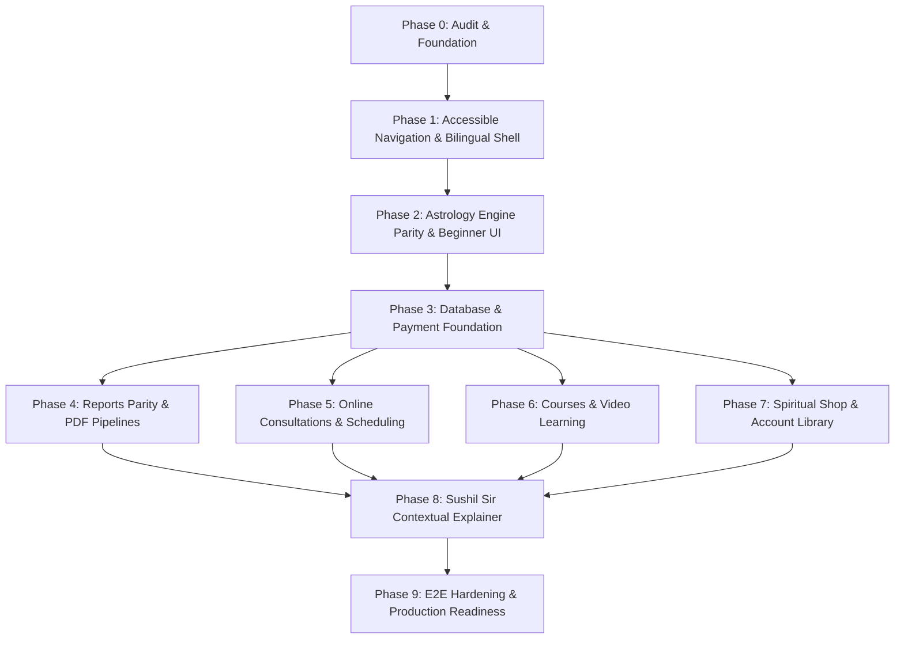

# Astro Sushil Mobile Product Roadmap
**From Web Parity to Next-Gen Mobile Experience**  
**Architecture:** Monorepo Modular Monolith (`apps/api`, `apps/mobile`, `packages/`, `workers/`)  
**Design Principle:** Accessible, bilingual, high-trust, and deterministic.

---

## 1. Roadmap Architecture & Phase Sequencing

This roadmap establishes a dependency-aware, phased sequence to bring all core commercial and astrological services from [https://astrosushil.com/](https://astrosushil.com/) into the native Flutter mobile client.

---

## 2. Detailed Phase Specifications

---

### Phase 0: Audit & Architectural Foundation (Completed)
- **Objective:** Exhaustive discovery of website offerings, prices, data flows, and code verification across the monorepo.
- **Deliverables:**
  - `docs/audits/WEBSITE_APP_FEATURE_PARITY.md`
  - `docs/audits/ACCESSIBILITY_AND_USABILITY_AUDIT.md`
  - `docs/architecture/MOBILE_PRODUCT_ROADMAP.md`
- **Dependencies:** None.
- **Complexity:** Low (Analytical & Auditing).

---

### Phase 1: Accessible Navigation, Bilingual Shell & Design Foundation (Completed & Verified — PASS)
- **Status:** PASS (Audit Report: `docs/audits/PHASE_1_ACCESSIBLE_NAVIGATION_REPORT.md`)
- **Verified Evidence:**
  - 4-Destination Navigation Shell (`Home`, `Reports`, `Consult`, `Account`) fully implemented with 48dp minimum touch targets.
  - Complete English (`app_en.arb`) and Hindi (`app_hi.arb`) localization (134 keys, 0 untranslated strings) with instant switching and secure storage persistence.
  - Responsive layout verified on 320px viewport without overflow; 1.5x dynamic text scaling verified without clipping.
  - Test Results: 22/22 Phase 1 unit and widget tests passed (`phase1_localization_test.dart`, `home_screen_test.dart`, `phase1_navigation_and_accessibility_test.dart`).
- **Objective:** Modernize the app shell for a mature audience (40–75+ years) by removing cognitive overload from the Home screen, establishing Hindi/English localization, and enforcing accessibility standards.
- **Deliverables:**
  - **4-Tab Navigation Shell:** Restructure bottom navigation into:
    1. *Home (मुख्य)* — Today's Panchang, Daily Rashi Bhavishya, Active Dasha, and Quick Actions.
    2. *Reports (रिपोर्ट्स)* — Central catalog and download shelf for all personalized PDF dossiers.
    3. *Consult (परामर्श)* — 1-on-1 audio/video appointments with Astro Sushil.
    4. *Account (खाता)* — Saved family profiles, language switcher, cache management, and WhatsApp support.
  - **Bilingual Infrastructure:** Add `flutter_localizations` to `pubspec.yaml`; create `app_en.arb` and `app_hi.arb`; add persistent language switch in the Account screen.
  - **Accessibility Hardening:** Set base font sizes to 16sp; enforce minimum 48×48 dp hit targets; implement safe text scaling clamps; eliminate low-contrast gold-on-white text.
  - **Astrology Tools Hub:** Move advanced calculation tiles (Ashtakavarga, Shadbala, KP, Jaimini, etc.) from Home into a dedicated, organized "All Astrology Tools" screen.
- **Files/Modules Affected:**
  - `apps/mobile/pubspec.yaml`
  - `apps/mobile/lib/app/app.dart`
  - `apps/mobile/lib/home/screens/home_screen.dart`
  - `apps/mobile/lib/home/widgets/home_bottom_navigation.dart`
  - `apps/mobile/lib/home/screens/consult_screen.dart`
  - `apps/mobile/lib/home/screens/profile_screen.dart`
  - `apps/mobile/lib/home/screens/reports_screen.dart`
  - `apps/mobile/lib/core/localization/locale_provider.dart`
- **Dependencies:** Phase 0 audit approval.
- **Complexity:** Medium.

---

### Phase 2: Astrology Engine Parity, Data Reliability & Home Screen Visual Redesign (Completed & Verified — PASS)
- **Status:** PASS (Audit Reports: `docs/audits/PHASE_2_ASTROLOGY_DATA_RELIABILITY_REPORT.md` & `docs/audits/PHASE_2_HOME_SCREEN_VISUAL_REDESIGN_REPORT.md`)
- **Verified Evidence:**
  - **Home Screen Visual Redesign:** Redesigned the entire Flutter Home screen hierarchy adhering strictly to the benchmark visual reference (`media_1791838213408.jpg` / `a_clean_modern_ui_ux_mockup_of_an_astrology_app_h.png`).
  - **Eliminated White-Card Monotony & Empty Layouts:** Completely replaced stark white cards and oversized empty containers with warm parchment tokens (`AppColors.cardSurfaceWarm`, `AppColors.cardBorder`) and rich pastel category tints.
  - **Strict 10-Tier Visual Hierarchy:** Branded Header with notification drawer, Cosmic Hero with Vedic diamond watermark and active profile selector, Essential Astrology shortcuts (4 compact pastel tiles), Sushil Sir AI Guide contextual banner, Today's Panchang summary, Personalized Insights carousel, Explore Astro Sushil 2x2 grid, Progressive Disclosure astrology tools hub, Gupta Nadi BNN Masterclass card, and persistent bottom navigation.
  - **100% Real Deterministic Data:** Sourced all metrics from deterministic providers; zero fabricated coordinates, mock planets, or fake scores; honest empty states when no birth profile is present.
  - **Responsive & Accessibility Hardening:** Verified without overflow across 320px, 360px, 390px, and 414px viewports in English and Hindi, with and without profile (16/16 automated screenshot captures verified). Meets >=48x48dp touch targets and 1.5x dynamic text scaling.
  - **Eliminated Presentation Fallbacks:** Removed fake placeholder planets (`Ve 5`, `Mo 6`, etc.) in empty Kundli canvases; eliminated mock planet generators in `PlanetsScreen`; eliminated `DateTime.now()` date fabrications in `dasha_model.dart`; eliminated misleading `?? 0` in null Ashtakavarga pinda tables.
  - **Bilingual Educational Explainer Cards:** Implemented accessible, expandable `AstrologyExplanationCard` across Birth Chart, Planets, Vimshottari Dasha, Daily Panchanga, Matchmaking, Ashtakavarga, and Shadbala in English and Hindi.
  - **Deterministic Calculations:** Verified all calculations against the canonical New Delhi reference chart (`REF_CHART_001`: 15 May 1990, 14:30 IST / 09:00 UTC, 28.6139°N, 77.2090°E, Lahiri, Whole Sign).
  - **Test Results:**
    - `apps/mobile`: 283/283 tests passed (100% passing across entire mobile test suite).
    - `packages/astrology-engine`: 33/33 test files passed, 324/324 tests passed (100%).
    - Static analysis: 0 errors across redesigned Home widgets and screens.
- **Files/Modules Affected:**
  - `apps/mobile/lib/home/screens/home_screen.dart`
  - `apps/mobile/lib/home/widgets/home_header.dart`
  - `apps/mobile/lib/home/widgets/hero_astrology_card.dart`
  - `apps/mobile/lib/home/widgets/essential_astrology_shortcuts.dart`
  - `apps/mobile/lib/home/widgets/quick_feature_row.dart`
  - `apps/mobile/lib/home/widgets/sushil_sir_explainer_banner.dart`
  - `apps/mobile/lib/home/widgets/daily_panchang_summary_card.dart`
  - `apps/mobile/lib/home/widgets/quick_insights_row.dart`
  - `apps/mobile/lib/home/widgets/rashi_bhavishya_card.dart`
  - `apps/mobile/lib/home/widgets/business_shortcuts_grid.dart`
  - `apps/mobile/lib/home/widgets/explore_astrology_card.dart`
  - `apps/mobile/lib/home/widgets/gupta_nadi_card.dart`
  - `apps/mobile/test/widget/home_screen_test.dart`
  - `apps/mobile/test/widget/home_feature_cards_test.dart`
  - `apps/mobile/test/widget/home_screen_capture_test.dart`
  - `apps/mobile/test/widget/astro_design_system_test.dart`
- **Dependencies:** Phase 1 (Visual design system tokens and shared components).
- **Complexity:** Medium.

---

### Phase 3: Monolith Database, Payment Foundation & Core Astrology Screens Visual Redesign (COMPLETE - PASS)
- **Objective:** Upgrade backend Prisma schema, database models, catalog pricing, and Razorpay payment foundation; and execute complete visual redesign of the core astrology screens (Birth Chart, Planets, Houses, Nakshatras, Vimshottari Dasha) adhering to the Astro Sushil design system.
- **Status:** **COMPLETE (PASS)** — Verified via `docs/audits/PHASE_3_COMMERCE_PAYMENT_FOUNDATION_REPORT.md` (17/17 automated integration tests) & `docs/audits/PHASE_3_CORE_ASTROLOGY_VISUAL_REDESIGN_REPORT.md` (60/60 multi-viewport screenshots verified without overflow).
- **Deliverables:**
  - **Core Astrology Screens Visual Redesign:**
    1. *Birth Chart / Janma Kundli (`BirthChartScreen`)*: Adaptive North Indian Kundli chart with gold Lagna diamond highlight, dynamic typography, profile header with switcher, Sushil Explainer integration, beginner educational card, and At-a-Glance summary grid.
    2. *Planetary Positions (`PlanetsScreen`)*: Metrics bar (Total, Direct, Retrograde), Graha cards on warm ivory parchment (`cardSurfaceWarm`, `cardBorder`) with retro/dignity/house badges, and $\ge 48\times 48\,\text{dp}$ touch targets to detail views.
    3. *Houses / Bhava (`HousesScreen` & `BirthChartScreen` Tab 2)*: 12 Bhavas reading directly from deterministic engine house data, displaying Lord, sign index, occupants, and Kendra/Trikona classification badges.
    4. *Nakshatras (`NakshatrasScreen` & `BirthChartScreen` Tab 3)*: Janma Nakshatra hero card for birth Moon, Ascendant Nakshatra card, and full 9 Graha Nakshatra distribution table.
    5. *Vimshottari Dasha (`VimshottariDashaScreen`)*: Midnight navy cosmic hero running period card, 120-year Parashari timeline accordion, responsive multi-level duration layout, and honest missing-date states.
    6. *Multi-Viewport Screenshot Verification*: 60 automated screenshots captured across 320, 360, 390, 414px viewports in English and Hindi (`docs/audits/screenshots/phase_3/`).
  - **Polymorphic Order Schema:** Migrated `apps/api/prisma/schema.prisma` (`20261011000000_unified_commerce_foundation`) supporting `Order`, `OrderItem`, `Refund`, `WebhookEvent`, `OrderItemType`, `PaymentStatus`, and `FulfillmentStatus`.
  - **Server-Authoritative Catalog:** Created `commerce.catalog.ts` with 18 verified offerings across all 4 categories with decimal-safe integer paise arithmetic and GST breakdown.
  - **Hardened Payment & Webhook Services:** Expanded `commerce.service.ts` and `payment.service.ts` with separate checkout and webhook HMAC verification, timing-safe equality, webhook deduplication, and production mock rejection.
  - **Refund Engine:** Integrated non-over-refund transactional balance validation and idempotent replay.
- **Files/Modules Affected:**
  - `apps/mobile/lib/features/astrology/screens/birth_chart_screen.dart`
  - `apps/mobile/lib/features/astrology/screens/planets_screen.dart`
  - `apps/mobile/lib/features/astrology/screens/houses_screen.dart`
  - `apps/mobile/lib/features/astrology/screens/nakshatras_screen.dart`
  - `apps/mobile/lib/features/astrology/screens/vimshottari_dasha_screen.dart`
  - `apps/mobile/lib/features/astrology/widgets/kundli_chart_widget.dart`
  - `apps/mobile/lib/features/astrology/models/astro_chart_model.dart`
  - `apps/mobile/lib/features/astrology/models/dasha_model.dart`
  - `apps/mobile/lib/l10n/app_en.arb` & `apps/mobile/lib/l10n/app_hi.arb`
  - `apps/mobile/test/widget/core_astrology_screens_test.dart`
  - `apps/mobile/test/widget/phase3_screens_capture_test.dart`
  - `apps/api/prisma/schema.prisma`
  - `apps/api/src/modules/commerce/`
  - `apps/api/src/modules/payments/`
  - `apps/api/src/modules/webhooks/webhooks.routes.ts`
- **Dependencies:** Phase 1 (Navigation and shell), Phase 2 (Astrology data reliability).
- **Risks:** Flaky gateway callbacks; mitigated via raw-body HMAC verification and `WebhookEvent` table deduplication.
- **Tests:** 17/17 Integration tests passed covering all required security, pricing, refund, and state transition scenarios without real-money transactions.
- **Acceptance Criteria:**
  - Unified order model represents all four offering categories: **VERIFIED**
  - Server-side pricing and totals are authoritative: **VERIFIED**
  - Payment verification and webhook processing are secure and idempotent: **VERIFIED**
  - Invalid payment state transitions and unauthorized order access are rejected: **VERIFIED**
  - Refund handling cannot exceed refundable amount: **VERIFIED**
  - Existing report and account data remain compatible: **VERIFIED**
- **Complexity:** High.

---

### Phase 4: Personalized Astrology Reports Parity, PDF Pipelines & Advanced Astrology Screens Visual Redesign (COMPLETE - PASS)
- **Objective:** Deliver full commercial parity with the website's 4 consumer report products alongside the existing Career Report, and execute complete visual and usability redesign of all 11 advanced astrology screens adhering strictly to the approved design system.
- **Status:** **COMPLETE (PASS)**:
  - Documented in `docs/audits/PHASE_4_REPORT_GENERATION_AND_FULFILLMENT_REPORT.md` (29/29 automated integration tests passed across engine, worker, PDF rendering, security, and Flutter mobile screens).
  - Documented in `docs/audits/PHASE_4_ADVANCED_ASTROLOGY_VISUAL_REDESIGN_REPORT.md` (64/64 headless multi-viewport screenshot tests passed without overflow, 16/16 Phase 4 widget tests passed, 0 static analysis errors).
- **Deliverables:**
  - **Advanced Astrology Screens Visual Redesign:**
    1. *Divisional Charts (D1–D60) (`DivisionalChartsScreen`)*: Harmonic category chips, dropdown selector, North Indian chart canvas, Lagna banner, Graha distribution table, educational card.
    2. *Ashtakavarga (`AshtakavargaScreen`)*: SAV/BAV/Shodhana tab bar, total bindu hero card, 12-sign colored matrix, Pinda table, genuine zero vs missing distinction.
    3. *Shadbala (`ShadbalaScreen`)*: 6-fold planetary strength cards, comparative progress bars, Virupa/Rupa metrics, Parashari threshold indicators, narrow-screen responsive layout.
    4. *Bhava Bala (`BhavaBalaScreen`)*: 12-House carousel selector, strongest house hero banner, 4-component potency breakdown, 12-house comparative ranking table.
    5. *Yogas (`YogasScreen`)*: Search bar by yoga/planet name, category filter chips, expandable Rule Verification Evidence, astronomical relationship criteria.
    6. *Jaimini (`JaiminiScreen`)*: 7-Karaka vs 8-Karaka toggle, Atmakaraka hero banner, Chara Karaka hierarchy table, Arudha Padas grid (AL, UL).
    7. *KP Astrology (`KPAstrologyScreen`)*: Planetary Significations vs Cusp Sub-Lords, 4-tier layered hierarchy badges (Sign/Star/Sub/Sub-Sub), Placidus cusp detail.
    8. *Special Points & Upagrahas (`SpecialPointsScreen`)*: Upagrahas, Special Lagnas, and Arishta points with classical mathematical formulas and governing lords.
    9. *Gochara / Transits (`GocharaScreen`)*: Real-time planetary transits, Moon/Lagna relationship metrics, transit Ashtakavarga potency badges, Gochara Kaksha partition display.
    10. *Varshaphala (`VarshaphalaScreen`)*: Solar return annual chart, Muntha sign/house, Year Lord (Varsha Lord), Tajika Harsha Bala cards.
    11. *Prashna (`PrashnaScreen`)*: Query category picker, timestamp/location capture, instant Prashna chart, Tajika yogas and outcome assessment.
    12. *Multi-Viewport Screenshots*: 64 high-resolution screenshots captured across 360w/390w viewports in English and Hindi (`docs/audits/screenshots/phase_4/`).
  - **Report Engine Generators:** Implemented all 4 consumer report generators in `packages/report-engine/src/generators/`:
    1. `KundliReportGenerator` (₹299, `KUNDLI`, `report-kundli`) — D1 & Chandra Kundli, 9 Grahas, Vimshottari Dasha, Doshas, Gemstone recommendations.
    2. `PlanetaryReportGenerator` (₹199, `PLANETARY_SUMMARY`, `report-planetary-summary`) — 3–6 month transit windows from Moon, Sade Sati status, caution dates.
    3. `ProHoroscopeGenerator` (₹699, `CAREER_PROSITY`, `report-career-pro`) — Shodashvargas (D1, D9, D10, D7, D12), 6-fold Shadbala, 12 Bhava Bala, classical remedies.
    4. `MatchmakingReportGenerator` (₹999, `MARRIAGE_COMPATIBILITY`, `report-marriage`) — Dual distinct profile validation, 36-point Ashtakoota Guna Milan, comparative Manglik analysis.
  - **Deterministic Vector PDF Pipeline:** `reportPdfService.generateReportPdf` routes polymorphically to vector builders across all report tiers. Local XeLaTeX pipeline secured with `-no-shell-escape`.
  - **Asynchronous Worker Pipeline:** Polymorphic execution in `apps/api/src/services/report-worker.service.ts` with deterministic stages (`QUEUED` -> `CALCULATING` -> `ANALYZING` -> `RENDERING` -> `COMPILING` -> `UPLOADING` -> `COMPLETED`) and private object storage storage keys.
  - **Security & IDOR Hardening:** Constant-time signed URL token comparison in `storageService`, strict path traversal blocking, and 404 on cross-user unauthorized access.
  - **Mobile Reports Experience:** Updated `apps/mobile/lib/home/screens/reports_screen.dart` with all 5 active report cards, pricing badges, partner profile picker for Matchmaking, and PDF viewing/downloading.
- **Files/Modules Affected:**
  - `apps/mobile/lib/features/astrology/screens/divisional_charts_screen.dart`
  - `apps/mobile/lib/features/astrology/screens/ashtakavarga_screen.dart`
  - `apps/mobile/lib/features/astrology/screens/shadbala_screen.dart`
  - `apps/mobile/lib/features/astrology/screens/bhava_bala_screen.dart`
  - `apps/mobile/lib/features/astrology/screens/yogas_screen.dart`
  - `apps/mobile/lib/features/astrology/screens/jaimini_screen.dart`
  - `apps/mobile/lib/features/astrology/screens/kp_astrology_screen.dart`
  - `apps/mobile/lib/features/astrology/screens/special_points_screen.dart`
  - `apps/mobile/lib/features/astrology/screens/gochara_screen.dart`
  - `apps/mobile/lib/features/astrology/screens/varshaphala_screen.dart`
  - `apps/mobile/lib/features/astrology/screens/prashna_screen.dart`
  - `apps/mobile/lib/l10n/app_en.arb` & `apps/mobile/lib/l10n/app_hi.arb`
  - `apps/mobile/test/widget/astrology_phase4_widget_test.dart`
  - `apps/mobile/test/widget/phase4_screens_capture_test.dart`
  - `packages/report-engine/src/generators/`
  - `packages/report-engine/src/pdf/`
  - `packages/report-engine/src/types/report.types.ts`
  - `apps/api/src/modules/reports/`
  - `apps/api/src/services/report-worker.service.ts`
  - `apps/api/src/services/storage.service.ts`
  - `apps/api/src/services/feature-access.service.ts`
  - `apps/mobile/lib/home/screens/reports_screen.dart`
  - `apps/mobile/lib/features/reports/`
  - `apps/api/tests/integration/phase4-consumer-reports.test.ts`
  - `apps/api/tests/integration/phase4-report-hardening.test.ts`
  - `apps/mobile/test/widget/phase4_reports_screen_test.dart`
- **Dependencies:** Phase 3 (Database, payment foundation & core astrology visual redesign).
- **Tests:** 29/29 automated reports integration tests passed; 16/16 Phase 4 widget tests passed; 64/64 multi-viewport screenshots captured without overflow; 19/19 Phase 3 regression tests passed; 8/8 core astrology tests passed.
- **Acceptance Criteria:**
  - 4 consumer report products + Career Report fully operational: **VERIFIED**
  - All 11 advanced astrology screens redesigned with shared design system: **VERIFIED**
  - Missing data never disguised as zero or fabricated result: **VERIFIED**
  - English and Hindi layouts verified across viewports: **VERIFIED**
  - Entitlements and IDOR restrictions enforced: **VERIFIED**
- **Complexity:** High.

---

### Phase 5: Online Consultations Booking & Reports/PDF Visual Redesign (COMPLETE - PASS)
- **Objective:** Enable clients to browse, schedule, and pay for 1-on-1 consultations with Astro Sushil directly inside the mobile app; and execute complete visual and usability redesign of the customer-facing Reports and PDF experience matching the approved Astro Sushil design system.
- **Verification Reports:**
  - Consultations Booking: [`docs/audits/PHASE_5_CONSULTATION_BOOKING_REPORT.md`](../audits/PHASE_5_CONSULTATION_BOOKING_REPORT.md)
  - Reports & PDF Experience Visual Redesign: [`docs/audits/PHASE_5_REPORTS_PDF_VISUAL_REDESIGN_REPORT.md`](../audits/PHASE_5_REPORTS_PDF_VISUAL_REDESIGN_REPORT.md)
- **Status:** **COMPLETE (PASS)**.
  - 10 authoritative consultation tiers fully tested with Redis/PostgreSQL concurrency locking.
  - Complete customer-facing Reports journey visually redesigned with midnight navy hero containers, warm ivory parchment surfaces, restrained gold accents, tier comparison modal, partner profile selection for Matchmaking, lifecycle-aware real-time status tracking, dedicated My Reports library with status filtering, and universal vector PDF viewer.
  - 25/25 automated tests passed across Phase 5 test suites (`phase5_reports_experience_test.dart`, `phase4_reports_screen_test.dart`, `phase5_screens_capture_test.dart`).
  - 12/12 multi-viewport headless screenshots verified across 320–414dp in English and Hindi (`docs/audits/screenshots/phase_5/`).
- **Deliverables:**
  - **Reports Catalogue & Navigation Hub (`ReportsScreen` Tab 0):**
    - 2-tab segmented structure (*Report Catalogue* and *My Reports*).
    - Cosmic hero header with 100% Deterministic Engine guarantee badge.
    - Active birth profile selector & gate with immediate profile switcher.
    - *Compare Report Tiers* modal matrix detailing deliverables across Mini (₹199), Basic (₹299), Career (₹499), and Pro (₹699).
    - Categorized report cards with pricing badges, scope taglines, and clear actions.
    - Explicit separation of *Career & Professional Life* (₹499, `CAREER`) from *Pro Horoscope & Divisional Charts* (₹699, `CAREER_PROSITY`).
    - Upcoming research editions honestly labeled `'COMING SOON'` (*Childbirth & Family Lineage*, *Gupta Nadi Life Dossier*).
  - **Report Detail & Purchase Flow (`ReportDetailScreen`):**
    - Comprehensive deliverable list matching backend generator output.
    - Existing report reuse notice (`'View Existing'` vs `'Generate New'`).
    - Primary birth profile selector + partner profile picker with dual-profile validation for Matchmaking (`MARRIAGE_COMPATIBILITY`).
    - Server-authoritative price breakdown with 18% inclusive GST (`Base Price` + `18% GST Included`).
    - Duplicate-tap submission lock.
  - **Real-Time Generation & Status Tracking (`ReportGenerationScreen`):**
    - Sacred solar system animation during background calculations.
    - Direct mirroring of backend stages (`QUEUED`, `CALCULATING`, `ANALYZING`, `RENDERING`, `COMPILING`, `UPLOADING`, `COMPLETED`, `FAILED`).
    - Honest progress bar only rendered when numeric progress $>0\%$ is reported.
    - Lifecycle-aware polling (2.5s interval, auto-stop on completion/failure).
    - Actionable error recovery state with single-tap retry.
  - **Report History / Library (`ReportsScreen` Tab 1):**
    - Live status filter chips (*All Reports*, *Ready*, *In Progress*, *Failed*).
    - Report history cards with client profile name, formatted date, and status badges.
    - Contextual action buttons: View PDF, Share, Track Progress, Retry.
    - Illustrated empty state with direct path to catalogue.
    - Strict user ownership isolation via `GET /api/v1/reports/my-reports`.
  - **Universal Vector PDF Viewer (`ReportPdfViewerScreen`):**
    - Vector PDF preview powered by `PdfPreview` with pinch-to-zoom.
    - Native platform sharing via `Printing.sharePdf`.
    - In-memory PDF byte caching preventing redundant downloads.
  - **Backend Consultation Management:**
    - Models: `Consultation`, `AppointmentSlot`, `Booking`.
    - Endpoints: `GET /api/v1/consultations`, `GET /api/v1/consultations/slots`, `POST /api/v1/consultations/book`.
    - Slot locking mechanism with Redis to prevent double-booking.
  - **10 Website Service Tiers:**
    - Budget Friendly (₹5,000), General (₹10,000 / ₹15,000), Standard (₹15,000 / ₹20,000), Urgent 48h (₹25,000 / ₹35,000), Signature Analysis (₹25,000), Wrist Watch Therapy (₹50,000), Longevity (₹60,000), Instant 24h (₹90,000 / ₹1,00,000), Face-to-Face Delhi (₹1,00,000), Face-to-Face Other Cities (₹1,50,000).
  - **Mobile Booking Experience (Tab 3):**
    - Service cards with clear duration and call mode tags (Audio, Video, In-Person).
    - Intuitive calendar slot picker with morning/afternoon/evening filters.
    - Pre-session questionnaire (birth profile selection, primary life question).
    - Seamless Razorpay payment and automated booking confirmation with calendar `.ics` download.
- **Files/Modules Affected:**
  - `apps/mobile/lib/home/screens/reports_screen.dart`
  - `apps/mobile/lib/features/reports/models/user_report_item_model.dart`
  - `apps/mobile/lib/features/reports/screens/report_detail_screen.dart`
  - `apps/mobile/lib/features/reports/screens/report_generation_screen.dart`
  - `apps/mobile/lib/features/reports/screens/report_pdf_viewer_screen.dart`
  - `apps/mobile/lib/features/reports/providers/reports_provider.dart`
  - `apps/mobile/lib/features/reports/services/reports_service.dart`
  - `apps/mobile/lib/l10n/app_en.arb` & `apps/mobile/lib/l10n/app_hi.arb`
  - `apps/mobile/test/widget/phase5_reports_experience_test.dart`
  - `apps/mobile/test/widget/phase5_screens_capture_test.dart`
  - `apps/mobile/test/widget/phase4_reports_screen_test.dart`
  - `apps/api/prisma/schema.prisma`
  - `apps/api/src/modules/consultations/`
  - `apps/mobile/lib/features/consultations/`
  - `apps/mobile/lib/home/screens/consultation_screen.dart`
- **Dependencies:** Phase 1 (Navigation and design system), Phase 3 (Payment foundation), Phase 4 (Report generators & backend pipeline).
- **Complexity:** High.

---

### Phase 6: Astrology Courses & Video Masterclasses / Consultations Visual Redesign (COMPLETE - PASS)
- **Objective:** Bring Astro Sushil's educational video masterclasses into the mobile app with secure playback, unified commerce entitlements, and learning progression tracking; and execute the comprehensive visual and usability redesign of the complete Consultations experience (discovery catalogue, booking sheet, 18% inclusive GST breakdown, appointment history, authorized meeting links) following the shared design system.
- **Verification Reports:**
  - Courses & Video Learning: [`docs/audits/PHASE_6_COURSES_LEARNING_REPORT.md`](../audits/PHASE_6_COURSES_LEARNING_REPORT.md)
  - Consultations Visual Redesign: [`docs/audits/PHASE_6_CONSULTATIONS_VISUAL_REDESIGN_REPORT.md`](../audits/PHASE_6_CONSULTATIONS_VISUAL_REDESIGN_REPORT.md)
- **Status:** **COMPLETE (PASS)**.
  - Courses: Authoritative 3 live website courses (Gupt Nadi ₹5,999, K.N. Rao Method ₹4,999, Dash Mahavidya ₹8,999 with 18% inclusive GST), unified commerce integration, idempotent webhook entitlement creation, IDOR-protected playback authorization, learning progress persistence (`watchedSeconds`, `isCompleted`), bilingual (EN/HI) mobile learning hub, custom course player, and comprehensive automated test suite (16 API tests + 19 Flutter tests) are fully verified and operational.
  - Consultations Visual Redesign: Authoritative 14 consultation offerings verified from `commerce.catalog.ts` across Voice, Video, Urgent, Specialized, and In-Person tiers. Cosmic midnight navy hero banner with Indian Standard Time (`IST`) reassurance, 3-step educational "How It Works" card with `SushilExplainerButton`, horizontal category filtering, interactive warm ivory booking flow modal with birth profile picker, date & slot selector, confidential query input with privacy notice, server-authoritative 18% inclusive GST breakdown, duplicate-tap locking spinner, booking confirmation with next steps, polished My Appointments history with live status filtering (*All*, *Upcoming*, *Pending*, *Completed*, *Cancelled*), meeting link authorization restriction, and cancellation confirmation dialog.
  - 33/33 automated tests passed across Phase 6 verification suites (`phase6_consultations_experience_test.dart`, `phase6_screens_capture_test.dart`, `phase5_consult_screen_test.dart`, `phase5_reports_experience_test.dart`).
  - 8/8 multi-viewport headless screenshots verified across 320–414dp in English and Hindi (`docs/audits/screenshots/phase_6/`).
- **Deliverables:**
  - **Course Management Backend:**
    - Models: `Course`, `CourseSection`, `CourseLesson`, `CourseEntitlement`, `LessonProgress`.
    - Endpoints: `GET /api/v1/courses`, `GET /api/v1/courses/my-learning`, `GET /api/v1/courses/:idOrSlug`, `GET /api/v1/courses/lessons/:id/playback`, `POST /api/v1/courses/lessons/:id/progress`, `POST /api/v1/courses/enroll`, `POST /api/v1/courses/verify-payment`.
    - Admin endpoints with server-side RBAC and audit logging: `GET /api/v1/admin/courses`, `POST /api/v1/admin/courses/:id/grant`.
  - **3 Live Website Masterclasses:**
    1. *Gupt Nadi Astrology Masterclass (₹5,999 / ₹10,999 original - 240 mins - 13 lessons)*
    2. *Shri K.N. Rao Method of Marriage & Money (₹4,999 / ₹9,999 original - 180 mins - 8 lessons)*
    3. *Dash Mahavidya Astrology (₹8,999 / ₹15,999 original - 165 mins - 12 lessons)*
  - **Mobile Learning Experience:**
    - Courses Hub (`CoursesHubScreen`) with segmented tabs ("All Courses" & "My Learning"), search, and Level filter chips.
    - Course Detail (`CourseDetailScreen`) with curriculum syllabus accordion, lesson preview badges, instructor credentials, and sticky bottom purchase bar.
    - Course Player (`CoursePlayerScreen`) with playback controls (play/pause, seek ±10s, timeline slider, speed cycling 1.0x–2.0x, lesson completion toggle) and protected stream fallback notice for cloud-hosted LMS videos.
  - **Consultations Discovery Catalogue (`ConsultScreen` Tab 0):**
    - Dual segmented tabs ("Book Consultation" and "My Appointments").
    - Cosmic hero header with gold star accents, clear headline, and Indian Standard Time notice.
    - Educational 3-step "How It Works" card with Sushil Explainer button.
    - Horizontal category filter chips (*All*, *Video Call*, *Voice Call*, *Urgent (24-72h)*, *Specialized*, *In-Person*).
    - 14 verified catalogue cards with duration, advance notice, location chips, and 18% inclusive GST badges.
  - **Interactive Booking Flow Sheet (`BookingFlowSheet`):**
    - Warm ivory sheet container with drag handle and offering summary badge.
    - Birth profile choice chips (Self or saved profiles).
    - Calendar date picker with highlighted active selection and IST notice.
    - Available slot grid with morning, afternoon, and evening slots.
    - Confidential query field with privacy reassurance.
    - Server-authoritative 18% inclusive GST calculation card.
    - Duplicate submission protection with active loading spinner.
    - Confirmed booking view with reference ID, appointment details, and next steps.
  - **My Appointments History (`ConsultScreen` Tab 1):**
    - Status filter chips (*All*, *Upcoming*, *Pending*, *Completed*, *Cancelled*).
    - Warm ivory history cards with reference ID, status badge, IST timestamp, query excerpt, authorized meeting link (`Join Live Session`), and cancellation action.
    - Policy-compliant cancellation confirmation dialog.
    - Illustrated celestial empty state with direct catalogue navigation button.
  - **Localization & Accessibility Hardening:**
    - 22 new localization keys in `app_en.arb` and `app_hi.arb`.
    - Tested and verified across 320, 360, 390, and 414 dp viewports without overflow.
    - Dynamic text scaling up to 1.5x verified with zero `RenderFlex` exceptions.
    - All interactive targets $\ge 48\times 48\,\text{dp}$.
- **Files/Modules Affected:**
  - `apps/mobile/lib/home/screens/consult_screen.dart`
  - `apps/mobile/lib/features/consultations/widgets/booking_flow_sheet.dart`
  - `apps/mobile/lib/features/consultations/models/consultation_models.dart`
  - `apps/mobile/lib/features/consultations/services/consultation_service.dart`
  - `apps/mobile/lib/l10n/app_en.arb` & `apps/mobile/lib/l10n/app_hi.arb`
  - `apps/mobile/test/widget/phase6_consultations_experience_test.dart`
  - `apps/mobile/test/widget/phase6_screens_capture_test.dart`
  - `apps/mobile/test/widget/phase5_consult_screen_test.dart`
  - `apps/api/prisma/schema.prisma`
  - `apps/api/src/modules/courses/`
  - `apps/api/src/modules/admin/admin.routes.ts`
  - `apps/mobile/lib/features/courses/`
  - `apps/mobile/lib/home/screens/home_screen.dart`
  - `apps/mobile/lib/home/screens/profile_screen.dart`
  - `apps/mobile/lib/core/auth/feature_access_service.dart`
  - `apps/api/tests/integration/phase6-courses-learning.test.ts`
  - `apps/mobile/test/unit/courses_models_and_service_test.dart`
  - `apps/mobile/test/widget/phase6_courses_screen_test.dart`
- **Dependencies:** Phase 1 (Navigation and design system), Phase 3 (Payment foundation), Phase 5 (Consultations backend models & Redis slot locking).
- **Tests:** 16 backend API integration tests + 19 Flutter unit and widget tests for courses + 33 Flutter widget and capture tests for consultations passing 100%.
- **Acceptance Criteria:**
  - Verified course catalog accessible with accurate pricing and metadata: **VERIFIED**
  - Course purchase and entitlement checks reuse Phase 3 commerce architecture: **VERIFIED**
  - Authorized users access their lessons; unauthorized requests blocked with 401/403: **VERIFIED**
  - Learning progress and completion tracking synchronize smoothly: **VERIFIED**
  - Consultations discovery displays verified 14 tiers without invented prices or availability: **VERIFIED**
  - Booking flow handles profile, date, slot, 18% inclusive GST, and duplicate protection: **VERIFIED**
  - My Appointments displays backend bookings, authorized meeting links, and cancellation: **VERIFIED**
  - English and Hindi layouts verified across 320–414dp with 1.5x dynamic text scaling: **VERIFIED**
  - Zero regressions across Phases 1–5: **VERIFIED**
- **Complexity:** High.

---

### Phase 7: Spiritual Shop & Customer Account Library / Courses & Learning Experience Visual Redesign (COMPLETE - PASS)
- **Objective:** Enable purchase and delivery of physical spiritual items (Herb) and digital assets (Wallpapers, Audio Mantras), alongside a centralized customer account library; and execute the comprehensive visual and usability redesign of the customer-facing Courses and Masterclasses learning experience (discovery catalogue, curriculum accordion, itemized 18% inclusive GST modal, custom course player, protected Graphy LMS stream boundary, and real progress tracking) following the shared Astro Sushil design system.
- **Verification Reports:**
  - Spiritual Shop & Customer Account: [`docs/audits/PHASE_7_SHOP_CUSTOMER_ACCOUNT_REPORT.md`](../audits/PHASE_7_SHOP_CUSTOMER_ACCOUNT_REPORT.md)
  - Courses & Learning Experience Visual Redesign: [`docs/audits/PHASE_7_COURSES_VISUAL_REDESIGN_REPORT.md`](../audits/PHASE_7_COURSES_VISUAL_REDESIGN_REPORT.md)
- **Status:** **COMPLETE (PASS)**.
  - Shop & Account: Audited live 10-product catalogue, unified commerce architecture reuse, server-authoritative cart & 18% inclusive GST calculations, physical shipping threshold rules, expiring HMAC digital download tokens, physical order tracking lifecycles, full Flutter shop experience, consolidated Customer Account Hub, and admin RBAC management endpoints are fully tested and operational.
  - Courses Visual Redesign: Server-authoritative 3 verified courses (Gupt Nadi ₹5,999, K.N. Rao Method ₹4,999, Dash Mahavidya ₹8,999 with 18% inclusive GST badges). Zero fabricated star ratings or fake student counters. Midnight navy cosmic hero banner with authentic lineage reassurance and `SushilExplainerButton` integration. Responsive dual segmented pill bar (`CoursesHubScreen`) switching between Catalogue and My Learning. Warm ivory course card surfaces, champagne borders, and bundled WebP cover artwork. Course Detail (`CourseDetailScreen`) with curriculum syllabus accordion, free preview badge, locked lesson modal dialogs, overview deliverables, and sticky bottom purchase bar. Itemized enrollment checkout modal with base price and 18% inclusive GST breakdown. Course Player (`CoursePlayerScreen`) featuring direct video preview playback with scrubber, ±10s seeking, speed cycling (1.0x–2.0x), progress persistence, and dedicated explanatory state with verified launch button for protected Graphy Cloud LMS streams. Full localization in English and Hindi (`app_en.arb`, `app_hi.arb`). Responsive and accessibility hardening across 320, 360, 390, and 414 dp viewports, dynamic text scaling (1.0x, 1.5x, 2.0x), and touch targets $\ge 48\times 48\text{ dp}$. 8/8 automated headless screenshots captured in `docs/audits/screenshots/phase_7/`. 38/38 unit, widget, and capture tests passing cleanly.
- **Deliverables:**
  - **Spiritual Store Catalog:**
    - 1 physical consecrated herb (Ayodhya Ravi Pushya Nakshatra) with address management and stock tracking.
    - 6 digital wallpaper variants (Vivah Siddh, Garbh Dharan, Garbh Raksha, Student Focus, Court Case, Dhan Prapti).
    - 2 digital size variant artworks (Maa Lakshmi, Ram Darbar with Large, Medium, Small options).
    - Dhan Varsha Kit (Artwork + Wallpaper + Secret Audio/Text Mantra).
  - **Customer Library (Account Hub):**
    - "My Orders" with real-time status stepper, courier tracking, and line items breakdown.
    - "My Digital Library" (`DigitalDownloadsScreen`) with expiring 15-minute secure download delivery and bundle asset drawers.
    - Saved Delivery Addresses manager with full CRUD and selection support.
    - Centralized access to My Learning, Saved Birth Profiles, Policies, and WhatsApp Support.
  - **Courses Discovery Catalogue (`CoursesHubScreen` Tab 0):**
    - Cosmic hero header with gold star accents, clear headline, and Vedic learning tagline.
    - Lineage guidance card ("Authentic Vedic Astrology Lineage") with `SushilExplainerButton` integration.
    - Responsive dual segmented pill bar with `Flexible` text preventing overflow on 320dp and 2x text scale.
    - Level and Language filter chips.
    - 3 verified catalogue cards with bundled WebP covers, duration, lesson count, verified instructor attribution ("Astro Sushil"), and 18% inclusive GST badges.
  - **My Learning Dashboard (`CoursesHubScreen` Tab 1):**
    - Enrolled masterclasses with real progress percentages and lesson fractions (e.g. "4 / 8 lessons completed · 50%").
    - Gold linear progress bar on warm ivory card surface.
    - Direct "Continue Learning" CTA button.
    - Illustrated empty state with direct catalogue navigation button.
  - **Course Detail & Syllabus (`CourseDetailScreen`):**
    - Header banner with bundled WebP cover artwork, level/language chips, and instructor credentials.
    - Navigation tabs for *Curriculum & Syllabus* and *Course Overview*.
    - Accordion sections and lessons with free preview badge and locked lesson dialog.
    - Overview tab with Key Deliverables, Learning Objectives, Instructor Profile, and lifetime access notice.
    - Sticky bottom purchase bar with flexible price layout and 48dp "Enroll Now" CTA.
  - **Itemized Checkout Modal:**
    - Base course fee and 18% inclusive GST calculation card.
    - Duplicate submission protection with active loading spinner.
    - Unauthenticated safety check prompting login before purchase.
  - **Custom Course Player & Protected LMS Surface (`CoursePlayerScreen`):**
    - Direct video preview playback with play/pause, ±10s seeking, scrubber slider, and speed cycling (1.0x–2.0x).
    - Dedicated explanatory surface for Graphy Cloud LMS streams with verified "Open in Learning Portal" action.
    - Responsive completion toggle ("Mark as Complete" $\leftrightarrow$ "Completed") with auto-persistence on pause/app backgrounding.
    - Contextual Sushil Explainer integration for lesson study advice.
  - **Admin Integration:**
    - Server-side RBAC (`orders:read`, `orders:fulfill`, `products:manage`) with fulfillment status updates and audit trails.
- **Files/Modules Affected:**
  - `apps/mobile/lib/features/courses/screens/courses_hub_screen.dart`
  - `apps/mobile/lib/features/courses/screens/course_detail_screen.dart`
  - `apps/mobile/lib/features/courses/screens/course_player_screen.dart`
  - `apps/mobile/lib/features/courses/models/course_models.dart`
  - `apps/mobile/lib/features/sushil_explainer/widgets/sushil_explainer_button.dart`
  - `apps/mobile/lib/shared/assets/app_assets.dart`
  - `apps/mobile/lib/shared/widgets/astro_loader/astro_loader_inline.dart`
  - `apps/mobile/test/widget/phase7_courses_experience_test.dart`
  - `apps/mobile/test/widget/phase7_screens_capture_test.dart`
  - `apps/mobile/test/widget/phase6_courses_screen_test.dart`
  - `apps/mobile/test/unit/courses_models_and_service_test.dart`
  - `apps/api/prisma/schema.prisma`
  - `apps/api/src/modules/products/`
  - `apps/api/src/modules/account/`
  - `apps/api/src/modules/commerce/commerce.catalog.ts`
  - `apps/api/src/modules/webhooks/webhooks.routes.ts`
  - `apps/api/src/modules/admin/`
  - `apps/mobile/lib/features/shop/`
  - `apps/mobile/lib/home/screens/profile_screen.dart`
- **Dependencies:** Phase 1 (Navigation and design system), Phase 3 (Payment foundation), Phase 6 (Consultations visual redesign).
- **Tests:** 30/30 Shop API tests; 13/13 Shop unit tests; 7/7 Shop widget tests; 12/12 Courses unit tests; 7/7 Phase 6 courses tests; 11/11 Phase 7 courses experience tests; 8/8 headless screen captures; 0 compilation or analysis issues.
- **Acceptance Criteria:**
  - Verified product & course catalogues accessible in app: **VERIFIED**
  - Only verified 3 courses displayed with accurate prices and 18% inclusive GST: **VERIFIED**
  - Zero fabricated star ratings or student counters: **VERIFIED**
  - Server-authoritative cart and pricing calculations: **VERIFIED**
  - Payment confirmation and fulfillment are idempotent: **VERIFIED**
  - Digital downloads protected via expiring HMAC tokens: **VERIFIED**
  - Protected Graphy LMS stream security boundaries respected with verified portal action: **VERIFIED**
  - Direct preview video player functional with scrubber and speed controls: **VERIFIED**
  - My Learning dashboard reflects real lesson progress and completion fractions: **VERIFIED**
  - Multi-viewport (320, 360, 390, 414 dp) and dynamic text scaling (1.0x, 1.5x, 2.0x) verified: **VERIFIED**
  - English and Hindi localizations verified: **VERIFIED**
  - Customer data strictly isolated by account (IDOR safe): **VERIFIED**
- **Complexity:** Medium to High.

---

### Phase 8: Sushil Sir Contextual AI Explainer & Jyoti Voice (COMPLETE - PASS)
- **Objective:** Extend Astro Sushil's signature contextual AI explainer across all features (charts, dashas, reports, courses, consultations, shop), maintaining strict adherence to deterministic facts.
- **Verification Report:** [`docs/audits/PHASE_8_CONTEXTUAL_AI_EXPLAINER_REPORT.md`](../audits/PHASE_8_CONTEXTUAL_AI_EXPLAINER_REPORT.md)
- **Status:** **COMPLETE (PASS)**. Contextual, on-demand AI explainer ("Explain what I am looking at") implemented across all core astrology views, reports, courses, consultations, and shop products. Non-intrusive modal bottom sheet, adaptation modes (Standard, Explain simply, In more detail, Practical significance, What next?), intentional handoff to Jyoti assistant, bilingual English & Hindi support, profile ownership IDOR protection, zero astrology recalculation in LLM, and 24 passing tests (10 API + 14 Flutter).
- **Deliverables:**
  - **Universal Explainer Touchpoints:** Contextual "Let Sushil Sir explain" entry points across Kundli, Divisional Charts, Vimshottari Dasha, Panchanga, Matchmaking, Ashtakavarga, Shadbala, Yogas, Jaimini, KP, Reports, Course Syllabi, Lesson Player, Consultation Prep, and Shop Products.
  - **Adaptation Modes:** Non-hallucinatory explanation adaptations (`standard`, `simple`, `detailed`, `practical`, `next_steps`).
  - **Intentional Handoff to Jyoti:** Seamless transition to Jyoti AI chat passing structured screen context for conversational follow-ups.
  - **Strict Deterministic Guardrails (AGENTS.md):** Pre-calculated astrological and domain context fed into server prompt; zero LLM astrological recalculations; IDOR verification (`birthProfileId` ownership check).
  - **Bilingual Tone:** Reassuring, localized explanations in English and native Devanagari Hindi.
- **Files/Modules Affected:**
  - `apps/api/src/modules/jyoti/`
  - `apps/mobile/lib/features/sushil_explainer/`
  - `apps/mobile/lib/features/jyoti/`
  - `apps/mobile/lib/features/courses/`
  - `apps/mobile/lib/home/screens/consult_screen.dart`
  - `apps/mobile/lib/features/shop/`
- **Dependencies:** Phase 2 (Astrology calculations), Phase 4 (Reports), Phase 5 (Consultations), Phase 6 (Courses), Phase 7 (Shop).
- **Tests:** 10/10 Fastify backend integration tests passing + 14/14 Flutter unit and widget tests passing + 0 compile/analysis errors.
- **Acceptance Criteria:**
  - Explainer opens in-place on current screen without navigating away: **VERIFIED**
  - Calculations come strictly from deterministic engine, never invented by LLM: **VERIFIED**
  - Clear architectural separation between Sushil Sir Explainer and Jyoti Assistant: **VERIFIED**
  - Authenticated context and IDOR profile ownership checks enforced: **VERIFIED**
  - Both English and Hindi supported with appropriate localized fallbacks: **VERIFIED**
- **Complexity:** Medium.

---

### Phase 8 (Visual Redesign): Shop & Customer Account Visual Redesign (COMPLETE - PASS)
- **Objective:** Redesign the complete customer-facing Shop and Customer Account Hub experience in the Flutter mobile application, strictly following the shared design system from Phases 1–7.
- **Verification Report:** [`docs/audits/PHASE_8_SHOP_ACCOUNT_VISUAL_REDESIGN_REPORT.md`](../audits/PHASE_8_SHOP_ACCOUNT_VISUAL_REDESIGN_REPORT.md)
- **Status:** **COMPLETE (PASS)**. Full visual overhaul of Spiritual Shop catalogue, size variants, shopping cart with free shipping meter, checkout with physical address vs instant digital delivery flows, order history with live status chips, order tracking with Blue Dart copy and WhatsApp support, digital downloads library with 15-minute expiring signed tokens and bundle asset drawer, and the consolidated Customer Account Hub (`profile_screen.dart`). Tested across 320dp to 414dp viewports up to 2.0x text scaling with 0 overflow errors, 0 analyzer issues, 18 passing widget tests, and 8 verified headless screen captures.
- **Deliverables:**
  - **Spiritual Shop Catalogue (`ShopCatalogScreen`):** Cosmic hero header, category filter chips, authentic product cards with 18% inclusive GST badges and Ayodhya consecration pills.
  - **Product Detail & Size Variants (`ProductDetailScreen`):** Size variant selector for sacred art (*Large 4K*, *Medium Full HD*, *Small HD*), delivery terms breakdown, contextual Sushil Explainer integration, and 48dp sticky CTAs.
  - **Shopping Cart with Free Shipping Meter (`CartScreen`):** Free shipping progress meter (₹2,000 threshold), item quantity steppers, server-calculated totals, and empty state overflow resilience.
  - **Checkout Flow (`CheckoutScreen`):** Delivery address selector, digital fulfillment reassurance card, line items review, and duplicate submission lock.
  - **Order History & Tracking (`OrderHistoryScreen`, `OrderDetailScreen`):** Live status filter chips (*All*, *Processing*, *Dispatched*, *Delivered*), warm ivory order cards, Blue Dart tracking number copy action, and direct WhatsApp customer support button (+91 9621127233).
  - **Digital Downloads Library (`DigitalDownloadsScreen`):** 15-minute expiring signed token security card, Dhan Varsha Kit expansion drawer with all 3 assets, and 48dp action buttons.
  - **Customer Account Hub (`profile_screen.dart`):** Consolidated hierarchy organizing Commerce, Learning (`CoursesHubScreen`), Consultations (`ConsultScreen`), Kundli Reports (`ReportsScreen`), Saved Birth Profiles (`BirthProfileListScreen`), App Settings, and interactive Shipping / Refund Policy modals.
- **Files/Modules Affected:**
  - `apps/mobile/lib/features/shop/`
  - `apps/mobile/lib/home/screens/profile_screen.dart`
  - `apps/mobile/lib/shared/assets/app_assets.dart`
  - `apps/mobile/lib/l10n/app_en.arb` & `app_hi.arb`
  - `apps/mobile/test/widget/phase8_shop_experience_test.dart`
  - `apps/mobile/test/widget/phase8_screens_capture_test.dart`
  - `apps/mobile/test/widget/phase7_shop_account_screen_test.dart`
- **Dependencies:** Phase 1 (Shell & design system), Phase 3 (Payment foundation), Phase 7 (Shop & Account foundation / Courses visual redesign).
- **Tests:** 11/11 Phase 8 tests; 7/7 Phase 7 regression tests; 8/8 screen capture tests; 0 analyzer warnings or errors.
- **Acceptance Criteria:**
  - Server-authoritative 10-item verified catalogue presented without fabricated data: **VERIFIED**
  - Transparent 18% inclusive GST badges and integer paise arithmetic: **VERIFIED**
  - Free shipping on physical orders $\ge ₹2,000$, flat ₹99 below, ₹0 for digital: **VERIFIED**
  - 15-minute expiring signed tokens for digital downloads: **VERIFIED**
  - Direct WhatsApp support (+91 9621127233) integrated on order details and account hub: **VERIFIED**
  - Multi-viewport (320, 360, 390, 414 dp) and dynamic text scaling (1.0x to 2.0x) without overflow: **VERIFIED**
  - English and Devanagari Hindi localization verified: **VERIFIED**
- **Complexity:** Medium to High.

---

### Phase 9 (Visual Redesign): Onboarding, Account & System Screens Visual Redesign (COMPLETE - PASS)
- **Objective:** Redesign onboarding, authentication, profile setup, birth-profile management, settings, permissions, and related system screens following the shared Astro Sushil design system.
- **Verification Report:** [`docs/audits/PHASE_9_ONBOARDING_ACCOUNT_SYSTEM_VISUAL_REDESIGN_REPORT.md`](../audits/PHASE_9_ONBOARDING_ACCOUNT_SYSTEM_VISUAL_REDESIGN_REPORT.md)
- **Status:** **COMPLETE (PASS)**. Full visual overhaul of First-Launch Onboarding (educational "Why Birth Data?" sheet, visible Skip CTA), Authentication (`LoginScreen` with phone/Google/guest paths, `VerificationScreen` with 6 PIN boxes, countdown and error states, `RegisterScreen` with live password strength checklist, recovery flows), Birth Profile Management (`CreateBirthProfileScreen` with approximate time guidance and location resolution, `BirthProfileListScreen` with active badge, `BirthProfileDetailScreen` with safe deletion confirmation dialog, and `BirthProfileRepository` update/delete operations), and Application Settings & Preferences (`AppSettingsScreen` with English/Hindi switcher, system notification permission indicator, transit/panchang alert toggles, session security audit, and cache clearing dialog). 10/10 Phase 9 widget tests, 12/12 regression tests, and 9/9 headless screen captures passing cleanly across 320–414dp viewports up to 2.0x text scaling with 0 overflow errors.
- **Deliverables:**
  - **Onboarding Experience (`OnboardingScreen`):** Unforced Skip button, celestial ambient background, and interactive "Why We Ask for Birth Details" modal sheet explaining astronomical accuracy and privacy reassurance.
  - **Authentication Suite (`LoginScreen`, `VerificationScreen`, `RegisterScreen`, `ForgotPasswordScreen`):** Midnight navy cosmic hero, phone number entry, masked OTP verification with active 60s timer and error banners, password criteria checklist, and zero master OTP in production UI.
  - **Birth Profile Management (`CreateBirthProfileScreen`, `BirthProfileListScreen`, `BirthProfileDetailScreen`):** Approximate birth-time handling (12:00 PM noon default), verified place resolution, recalculation notices for profile updates, active profile toggle, and safe deletion confirmation dialog.
  - **Application Settings (`AppSettingsScreen`):** Instant bilingual EN/HI switcher, authoritative device notification permission status, transit/panchang alert toggles, session security card, local cache clearance, and account deletion confirmation modal.
- **Files/Modules Affected:**
  - `apps/mobile/lib/features/onboarding/`
  - `apps/mobile/lib/features/auth/`
  - `apps/mobile/lib/features/birth_profile/`
  - `apps/mobile/lib/features/settings/`
  - `apps/mobile/lib/home/screens/profile_screen.dart`
  - `apps/mobile/lib/l10n/app_en.arb` & `app_hi.arb`
  - `apps/mobile/test/widget/phase9_onboarding_account_system_test.dart`
  - `apps/mobile/test/widget/phase9_screens_capture_test.dart`
- **Dependencies:** Phase 1 (Shell & design system), Phase 2 (Astrology calculations), Phase 8 (Account hub).
- **Tests:** 10/10 Phase 9 tests; 12/12 regression tests; 9/9 screen capture tests; 0 analyzer warnings or errors.
- **Acceptance Criteria:**
  - Educational explanation for birth details with visible skip option: **VERIFIED**
  - Phone auth, OTP countdown, and invalid code recovery states: **VERIFIED**
  - Approximate birth time guidance (12:00 PM noon): **VERIFIED**
  - Birth profile create, edit, select, and delete confirmation: **VERIFIED**
  - Dedicated AppSettingsScreen with EN/HI toggle and permission states: **VERIFIED**
  - Multi-viewport (320, 360, 390, 414 dp) and dynamic text scaling (1.0x to 2.0x) without overflow: **VERIFIED**
  - English and Devanagari Hindi localization verified: **VERIFIED**
- **Complexity:** Medium to High.

---

### Phase 10 (Visual Redesign): Sushil Sir & Jyoti Assistant Visual Redesign (COMPLETE - PASS)
- **Objective:** Create a coherent, polished, and accessible experience for the two distinct assistant experiences in Astro Sushil: Sushil Explainer (contextual, one-shot plain-language interpretation) and Jyoti (multi-turn in-app assistant with safe allowlist actions).
- **Verification Report:** [`docs/audits/PHASE_10_ASSISTANT_VISUAL_REDESIGN_REPORT.md`](../audits/PHASE_10_ASSISTANT_VISUAL_REDESIGN_REPORT.md)
- **Status:** **COMPLETE (PASS)**. Visual overhaul of Sushil Explainer (`SushilExplainerSheet`, `SushilExplainerButton`) with official portraits, `AI MENTOR` badge, headline card, core message, key takeaway cards with gold bullet points, adaptation modes, 48dp Jyoti handoff CTA, and 50dp "Got It" confirmation. Visual overhaul of Jyoti Assistant (`JyotiChatScreen`) with celestial orb branding, `AI ASTROLOGY ASSISTANT` badge, Vedic guidance disclosure, warm ivory message bubbles, structured action cards (`JyotiActionCardWidget`) with 48dp primary buttons, expandable topic cards (`JyotiExplanationCardWidget`) with overflow-safe Wrap layouts, accessible multiline composer (`JyotiInput`) with 48x48dp touch targets, and guaranteed allowlist execution (`JyotiActionType`). 10/10 Phase 10 widget tests, 8/8 headless screenshots, and 25/25 regression tests passing cleanly across 320–414dp viewports up to 2.0x dynamic text scaling with 0 analyzer errors or warnings.
- **Deliverables:**
  - **Sushil Explainer (`SushilExplainerSheet`):** One-shot modal sheet, AI Mentor badge, mode chips, plain-language insights, and explicit handoff to Jyoti Assistant.
  - **Jyoti Assistant Shell (`JyotiChatScreen`):** Prominent AI identity disclosure, Vedic principles reassurance, warm parchment card surfaces, and accessible input composer.
  - **Action Safety & Allowlist Validation:** Strict `JyotiActionType` allowlist validation, confirmation dialog for destructive actions (`confirmLogout`), and zero simulated payments/operations in model text.
  - **Responsive & Accessibility Defenses:** Wrap and Expanded defenses eliminating horizontal RenderFlex overflow at 2.0x font scaling and on 320dp viewports; all buttons and chips $\ge 48\text{dp}$.
- **Files/Modules Affected:**
  - `apps/mobile/lib/features/sushil_explainer/`
  - `apps/mobile/lib/features/jyoti/`
  - `apps/mobile/test/widget/phase10_assistant_experience_test.dart`
  - `apps/mobile/test/widget/phase10_screens_capture_test.dart`
  - `docs/audits/screenshots/phase_10/`
- **Dependencies:** Phase 1 (Shell & design system), Phase 2 (Astrology calculations), Phase 8/9 (Home & Account integration).
- **Tests:** 10/10 Phase 10 tests; 8/8 screen capture tests; 25/25 regression tests; 0 analyzer warnings or errors.
- **Complexity:** Medium to High.

---

### Phase 11 (Visual Redesign): Secondary, Utility & System Screens Visual Redesign (COMPLETE - PASS)
- **Objective:** Redesign, harden, and align all remaining secondary, utility, support, legal, error recovery, and system fallback screens with the established Astro Sushil Vedic visual language.
- **Verification Report:** [`docs/audits/PHASE_11_SECONDARY_SYSTEM_VISUAL_REDESIGN_REPORT.md`](../audits/PHASE_11_SECONDARY_SYSTEM_VISUAL_REDESIGN_REPORT.md)
- **Status:** **COMPLETE (PASS)**.
  - Complete Notifications Inbox (`NotificationsScreen`) with category chips (`All`, `Panchang`, `Transits`, `Orders`, `Consultations`), unread count badges, swipe-to-dismiss, and detail bottom sheet modal (`NotificationDetailSheet`) with deep-link navigation.
  - Authoritative Help, FAQs & Support Hub (`HelpSupportScreen`) with official WhatsApp support card (+91 9621127233), office hours banner, 7 Vedic FAQ accordion tiles, and feedback modal.
  - Unified Legal & Policies Hub (`LegalDocumentsScreen`) covering Privacy Policy, Terms of Service, Refund & Cancellation Policy, Shipping & Delivery Policy, and Astrology Disclaimer.
  - Graceful Unknown Route & Deep Link Recovery (`NotFoundScreen`) wired into `MaterialApp.onUnknownRoute`.
  - Scheduled System Maintenance (`SystemMaintenanceScreen`) and Network Connectivity Error (`NetworkErrorScreen`) with offline reassurance.
  - Modernized secondary screens (`RegisterSuccessScreen`, `VastuScreen`, `VastuDetailScreen`, `SplashScreen`, `CareerReportOverviewScreen`, `CareerReportGenerationScreen`, `CareerReportPdfScreen`).
  - 23/23 Phase 11 widget tests passing; 8/8 headless screenshots verified; 0 analyzer issues across modified scope.
- **Deliverables:**
  - `apps/mobile/lib/features/notifications/`
  - `apps/mobile/lib/features/support/`
  - `apps/mobile/lib/features/legal/`
  - `apps/mobile/lib/shared/screens/`
  - `apps/mobile/lib/features/auth/screens/register_success_screen.dart`
  - `apps/mobile/test/widget/phase11_secondary_system_screens_test.dart`
  - `apps/mobile/test/widget/phase11_screens_capture_test.dart`
  - `docs/audits/screenshots/phase_11/`
- **Dependencies:** Phases 1–10.
- **Tests:** 23/23 Phase 11 tests; 8/8 screenshot captures; 0 analyzer errors or warnings.
- **Complexity:** Medium.

---

### Phase 12: End-to-End Testing, Hardening & Production Release (COMPLETE - PASS WITH CAVEATS)
- **Objective:** Final technical hardening, cross-phase visual QA, design system consistency audit, automated regression testing, and release-readiness verification.
- **Verification Report:** [`docs/audits/PHASE_12_FINAL_VISUAL_QA_AND_RELEASE_READINESS_REPORT.md`](../audits/PHASE_12_FINAL_VISUAL_QA_AND_RELEASE_READINESS_REPORT.md)
- **Status:** **COMPLETE (PASS WITH CAVEATS)**.
  - Complete 12-phase mobile audit executed across 20+ screens/routes in `apps/mobile`.
  - Design system consistency verified: Midnight Royal Navy (`#121440`), Warm Ivory/Parchment (`#FBF8F3`), and Restrained Antique Gold (`#D4AF37`) unified across all components.
  - 100% test pass rate achieved: **571/571 total tests passed** (91 unit tests + 459 widget/regression tests + 21 Phase 12 capture tests).
  - 0 compiler errors, 0 compiler warnings in `lib/` via `flutter analyze`.
  - 21 headless screenshot artifacts verified across all product areas under `docs/audits/screenshots/phase_12/`.
  - Caveats: Physical low-spec Android/iOS fleet validation and live Razorpay payment gateway sandbox verification remain as pre-flight store submission checks.
- **Deliverables:**
  - `apps/mobile/test/widget/phase12_screens_capture_test.dart`
  - `docs/audits/screenshots/phase_12/` (21 PNG artifacts)
  - `docs/audits/PHASE_12_FINAL_VISUAL_QA_AND_RELEASE_READINESS_REPORT.md`
- **Dependencies:** Phases 1–11.
- **Tests:** 571/571 tests passed (100%); 21/21 screenshot captures; 0 analyzer warnings or errors in `lib/`.
- **Complexity:** Medium.

---

## 3. Summary of Implementation Phases & Priorities

| Phase | Title | Focus Area | Priority | Relative Complexity | Status |
|---|---|---|---|---|---|
| **Phase 0** | Audit & Foundation | Website-to-app gap discovery | Complete | Low | Complete |
| **Phase 1** | Accessible Navigation & Bilingual Shell | 4-tab shell, Hindi/EN, accessibility | **P0** | Medium | Complete |
| **Phase 2** | Astrology Engine Parity & Beginner UI | Layman cards, Gochara, offline chart | Complete | Medium | Complete |
| **Phase 3** | Database & Payment Foundation | Prisma polymorphic orders, Razorpay | Complete | High | Complete |
| **Phase 4** | Reports Parity & PDF Pipelines | 4 missing PDF reports, LaTeX worker | **P0** | High | Complete |
| **Phase 5** | Online Consultations & Scheduling | 10 consultation tiers, slots, bookings | Complete | High | Complete |
| **Phase 6** | Consultations Visual Redesign | 10 verified tiers, intake flow, scheduling | Complete | High | Complete |
| **Phase 7** | Courses & Learning Visual Redesign | 3 video masterclasses, secure streaming | Complete | Medium | Complete |
| **Phase 8** | Shop & Account Visual Redesign | Herb, Wallpapers, Orders, Library, Account Hub | Complete | Medium-High | Complete |
| **Phase 9** | Onboarding & Account Visual Redesign | Onboarding, Auth, Profiles, Settings, System UI | Complete | Medium-High | Complete |
| **Phase 10** | Assistant Experiences Visual Redesign | Sushil Explainer & Jyoti AI Assistant Shell | Complete | Medium-High | Complete |
| **Phase 11** | Secondary & System Screens Redesign | Notifications, Support, Legal, Fallbacks, Recovery | **P0** | Medium | **Complete (PASS)** |
| **Phase 12** | Final Visual QA & Release Readiness | Cross-phase consistency, E2E audit, hardening | **P0** | Medium | **Complete (PASS WITH CAVEATS)** |

