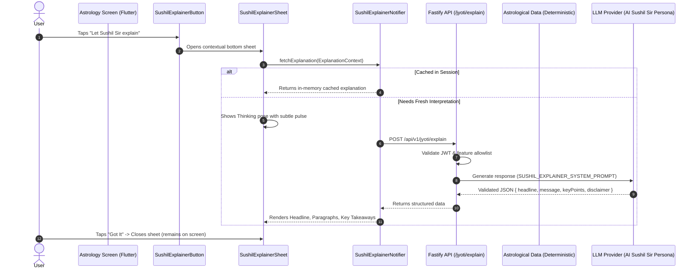

# Universal "Let Sushil Sir Explain" System Architecture

**Document Version:** 1.0.0  
**Phase:** Phase 1 (Universal Contextual Explainer)  
**Status:** Production Ready  

---

## 1. Product Overview & Purpose

Astro Sushil provides rich, mathematically rigorous Vedic astrology calculations (Parashari, Gupta Nadi BNN, Jaimini, KP, Shadbala, Ashtakavarga). However, ordinary users can easily feel overwhelmed when presented with raw planetary charts, Sanskrit terms, and tabular numerical data.

The **Universal "Let Sushil Sir Explain" System** introduces a contextual AI mentor layer that sits beside the user on technical screens and explains what they are seeing in simple, reassuring, plain-language terms.

### Core Philosophy:
> **"I am looking at something complicated → Sushil Sir is standing beside me and explaining it."**

- **NOT a Chatbot:** No typing, no prompt composer, no conversation history, no full-screen navigation.
- **One-Shot & Screen-Aware:** Tapping the button immediately captures the current screen's deterministic astrology data, passes it to the backend, and presents a structured explanation in a bottom sheet.
- **Auditable & Safe:** Zero calculation happens in the LLM. The deterministic calculation engine remains the 100% source of truth.

---

## 2. Jyoti vs. Sushil Explainer Distinction

| Feature / Attribute | Jyoti AI Assistant | Sushil Explainer ("AI Sushil Sir") |
| :--- | :--- | :--- |
| **User Interaction** | Conversational chat interface | Compact contextual button + Bottom Sheet |
| **Input Mode** | User types questions or taps action chips | One-shot, zero user typing required |
| **Scope** | General app queries, navigation, FAQs, features | Explaining the current screen's calculated data |
| **State** | Persistent chat history | Screen-session cached explanation |
| **LLM Infrastructure** | Fastify + `OpenRouterProvider` | Shared Fastify + `OpenRouterProvider` (Extended) |
| **Persona** | Conversational assistant (Jyoti) | AI Sushil Sir (knowledgeable, calm mentor) |

---

## 3. End-to-End Request & Data Flow



---

## 4. Universal Explanation Context (`ExplanationContext`)

Screens construct a compact, structured `ExplanationContext` containing only the relevant facts needed for interpretation:

```json
{
  "feature": "birth_chart",
  "screenTitle": "Birth Chart",
  "purpose": "Explain the user's natal chart placements",
  "context": {
    "astrologyData": {
      "ascendant": { "sign": "Leo", "degree": 14.5 },
      "planets": [
        { "name": "Sun", "sign": "Taurus", "house": 10 },
        { "name": "Moon", "sign": "Capricorn", "house": 6 }
      ],
      "houses": [
        { "houseNumber": 10, "sign": "Taurus", "occupyingPlanets": ["Sun"] }
      ]
    },
    "importantValues": {
      "ascendantSign": "Leo",
      "moonSign": "Capricorn",
      "sunSign": "Taurus"
    },
    "userProfileContext": {
      "name": "Arjun",
      "dateOfBirth": "1992-05-15",
      "placeName": "New Delhi, India"
    }
  }
}
```

### Feature Allowlist
The backend enforces strict feature allowlisting:
- `birth_chart`
- `vimshottari_dasha`
- `shadbala`
- `ashtakavarga`
- `planet_details`
- `houses`
- `nakshatra`
- `yogas`
- `kp_astrology`
- `divisional_charts`
- `panchanga`
- `gochara`
- `matchmaking`
- `vastu`
- `rashi_bhavishya`
- `varshaphala`
- `jaimini`
- `prashna`
- `bhava_bala`
- `general_astrology`

---

## 5. Backend Endpoint Specification

### `POST /api/v1/jyoti/explain`
- **Authentication:** Mandatory Bearer JWT (`fastify.authenticate`).
- **Rate Limiting:** Enforces in-memory user-level query limiting.
- **Request Body:** Validated via `JyotiExplainRequestSchema` (Zod).
- **System Prompt:** `SUSHIL_EXPLAINER_SYSTEM_PROMPT` enforces:
  1. Persona: "AI Sushil Sir", warm, approachable, teacher-like.
  2. Formula: `TERM -> SIMPLE MEANING -> WHY IT MATTERS TO YOU IN DAILY LIFE`.
  3. No astrology calculation or fabrication.
  4. Response strictly adheres to JSON schema.

### Response Contract:
```json
{
  "data": {
    "headline": "A Confident Leader with Practical Ambition",
    "message": "With a Leo Ascendant, you naturally project warmth, confidence, and a strong presence. The Sun sitting in your 10th house in Taurus highlights a dedicated and persistent career path.\n\nYour Moon is placed in Capricorn in the 6th house, meaning your emotional well-being is closely tied to your daily routines and duties.",
    "keyPoints": [
      "Leo ascendant makes you naturally confident and expressive.",
      "Taurus Sun in 10th house highlights a steady, determined career approach.",
      "Capricorn Moon in 6th house ties emotional security to daily discipline.",
      "Mars in Aries in 9th house fuels enthusiasm for learning and growth."
    ],
    "disclaimer": "AI Sushil Sir interpretation based on calculated chart data."
  }
}
```

---

## 6. AI Sushil Sir Persona Guidelines

1. **Voice & Demeanor:** Reassuring, friendly, wise, educational, practical.
2. **Clarity over Complexity:** Explain Sanskrit terms immediately without assuming previous astrological expertise.
   - Example: *"Your Moon is in Capricorn. In simple terms, the Moon represents your emotional nature and mind. Capricorn brings discipline and practicality. This means you tend to process feelings by solving problems rather than dwelling on the emotion."*
3. **Astrology Safety Directives:**
   - LLM never generates numbers, degrees, or dates.
   - LLM never predicts doom, tragedy, or fear.
   - If screen data is empty, LLM responds that data is unavailable and advises selecting birth details.

---

## 7. Concept Art Asset Pipeline

Using the official Astro Sushil concept art reference, the following high-resolution assets are extracted into `apps/mobile/assets/images/`:

| Asset Path | Usage in Explainer UI |
| :--- | :--- |
| `assets/images/sushil_avatar.png` | Button icon & default mentor badge |
| `assets/images/sushil_thinking.png` | Thinking/loading state with lightbulb thought |
| `assets/images/sushil_explaining.png` | Standard explanation header |
| `assets/images/sushil_explaining_chart.png` | Chart / Kundli screen explanation header |
| `assets/images/sushil_guiding.png` | Dasha / Progression screen header |
| `assets/images/sushil_avatar_neutral.png` | Error & offline state fallback |

---

## 8. Developer Guide: How to Integrate a New Screen

Adding the Sushil Explainer to any astrology screen requires only **3 steps**:

### Step 1: Import Components
```dart
import '../../sushil_explainer/models/explanation_context.dart';
import '../../sushil_explainer/widgets/sushil_explainer_button.dart';
```

### Step 2: Build the `ExplanationContext`
```dart
ExplanationContext _buildContext(AstroData data, BirthProfileModel profile) {
  return ExplanationContext(
    feature: 'your_feature_name',
    screenTitle: 'Screen Title',
    purpose: 'Explain the core dynamics of this screen',
    astrologyData: data.toJson(),
    importantValues: {
      'highlightKey': data.highlightValue,
    },
    userProfileContext: {
      'name': profile.name,
      'dateOfBirth': profile.dateOfBirth,
    },
  );
}
```

### Step 3: Embed `SushilExplainerButton`
```dart
SushilExplainerButton(
  contextData: _buildContext(data, profile),
  label: 'Let Sushil Sir explain',
  isCompact: false, // or true for app bars/compact headers
)
```

---

## 9. Integrated Screens (Phase 1)

1. **Birth Chart Screen (`BirthChartScreen`)**
   - Location: `apps/mobile/lib/features/astrology/screens/birth_chart_screen.dart`
   - Context: Ascendant sign & nakshatra, all 9 planets with houses, rashis, degrees, and retrogression.
2. **Vimshottari Dasha Screen (`VimshottariDashaScreen`)**
   - Location: `apps/mobile/lib/features/astrology/screens/vimshottari_dasha_screen.dart`
   - Context: Active Mahadasha, Antardasha, Pratyantardasha, dates, timeline summary.
3. **Planetary Strength Screen (`ShadbalaScreen`)**
   - Location: `apps/mobile/lib/features/astrology/screens/shadbala_screen.dart`
   - Context: 6-fold Shadbala potencies (Sthana, Dig, Kala, Cheshta, Naisargika, Drik), rupas, ratios, rankings.
4. **Ashtakavarga Screen (`AshtakavargaScreen`)**
   - Location: `apps/mobile/lib/features/astrology/screens/ashtakavarga_screen.dart`
   - Context: Sarvashtakavarga 12-sign bindu distribution, grand total, favorable vitality scores.
5. **Classical Vedic Yogas Screen (`YogasScreen`)**
   - Location: `apps/mobile/lib/features/astrology/screens/yogas_screen.dart`
   - Context: Detected Raja, Dhana, Mahapurusha, and auspicious planetary yoga combinations.
