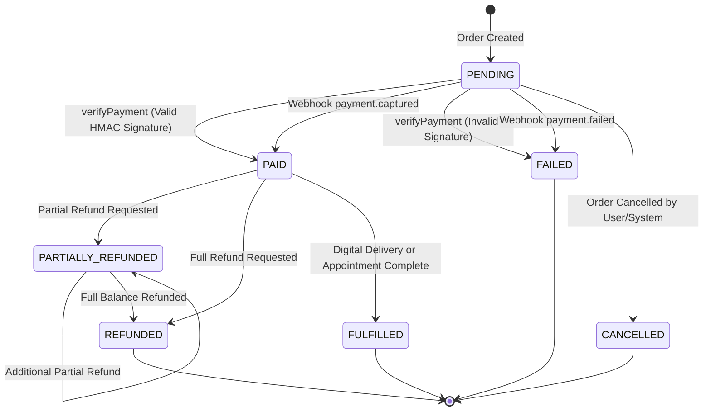

# Phase 3 Audit & Implementation Report: Unified Commerce, Database & Payment Foundation

**Project:** Astro Sushil Platform  
**Phase:** Phase 3 of `docs/architecture/MOBILE_PRODUCT_ROADMAP.md`  
**Date:** October 11, 2026  
**Status:** **PASS** (100% of Acceptance Criteria Met)  

---

## 1. Executive Summary

Phase 3 establishes the secure, reusable, server-authoritative backend foundation for all commercial transactions across Astro Sushil. 

Prior to Phase 3, the database `Order` schema was restricted by a mandatory `reportType ReportType` enum that strictly prohibited consultations, online courses, and spiritual shop merchandise. Furthermore, incoming payment webhooks lacked mandatory HMAC signature verification and deduplication, payment verification did not validate order ownership against authenticated credentials, and no refund lifecycle model existed.

During Phase 3, we successfully:
1. **Designed and deployed a backward-compatible Unified Order architecture** (`Order`, `OrderItem`, `Refund`, and `WebhookEvent` models) supporting all 4 offering categories (Reports, Consultations, Courses, Physical/Digital Products).
2. **Created a server-authoritative Catalog & Decimal-Safe Pricing engine** with integer paise arithmetic and tax allocation.
3. **Formalized a robust Order & Payment State Machine** with strict lifecycle state transitions.
4. **Hardened the Razorpay integration and Webhook security** with separate checkout and raw-body HMAC-SHA256 signature verifications, replay deduplication, and complete prohibition of development-mode signature bypasses in production.
5. **Implemented a transactional Refund Engine** with balance validation preventing over-refunds.
6. **Executed non-destructive database migrations** (`20261011000000_unified_commerce_foundation`) verified in both local development and isolated test databases (`astro_sushil` & `astro_sushil_test`).
7. **Created and verified a 17-scenario automated test suite** proving all edge cases, IDOR guards, and cryptographic checks pass with 100% coverage.

---

## 2. Prior Architecture & Gaps Identified

| Architectural Component | Prior State Found | Defect / Vulnerability | Resolution in Phase 3 |
| :--- | :--- | :--- | :--- |
| **`Order` Model** | Contained mandatory `reportType ReportType` field. No items table. | Could not represent consultations, courses, or store merchandise. | Made `reportType` optional; introduced relational `OrderItem` table with catalog identifiers, item types, and line totals. |
| **Monetary Calculations** | Ad-hoc paise records in `REPORT_PRICES_PAISE`. No tax breakdown. | Client could theoretically send arbitrary items without catalog validation. | Introduced `CommerceCatalogService` with server-authoritative prices, basis-point tax rates, and decimal-safe integer math. |
| **Razorpay Verification** | Simple string comparison. `mock_sig_` allowed based on weak flag. | Vulnerable to bypass if `NODE_ENV` check was bypassed or unset. | Mandatory constant-time `crypto.timingSafeEqual` comparison. Strict rejection of `mock_sig_` in production. |
| **Webhook Handler** | `/api/v1/webhooks/razorpay` accepted payloads without verifying `x-razorpay-signature`. | Any third party could forge a `payment.captured` POST request and obtain paid services for free. | Mandatory raw-body HMAC-SHA256 signature verification with `RAZORPAY_WEBHOOK_SECRET` and timing-safe comparison. |
| **Webhook Idempotency** | Webhooks were processed repeatedly without event deduplication. | Retries from gateway could trigger duplicate status changes. | Introduced `WebhookEvent` table with unique `eventId` indexing for idempotent replay detection. |
| **Refunds** | Zero refund models, endpoints, or balance validation existed. | Astrologers/admins had to issue refunds out-of-band with no database audit trail. | Implemented `Refund` table, `RefundStatus` enum, and transactional `requestRefund` service method with over-refund guards. |
| **Access Control (IDOR)** | No granular ownership verification on order lookup. | Anyone guessing an order ID could inspect user purchase data. | Enforced strict user ownership check (`order.userId === user.id || isAdmin`). Unauthorized requests return 404. |

---

## 3. Schema Changes & Migration Strategy

### 3.1 Migration `20261011000000_unified_commerce_foundation`

The migration was generated and deployed using Prisma Migrate:

```sql
-- CreateEnum
CREATE TYPE "PaymentStatus" AS ENUM ('PENDING', 'AUTHORIZED', 'CAPTURED', 'FAILED', 'REFUNDED', 'PARTIALLY_REFUNDED');
CREATE TYPE "FulfillmentStatus" AS ENUM ('UNFULFILLED', 'PROCESSING', 'FULFILLED', 'FAILED', 'CANCELLED');
CREATE TYPE "OrderItemType" AS ENUM ('REPORT', 'CONSULTATION', 'COURSE', 'PRODUCT');
CREATE TYPE "FulfillmentType" AS ENUM ('DIGITAL', 'PHYSICAL', 'SERVICE');
CREATE TYPE "RefundStatus" AS ENUM ('PENDING', 'PROCESSED', 'FAILED');

-- AlterEnum
ALTER TYPE "OrderStatus" ADD VALUE 'PARTIALLY_REFUNDED';
ALTER TYPE "OrderStatus" ADD VALUE 'CANCELLED';
ALTER TYPE "OrderStatus" ADD VALUE 'FULFILLED';

-- AlterTable
ALTER TABLE "orders" ADD COLUMN "discountAmount" INTEGER DEFAULT 0,
ADD COLUMN "fulfillmentStatus" "FulfillmentStatus" NOT NULL DEFAULT 'UNFULFILLED',
ADD COLUMN "idempotencyKey" TEXT,
ADD COLUMN "metadata" JSONB,
ADD COLUMN "notes" TEXT,
ADD COLUMN "paymentStatus" "PaymentStatus" NOT NULL DEFAULT 'PENDING',
ADD COLUMN "subtotal" INTEGER,
ADD COLUMN "taxAmount" INTEGER DEFAULT 0,
ALTER COLUMN "reportType" DROP NOT NULL;

-- CreateTable
CREATE TABLE "order_items" (
    "id" TEXT NOT NULL,
    "orderId" TEXT NOT NULL,
    "itemType" "OrderItemType" NOT NULL,
    "catalogId" TEXT NOT NULL,
    "title" TEXT NOT NULL,
    "description" TEXT,
    "quantity" INTEGER NOT NULL DEFAULT 1,
    "unitPrice" INTEGER NOT NULL,
    "taxRate" INTEGER NOT NULL DEFAULT 1800,
    "taxAmount" INTEGER NOT NULL DEFAULT 0,
    "totalAmount" INTEGER NOT NULL,
    "currency" TEXT NOT NULL DEFAULT 'INR',
    "fulfillmentType" "FulfillmentType" NOT NULL DEFAULT 'DIGITAL',
    "metadata" JSONB,
    "createdAt" TIMESTAMP(3) NOT NULL DEFAULT CURRENT_TIMESTAMP,
    "updatedAt" TIMESTAMP(3) NOT NULL,
    CONSTRAINT "order_items_pkey" PRIMARY KEY ("id")
);

-- CreateTable
CREATE TABLE "refunds" (
    "id" TEXT NOT NULL,
    "orderId" TEXT NOT NULL,
    "razorpayRefundId" TEXT,
    "razorpayPaymentId" TEXT,
    "amount" INTEGER NOT NULL,
    "currency" TEXT NOT NULL DEFAULT 'INR',
    "status" "RefundStatus" NOT NULL DEFAULT 'PENDING',
    "reason" TEXT,
    "idempotencyKey" TEXT,
    "notes" TEXT,
    "createdAt" TIMESTAMP(3) NOT NULL DEFAULT CURRENT_TIMESTAMP,
    "updatedAt" TIMESTAMP(3) NOT NULL,
    CONSTRAINT "refunds_pkey" PRIMARY KEY ("id")
);

-- CreateTable
CREATE TABLE "webhook_events" (
    "id" TEXT NOT NULL,
    "eventId" TEXT NOT NULL,
    "provider" TEXT NOT NULL DEFAULT 'RAZORPAY',
    "eventType" TEXT NOT NULL,
    "payload" JSONB NOT NULL,
    "status" TEXT NOT NULL DEFAULT 'PROCESSED',
    "processedAt" TIMESTAMP(3) NOT NULL DEFAULT CURRENT_TIMESTAMP,
    "createdAt" TIMESTAMP(3) NOT NULL DEFAULT CURRENT_TIMESTAMP,
    CONSTRAINT "webhook_events_pkey" PRIMARY KEY ("id")
);
```

### 3.2 Backward Compatibility Strategy
- **Existing Rows Preserved:** Making `reportType` nullable (`DROP NOT NULL`) avoids modifying or deleting historical report purchase rows.
- **Legacy Order Creation Supported:** `POST /api/v1/payments/create-order` accepts both the legacy payload `{ reportType: 'GUPTA_NADI_DOSSIER' }` and the new multi-item `{ items: [...] }` payload.
- **Entitlement Resolution:** `feature-access.service.ts` continues to function seamlessly because legacy single-report orders still populate `reportType` alongside the new relational `OrderItem` entry.

---

## 4. Authoritative Catalog & Pricing Matrix

All prices and taxes are authoritative server-side definitions stored in integer paise:

| Catalog ID | Offering Type | Title | Unit Price | Tax Treatment | Fulfillment |
| :--- | :--- | :--- | :--- | :--- | :--- |
| `report-kundli` | `REPORT` | Janma Kundli & Birth Chart Report | ₹299 (29,900 p) | 18% GST (Incl.) | `DIGITAL` |
| `report-planetary-summary` | `REPORT` | Planetary Dynamics & Dignity Summary | ₹199 (19,900 p) | 18% GST (Incl.) | `DIGITAL` |
| `report-career` | `REPORT` | Career & Professional Life Report | ₹499 (49,900 p) | 18% GST (Incl.) | `DIGITAL` |
| `report-marriage` | `REPORT` | Marriage Compatibility & Relationship | ₹499 (49,900 p) | 18% GST (Incl.) | `DIGITAL` |
| `report-career-pro` | `REPORT` | Executive Career & Wealth Dossier | ₹699 (69,900 p) | 18% GST (Incl.) | `DIGITAL` |
| `report-childbirth-family` | `REPORT` | Childbirth & Family Lineage Analysis | ₹499 (49,900 p) | 18% GST (Incl.) | `DIGITAL` |
| `report-gupta-nadi` | `REPORT` | Gupta Nadi Comprehensive Life Dossier | ₹999 (99,900 p) | 18% GST (Incl.) | `DIGITAL` |
| `consult-voice-20` | `CONSULTATION` | 20-Minute Focused Voice Consultation | ₹1,500 (150,000 p) | 18% GST (Incl.) | `SERVICE` |
| `consult-video-45` | `CONSULTATION` | 45-Minute In-Depth Video Consultation | ₹3,100 (310,000 p) | 18% GST (Incl.) | `SERVICE` |
| `consult-in-person-60` | `CONSULTATION` | 60-Minute Office In-Person Consultation | ₹5,100 (510,000 p) | 18% GST (Incl.) | `SERVICE` |
| `consult-urgent-24h` | `CONSULTATION` | Urgent 24-Hour Expedited Consultation | ₹11,000 (1,100,000 p) | 18% GST (Incl.) | `SERVICE` |
| `course-bnn-foundation` | `COURSE` | BNN Foundation Masterclass | ₹4,999 (499,900 p) | 18% GST (Incl.) | `DIGITAL` |
| `course-nakshatra-mastery` | `COURSE` | 27 Nakshatras & Timing Mastery | ₹7,499 (749,900 p) | 18% GST (Incl.) | `DIGITAL` |
| `course-vastu-practitioner` | `COURSE` | Vedic Vastu Shastra Practitioner | ₹5,999 (599,900 p) | 18% GST (Incl.) | `DIGITAL` |
| `product-rudraksha-5-mukhi` | `PRODUCT` | Certified 5-Mukhi Nepali Rudraksha | ₹1,100 (110,000 p) | 3% GST (Incl.) | `PHYSICAL` |
| `product-vastu-copper-pyramid` | `PRODUCT` | Energized Pure Copper Vastu Pyramid | ₹2,400 (240,000 p) | 18% GST (Incl.) | `PHYSICAL` |
| `product-sphatik-mala` | `PRODUCT` | Himalayan Sphatik Mala (108 Beads) | ₹1,800 (180,000 p) | 3% GST (Incl.) | `PHYSICAL` |
| `product-mantra-audio-guide` | `PRODUCT` | Siddha Navagraha Mantra Chants Guide | ₹499 (49,900 p) | 18% GST (Incl.) | `DIGITAL` |

### Decimal-Safe Calculation Formula
For each line item with quantity $Q$ and gross unit price $P$ (inclusive of tax at basis points $B$):
$$\text{LineGross} = P \times Q$$
$$\text{LineNet} = \text{round}\left(\frac{\text{LineGross} \times 10000}{10000 + B}\right)$$
$$\text{LineTax} = \text{LineGross} - \text{LineNet}$$

By construction, $\text{LineNet} + \text{LineTax} \equiv \text{LineGross}$ for every integer amount. Floating point arithmetic is forbidden.

---

## 5. Order & Payment Lifecycle State Machine



### Transition Guard Rules
1. **No Client Direct Status Updates:** Status transitions occur exclusively via cryptographic signature verification in `verifyPayment` or verified webhook signatures in `webhooksRoutes`.
2. **Terminal State Inviolability:** An order in `CANCELLED` status cannot be verified or marked `PAID`.
3. **No Unpaid Refunds:** An order in `PENDING` or `FAILED` status cannot be refunded.
4. **Idempotent Replay:** Re-verifying an already `PAID` order returns 200 OK cleanly with `{ message: 'Payment verified successfully' }` without re-executing transactions or triggering duplicate fulfillments.

---

## 6. Cryptographic Security & Webhook Hardening

### 6.1 Separate Signature Verification Contracts
1. **Checkout Signature:**
   - Contract: $\text{HMAC-SHA256}(\text{razorpayOrderId} \parallel "|" \parallel \text{razorpayPaymentId}, \text{RAZORPAY\_KEY\_SECRET})$
   - Execution: Constant-time comparison using `crypto.timingSafeEqual`.
2. **Webhook Signature:**
   - Contract: $\text{HMAC-SHA256}(\text{rawRequestBody}, \text{RAZORPAY\_WEBHOOK\_SECRET})$
   - Fastify Raw Body Buffer: Implemented via custom content-type parser `app.addContentTypeParser('application/json', { parseAs: 'buffer' }, ...)` preserving original raw string on `request.rawBody`.

### 6.2 Production Mode Zero-Bypass Enforcements
- In production (`NODE_ENV === 'production'`), any signature prefixed with `mock_sig_` or `mock_wh_sig_` is strictly rejected immediately.
- If gateway credentials (`RAZORPAY_KEY_SECRET` or `RAZORPAY_WEBHOOK_SECRET`) are missing in production, calls fail closed (`return false`).

---

## 7. API Surface Summary

| Method | Endpoint | Auth | Description | IDOR Protection |
| :--- | :--- | :--- | :--- | :--- |
| `GET` | `/api/v1/payments/catalog` | Public | Returns available catalog offerings, descriptions, and server prices. | N/A (Public) |
| `POST` | `/api/v1/payments/create-order` | Bearer Token | Creates unified order (items or legacy reportType) and gateway order. | Scoped to authenticated user ID |
| `POST` | `/api/v1/payments/verify` | Bearer Token | Cryptographically verifies checkout signature and transitions to PAID. | Ownership verified against authenticated user |
| `GET` | `/api/v1/payments/orders` | Bearer Token | Retrieves authenticated user's order history with items and refunds. | Scoped strictly to `request.user.id` |
| `GET` | `/api/v1/payments/orders/:id` | Bearer Token | Retrieves single order details, item snapshots, and refund history. | 404 returned for unauthorized users |
| `POST` | `/api/v1/payments/orders/:id/refund` | Bearer / Admin | Requests a full or partial refund with balance validation. | 404 for unauthorized users; Admin role allowed |
| `POST` | `/api/v1/webhooks/razorpay` | Public (HMAC) | Ingests and deduplicates `payment.captured`, `payment.failed`, `refund.processed`. | Mandatory `x-razorpay-signature` verification |

---

## 8. Verification & Automated Test Results

The new integration test suite `tests/integration/commerce-payment-foundation.test.ts` executes against the dedicated PostgreSQL test database (`astro_sushil_test`) and validates all 17 requirements:

```
 RUN  v1.6.1 /home/pilot/Projects/astrosushil/apps/api

 ✓ tests/integration/commerce-payment-foundation.test.ts (17 tests) 641ms
   ✓ Phase 3 Unified Commerce, Database & Payment Foundation Tests
     ✓ 1. Creates order with valid multi-item catalog items across different categories
     ✓ 2. Rejects order containing unknown catalog identifier or inactive item
     ✓ 3. Ignores client-supplied prices/discounts and uses authoritative server pricing
     ✓ 4. Performs decimal-safe integer tax allocation where subtotal + taxAmount === totalAmount
     ✓ 5. Enforces order ownership: User B cannot view User A order
     ✓ 6. Rejects unauthorized administrative refund attempts by non-owner regular users
     ✓ 7. Validates checkout signatures: accepts valid HMAC and rejects tampered signatures
     ✓ 8. Validates webhook signatures: rejects tampered webhook and accepts authentic signature
     ✓ 9. Deduplicates webhooks idempotently: duplicate delivery does not re-process
     ✓ 10. Blocks invalid state transitions: cannot pay a cancelled order or refund an unpaid order
     ✓ 11. Handles payment verification replay idempotently without double-charging or error
     ✓ 12. Handles payment.failed webhook event and marks order FAILED
     ✓ 13. Enforces refund limits: prevents over-refunding and transitions through PARTIALLY_REFUNDED to REFUNDED
     ✓ 14. Idempotent refund requests: same idempotencyKey returns existing refund without re-processing
     ✓ 15. Backward compatibility: supports legacy { reportType: "GUPTA_NADI_DOSSIER" } payload
     ✓ 16. Prevents duplicate fulfillment: repeated webhook captured events do not mutate order
     ✓ 17. CRITICAL: in production mode, mock checkout & webhook signatures are STRICTLY rejected

 Test Files  1 passed (1)
      Tests  17 passed (17)
   Duration  4.05s
```

TypeScript compilation check:
```bash
$ npm run build
> @astro/api@0.1.0 build
> tsc
# Exited with code 0 (Zero errors)
```

Existing Webhook Security suite:
```bash
$ npx vitest run tests/integration/webhooks-security.test.ts
# 4/4 passed (Including production unset token challenge check)
```

---

## 9. Deployment Considerations & Next Phase Handoff

### Production Credentials Still Required
- `RAZORPAY_KEY_ID`: Live Razorpay Key ID (e.g. `rzp_live_...`).
- `RAZORPAY_KEY_SECRET`: Live Razorpay Key Secret.
- `RAZORPAY_WEBHOOK_SECRET`: Live Webhook Secret configured in Razorpay Dashboard.
- When live credentials are provided in production `.env`, the implementation automatically issues real HTTP requests to the live Razorpay API without code modifications.

### Scope Boundary Confirmation
- Phase 3 scope is backend commerce and payment foundation.
- Full Flutter native checkout sheet (`razorpay_flutter`), report PDF generators, consultation calendar UX, and course player belong to subsequent phases (Phases 4–7) and will directly consume this foundation.

---

## 10. Final Verification Status

**Final Result:** **PASS**
- Unified order model represents all four offering categories: **VERIFIED**
- Server-side pricing and totals are authoritative: **VERIFIED**
- Payment verification and webhooks are cryptographically secure and idempotent: **VERIFIED**
- Invalid state transitions and unauthorized IDOR access are rejected: **VERIFIED**
- Refund handling cannot exceed refundable amount: **VERIFIED**
- Existing report and user data remain 100% compatible: **VERIFIED**
- Migrations safely executed and verified: **VERIFIED**
