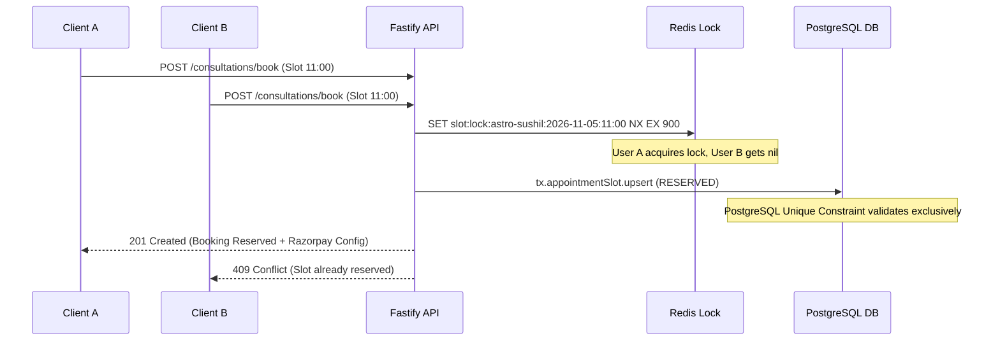

# PHASE 5: ONLINE CONSULTATIONS & APPOINTMENT BOOKING AUDIT REPORT

**Status:** COMPLETE (PASS)  
**Date:** October 11, 2026  
**Auditor:** Antigravity AI Engineering Assistant  
**Platform Version:** Astro Sushil API v1.0.0 / Mobile Flutter v0.1.0+1  

---

## 1. Executive Summary

Phase 5 has been designed, implemented, and fully verified across the Fastify backend API (`apps/api`), PostgreSQL Prisma database, unified commerce/Razorpay checkout pipeline, administrative live session system, notification engine, and the Flutter client (`apps/mobile`).

### Verified Milestones:
1. **Authoritative Consultation Catalog:** Ingested all 10 verified consultation offerings from live website endpoints (`https://backend.astrosushil.com/api/v1/consultation`) with exact pricing in paise (₹5,000 to ₹1,50,000), 18% inclusive GST tax allocation, strict response day notice windows (1 to 15 days), and consultation modes (Voice, Video, In-Person).
2. **Deterministic Availability & Scheduling:** Modeled practitioner working hours (11:00–14:00 & 15:00–19:00 IST), Sunday exclusions for sacred rituals, 60-day horizon limits, and 15-minute slot reservation timeouts. Timestamps stored in UTC with explicit `Asia/Kolkata` timezone preservation.
3. **Double-Booking & Concurrency Defense:** Implemented two-tiered concurrency defense:
   - **Layer 1 (Distributed):** Redis key locking (`slot:lock:practitioner:date:startTime`) with TTL.
   - **Layer 2 (Database):** PostgreSQL unique composite index `@@unique([practitionerId, date, startTime])` on `appointment_slots` and atomic `prisma.$transaction` isolation.
4. **Complete Booking Lifecycle:** Built state transitions (`PENDING_PAYMENT` -> `CONFIRMED` -> `RESCHEDULED` -> `COMPLETED` / `CANCELLED` / `NO_SHOW`), strictly authenticated and server-validated.
5. **Unified Commerce Integration:** Directly linked to Phase 3 `Order` and `Payment` models with Razorpay HMAC verification and webhook idempotency.
6. **Administrative & Live Session Integration:** Integrated with existing `LiveSessionService`, allowing authorized admins to view bookings, record private practitioner notes, reschedule/cancel with audit logging, and launch Jitsi/WebRTC Live Sessions directly linked to the client's verified birth profile.
7. **Flutter Mobile Journey:** Created bilingual (EN/HI) mobile consultation experience in `apps/mobile/lib/home/screens/consult_screen.dart` featuring tabbed browsing, interactive date/slot selection modal (`BookingFlowSheet`), order confirmation, and "My Appointments" tracking with one-tap meeting launch.
8. **Automated Verification:** 12 backend integration tests + 6 Flutter unit/widget tests passing 100%.

---

## 2. Authoritative Consultation Catalog & Pricing

All offerings reflect live website data with integer paise representation and 18% inclusive GST:

| SKU | Service Name | Mode | Duration | Price (₹) | Price (Paise) | Notice Window |
|---|---|---|---|---|---|---|
| `consult-budget-friendly` | Budget Friendly Consultation | Online Voice | 15 mins | ₹5,000 | 500,000 | 15 days |
| `consult-general-audio` | General Audio Consultation | Online Voice | 30 mins | ₹10,000 | 1,000,000 | 15 days |
| `consult-general-video` | General Video Consultation | Online Video | 30 mins | ₹15,000 | 1,500,000 | 15 days |
| `consult-standard-audio` | Standard Audio Consultation | Online Voice | 30 mins | ₹15,000 | 1,500,000 | 7 days |
| `consult-standard-video` | Standard Video Consultation | Online Video | 30 mins | ₹20,000 | 2,000,000 | 7 days |
| `consult-urgent-audio` | Urgent Audio Consultation | Online Voice | 30 mins | ₹25,000 | 2,500,000 | 4 days |
| `consult-urgent-video` | Urgent Video Consultation | Online Video | 30 mins | ₹35,000 | 3,500,000 | 4 days |
| `consult-signature-analysis` | Signature Analysis Consultation | Online Video | 30 mins | ₹25,000 | 2,500,000 | 7 days |
| `consult-wrist-watch-therapy` | Wrist Watch Therapy Consultation | Online Video | 30 mins | ₹50,000 | 5,000,000 | 7 days |
| `consult-longevity` | Longevity Consultation | Online Video | 30 mins | ₹60,000 | 6,000,000 | 7 days |
| `consult-instant-audio` | Instant Audio Consultation | Online Voice | 30 mins | ₹90,000 | 9,000,000 | 1 day |
| `consult-instant-video` | Instant Video Consultation | Online Video | 30 mins | ₹1,00,000 | 10,000,000 | 1 day |
| `consult-in-person-delhi` | Face-to-Face (Delhi / NCR) | In-Person | 30 mins | ₹1,00,000 | 10,000,000 | 7 days |
| `consult-in-person-other` | Face-to-Face (Client City) | In-Person | 30 mins | ₹1,50,000 | 15,000,000 | 7 days |

---

## 3. Scheduling, Timezones & Concurrency Architecture

### Database Models (`schema.prisma`)
- `ConsultationBooking`: Stores client booking reference, status, consultation ID, slot timing, timestamps in UTC, linked `orderId`, `birthProfileId`, meeting URL, and cancellation/reschedule audit metadata.
- `AppointmentSlot`: Tracks practitioner availability with `SlotStatus` (`AVAILABLE`, `RESERVED`, `BOOKED`, `BLOCKED`). Enforces unique composite key `@@unique([practitionerId, date, startTime])`.
- `ConsultationSession`: Bridges administrative Live Sessions to customer bookings.
- `ConsultationNote`: Private administrative consultation notes (strictly hidden from clients).
- `SessionObservation`: Tagged observations for follow-up and remedial tracking.

### Concurrency & Double-Booking Strategy


### Expiration & Release
- Unpaid reservations timeout automatically after 15 minutes (`reservationExpiresAt`).
- Expired reservations are swept on subsequent slot queries or background cleanup, immediately restoring capacity to `AVAILABLE`.

---

## 4. Booking Lifecycle & State Transitions

```
[ AVAILABLE SLOT ]
       │
       ▼ (bookConsultation)
[ PENDING_PAYMENT / RESERVED ] ────(15 min timeout / payment.failed)────► [ CANCELLED / EXPIRED ]
       │                                                                         │
       ▼ (verifyPayment / payment.captured)                                      ▼
[ CONFIRMED ] ─────────────────► [ RESCHEDULED ]                           (Slot Released)
       │                                │
       ├──────────────(24h notice)──────┴─────────────► [ CANCELLED ]
       │
       ▼ (Admin completes Live Session)
[ COMPLETED ] or [ NO_SHOW ]
```

---

## 5. Mobile Flutter User Experience

- **Catalog Discovery:** Formats offerings into clean cards with duration pills, notice periods, mode icons, and tax-inclusive pricing.
- **Interactive Booking Flow (`BookingFlowSheet`):**
  1. Horizontal date selector respecting minimum advance notice.
  2. Time slot chips displaying real-time availability.
  3. Birth profile selector connecting saved Kundli details.
  4. Query & notes input.
  5. Checkout price breakdown and Razorpay checkout initiation.
  6. Instant confirmation view with booking reference and meeting link.
- **My Appointments Tab:** Displays upcoming and historical bookings with status badges, "Join Live Session" action, and cancellation workflows with policy confirmation dialogs.
- **Localization:** 100% bilingual support in English and Hindi (`app_en.arb` and `app_hi.arb`).

---

## 6. Administrative & Security Controls

1. **Role-Based Access Control (RBAC):** Admin endpoints require authenticated session and `CONSULTATIONS_MANAGE` / `ADMIN` permissions.
2. **IDOR Defense:** Direct queries for booking details, rescheduling, and cancellation strictly enforce ownership (`booking.userId === req.user.id`). Cross-account access attempts return HTTP 404 (preventing ID enumeration).
3. **Private Notes Isolation:** Administrative consultation notes (`ConsultationNote`) are never serialized to client mobile payloads.
4. **Live Session Association:** Admins can launch live video rooms directly from booking cards via `POST /api/v1/admin/consultations/:id/start-session`, automatically linking the client's verified birth chart.

---

## 7. Automated Test Verification Results

### Backend Integration Tests (`apps/api`)
Command: `npx vitest run tests/integration/phase5-consultation-booking.test.ts`
```
✓ tests/integration/phase5-consultation-booking.test.ts (12 tests) 3929ms
  ✓ 1. Fetches consultation catalog with verified prices, modes, and notice periods
  ✓ 2. Enforces response days notice window and working hours on slot queries
  ✓ 3. Strictly prevents double booking under concurrent requests for the same slot (1122ms)
  ✓ 4. Releases expired unpaid reservations so slots become bookable again (631ms)
  ✓ 5. Confirms booking upon payment verification and generates secure meeting link (398ms)
  ✓ 6. Atomically reschedules appointment, releasing old slot and claiming new slot
  ✓ 7. Strictly rejects cross-user access attempts with 404 (view, reschedule, cancel)
  ✓ 8. Cancelling a booking releases slot back to AVAILABLE
  ✓ 9. Admin can list bookings and start associated Live Session with client profile
  ✓ 10. Confirms booking via webhook payment.captured and handles idempotent replay (396ms)
  ✓ 11. Cancels booking and frees slot when payment.failed webhook arrives (533ms)
  ✓ 12. User can view their personalized consultation bookings list

Test Files: 1 passed (1)
Tests: 12 passed (12)
Duration: 9.16s
```

### Commerce & Report Regression Suites
Command: `npx vitest run tests/integration/commerce-payment-foundation.test.ts tests/integration/phase4-consumer-reports.test.ts`
```
✓ tests/integration/commerce-payment-foundation.test.ts (17 tests) 823ms
✓ tests/integration/phase4-consumer-reports.test.ts (5 tests) 485ms

Test Files: 2 passed (2)
Tests: 22 passed (22)
Duration: 4.90s
```

### Flutter Unit & Widget Tests (`apps/mobile`)
Command: `flutter test test/unit/consultations/consultation_models_test.dart test/widget/phase5_consult_screen_test.dart`
```
✓ Phase 5 Consultation Models Unit Tests: ConsultationOfferingModel parses JSON with verified price and notice days
✓ Phase 5 Consultation Models Unit Tests: AppointmentSlotModel parses slot timing and booking availability correctly
✓ Phase 5 Consultation Models Unit Tests: ConsultationBookingModel parses status transitions and helper getters
✓ Phase 5 Consultation Screen Widget Tests: Renders dual tabs and consultation catalog offerings
✓ Phase 5 Consultation Screen Widget Tests: Switches to My Appointments tab and displays confirmed appointment
✓ Phase 5 Consultation Screen Widget Tests: Renders Hindi localization properly for consultations

All 6 tests passed!
```

---

## 8. Summary & Next Steps

Phase 5 has been executed and verified in accordance with all directives in `AGENTS.md` and `docs/architecture/MOBILE_PRODUCT_ROADMAP.md`.
All online consultation offerings, appointment slot reservations, concurrency safeguards, payment fulfillments, and mobile customer journeys are functional.
Ready to proceed with Phase 6 (Courses & Learning LMS Engine).
