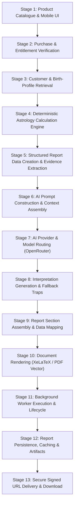
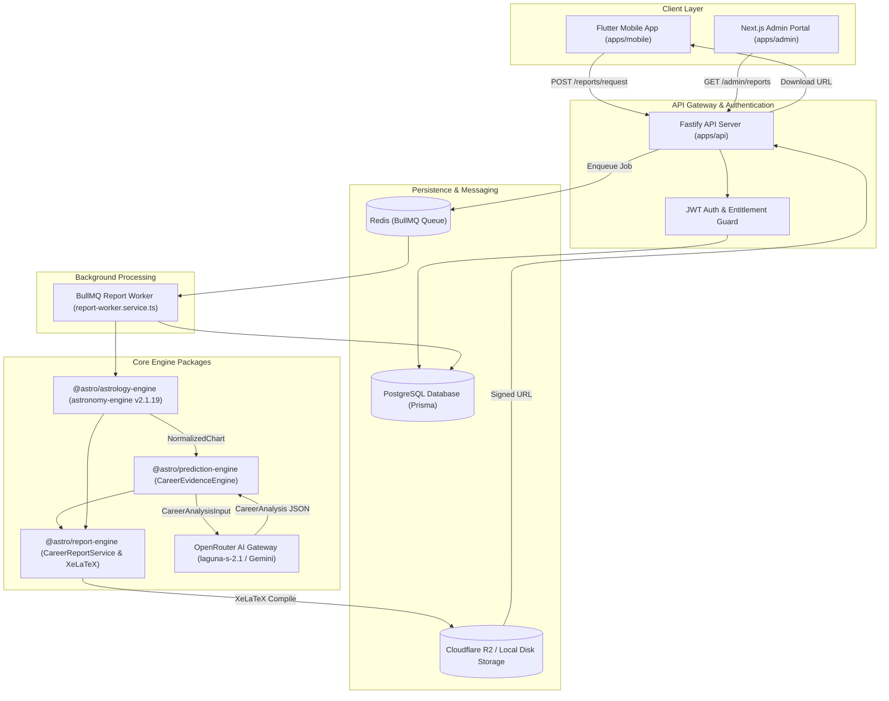

# Astro Sushil: Phase 0 System Inventory & Architecture Audit

**Document Reference:** `docs/audits/report_system/PHASE_0_SYSTEM_INVENTORY.md`  
**Classification:** Forensic System Audit & Architectural Inventory  
**Date of Audit:** November 3, 2026  
**Status:** Completed  

---

## 1. Executive Summary

This inventory documents the end-to-end report generation architecture of the **Astro Sushil** platform. The audit traced report requests from mobile client initiation and administrative dispatch through authentication, product entitlement verification, birth profile normalization, astrological calculations, AI interpretation pipelines, document assembly, XeLaTeX compilation, persistence, and secure asset delivery.

The system is organized as a TypeScript/Fastify modular monolith in `apps/api`, supported by workspace packages (`@astro/astrology-engine`, `@astro/prediction-engine`, `@astro/report-engine`, `@astro/gupta-nadi-engine`, `@astro/shared`), a Redis/BullMQ queue worker, PostgreSQL persistence via Prisma ORM, and Cloudflare R2 / local filesystem storage.

---

## 2. End-to-End Pipeline Trace: The 13 Stages

Every report request transitions through thirteen discrete stages:



---

### Stage 1: Product Catalogue & Client Initiation
- **Mobile Entry Points:**
  - `apps/mobile/lib/features/reports/screens/reports_screen.dart`
  - `apps/mobile/lib/features/reports/providers/reports_controller.dart`
- **Supported SKUs in Client:**
  - `KUNDLI` (Personalised Kundli Report)
  - `PLANETARY_SUMMARY` (Planetary Snapshot / Graha Report)
  - `CAREER_PROSITY` / `PRO_HOROSCOPE` (Professional Horoscope)
  - `MARRIAGE_COMPATIBILITY` (Couple Kundli Matchmaking)
  - `CAREER` (Comprehensive Career Analysis Dossier - 65–85 pages)
- **Catalogue Gap:** The platform's product catalogue implements only 5 report types, whereas the commercial reference catalogue (Astro Arun Pandit) comprises 13 distinct report SKUs.

### Stage 2: Purchase & Entitlement Verification
- **API Endpoints:**
  - `POST /api/v1/reports/request` (`apps/api/src/modules/reports/reports.routes.ts`)
  - `POST /api/v1/orders` (`apps/api/src/modules/orders/orders.routes.ts`)
- **Entitlement Checks:**
  - Enforced in `apps/api/src/modules/reports/reports.service.ts` (`requestReport`):
    - Verifies user authentication via JWT Bearer token (`request.user.id`).
    - Validates order completion and entitlement records in `entitlements` table.
    - Rate limits active report jobs per user via Redis locks.

### Stage 3: Customer & Birth-Profile Retrieval
- **Database Model:** `birth_profiles` table via Prisma (`apps/api/prisma/schema.prisma`).
- **Profile Fields:**
  - `id` (UUID), `userId` (FK to `users`), `name`, `dateOfBirth` (Date), `timeOfBirth` (String `HH:mm`), `placeName`, `latitude` (Float), `longitude` (Float), `timezone` (IANA string, e.g., `Asia/Kolkata`), `gender` (Enum).
- **Audit Observation:** Profile data is passed into `reportsService.requestReport` either via `birthProfileId` or inline `birthDetails` override.

### Stage 4: Deterministic Astrology Calculation Engine
- **Package:** `packages/astrology-engine/src/chart/chart-calculator.ts`
- **Ephemeris Adapter:** `AstronomyEngineAdapter` (`packages/astrology-engine/src/ephemeris/astronomy-engine.adapter.ts`), wrapping `astronomy-engine` v2.1.19.
- **Normalization:** `normalizeBirthTime` (`packages/astrology-engine/src/validation/birth-details.validator.ts`) computes UTC Julian Day (`julianDayUT`).
- **Engine Outputs:** `AstroChart` containing:
  - Lagna (Ascendant) point, degrees, sign, nakshatra, and pada.
  - 9 planetary positions (Sun, Moon, Mars, Mercury, Jupiter, Venus, Saturn, Rahu, Ketu) with coordinates, speed, and retrograde flags.
  - 12 Whole Sign Bhavas (Houses).
  - Vimshottari Mahadasha, Antardasha, and Pratyantardasha periods (`dasha-calculator.ts`).
  - Ashtakavarga matrices (Sarvashtakavarga / Bhinnashtakavarga) (`ashtakavarga-calculator.ts`).
  - Shadbala and Bhava Bala strength vectors (`shadbala-calculator.ts`, `bhava-bala.ts`).

### Stage 5: Structured Report Data Creation & Evidence Extraction
- **Package:** `packages/prediction-engine/src/evidence/career-evidence.engine.ts`
- **Class:** `CareerEvidenceEngine`
- **Functionality:** Ingests `NormalizedChart` and compiles a deterministic `CareerAnalysisInput` payload:
  - 10th and 6th house rulers, dignity, and placements.
  - Amatyakaraka (AmK) and Atmakaraka (AK) identified from highest planetary degrees.
  - D10 (Dashamsha) divisional placements.
  - Sarvashtakavarga (SAV) points for 10th (Karma) and 11th (Labha) houses.
  - Planetary strengths, combustion, and aspectual vectors.

### Stage 6: AI Prompt Construction & Context Assembly
- **File:** `packages/prediction-engine/src/prompts/career-analyst.prompt.ts`
- **System Prompt:** `CAREER_ANALYST_SYSTEM_PROMPT`
- **Structure:**
  - Strict role: "Executive Vedic Career Analyst".
  - Mandates valid JSON-only output conforming to 41 distinct structured fields.
  - Directs model to evaluate supplied astrological placements without inventing celestial positions.

### Stage 7: AI Provider & Model Routing
- **File:** `packages/prediction-engine/src/providers/openrouter-career-analysis.provider.ts`
- **Configured Model Hierarchy:**
  - Primary: `poolside/laguna-s-2.1:free` via OpenRouter HTTP API.
  - Fallbacks: `nvidia/nemotron-3.5-lightning:free`, `qwen/qwen3.8-27b:free`.
- **Alternative Provider:** `GeminiCareerAnalysisProvider` (`gemini-career-analysis.provider.ts`) supporting Google Gemini models (`gemini-2.5-pro`, `gemini-2.5-flash`), configured via `AI_PROVIDER=gemini`.

### Stage 8: Interpretation Generation & Fallback Traps
- **Execution:** Provider issues an HTTP POST request to OpenRouter/Gemini with timeout and retry logic.
- **Critical Audit Finding:** In `OpenRouterCareerAnalysisProvider` line 119:
  ```typescript
  catch (error) {
    logger.warn('OpenRouter provider failed. Falling back to MockCareerAnalysisProvider');
    return new MockCareerAnalysisProvider().analyze(input);
  }
  ```
  If API keys expire, models hit token limits, or network timeouts occur, the system **silently substitutes** `MockCareerAnalysisProvider`, which returns identical hardcoded text for every native.

### Stage 9: Report Section Assembly & Data Mapping
- **File:** `packages/report-engine/src/mappers/career-report.mapper.ts`
- **Function:** `mapNormalizedChartToCareerReportData`
- **Assembly Logic:**
  - Populates client identity metadata (Name, DOB, POB, TOB).
  - Injects astronomical tables (Planets, Bhavas, Dashas, Ashtakavarga).
  - Synthesizes career chapters from `CareerAnalysis`.
- **Critical Audit Finding:** Lines 1508–1804 hardcode almost all strategic, narrative, directional, cautionary, financial, relationship, and roadmap sections, completely ignoring the structured AI analysis!

### Stage 10: Document Rendering (XeLaTeX / PDF Vector)
- **Dossier Engine (Career Report):**
  - Generator: `packages/report-engine/src/generators/report-data-tex.generator.ts`
  - LaTeX Compiler: `packages/report-engine/src/pdf/xelatex-compiler.ts`
  - Template: `packages/report-engine/templates/career-report.tex` (XeLaTeX template with modular partials).
  - Execution: Spawns `xelatex -interaction=nonstopmode` inside an isolated temporary directory, executing two passes for table-of-contents alignment.
- **Vector PDF Engine (Kundli, Planetary, Horoscope, Matchmaking):**
  - Handled by `ReportPdfService` (`packages/report-engine/src/pdf/report-pdf.service.ts`) using PDFKit vector graphics, producing basic 3–4 page summaries.

### Stage 11: Background Worker Execution & Lifecycle
- **Worker Process:** `apps/api/src/worker.ts` and `apps/api/src/services/report-worker.service.ts`
- **Queue System:** BullMQ queue `report-generation` backed by Redis on port 6379.
- **Job Flow:**
  1. API pushes job `{ reportId, reportType, birthProfileId, userId }` to BullMQ.
  2. Updates report status in PostgreSQL to `PROCESSING`.
  3. Worker calculates chart, runs LLM analysis, generates LaTeX/PDF, and uploads artifact.
  4. Updates report status to `COMPLETED` and sets `storageKey`, `fileSize`, `pagesCount`.
  5. On error, transitions to `FAILED` with failure telemetry.

### Stage 12: Report Persistence, Caching & Artifacts
- **Database Record:** `reports` table in PostgreSQL.
- **Storage Adapter:** `StorageService` (`apps/api/src/services/storage.service.ts`):
  - Cloudflare R2 (S3-compatible) when credentials exist.
  - Local disk fallback: `/tmp/astro-sushil/storage/reports/`.
- **Cache Strategy:**
  - In `reports.service.ts`, before enqueuing a job, the service queries existing completed reports for the same `userId`, `birthProfileId`, and `reportType`.
  - If a completed report exists within the validity window, the existing report record is returned immediately without re-running calculations.

### Stage 13: Secure Signed URL Delivery & Download
- **Endpoint:** `GET /api/v1/reports/:id/download` (`apps/api/src/modules/reports/reports.routes.ts`)
- **Security Check:**
  - Enforces user ownership (`report.userId === request.user.id`) or admin privilege (`ADMIN`, `SUPER_ADMIN`).
  - Generates time-limited pre-signed URL with 15-minute expiration (900 seconds) via AWS S3 SDK / Cloudflare R2 client.

---

## 3. Dependency and Data-Flow Diagram



---

## 4. Comprehensive Inventory Table of Report Components

| Component Type | File / Path | Primary Purpose | Status / Findings |
| :--- | :--- | :--- | :--- |
| **API Route** | `apps/api/src/modules/reports/reports.routes.ts` | Report request & download endpoints | Fully functional; enforces JWT ownership |
| **API Service** | `apps/api/src/modules/reports/reports.service.ts` | Orchestrates report jobs & cache checks | Reuses completed reports if found for user |
| **Worker Service** | `apps/api/src/services/report-worker.service.ts` | BullMQ consumer & pipeline executor | Dispatches `CAREER` to XeLaTeX, others to PDFKit |
| **Storage Service** | `apps/api/src/services/storage.service.ts` | Cloudflare R2 / local disk driver | Implements 15-min signed URLs; fallback to `/tmp` |
| **Career Service** | `packages/report-engine/src/services/career-report.service.ts` | Pipeline coordinator for Career Report | Validates chart completeness, maps data to TeX |
| **Data Mapper** | `packages/report-engine/src/mappers/career-report.mapper.ts` | Maps chart + AI analysis to TeX models | **CRITICAL DEFECT:** 1500+ lines of hardcoded static data |
| **TeX Generator** | `packages/report-engine/src/generators/report-data-tex.generator.ts` | Serializes TeX macros & tables | Escapes LaTeX characters; builds table macros |
| **XeLaTeX Compiler** | `packages/report-engine/src/pdf/xelatex-compiler.ts` | Compiles LaTeX dossier via subprocess | Two-pass XeLaTeX execution with 120s timeout |
| **LaTeX Template** | `packages/report-engine/templates/career-report.tex` | XeLaTeX document layout (65–85 pages) | High visual quality; renders tables and chapters |
| **PDFKit Service** | `packages/report-engine/src/pdf/report-pdf.service.ts` | Lightweight vector PDF generator | Renders 3–4 page basic PDFs for non-career reports |
| **Kundli Generator** | `packages/report-engine/src/generators/kundli-report.generator.ts` | Basic Kundli PDF generator | **CRITICAL DEFECT:** Hardcodes Saturn transit at 345° |
| **Planetary Generator**| `packages/report-engine/src/generators/planetary-report.generator.ts` | Planetary positions PDF generator | **CRITICAL DEFECT:** Hardcodes static planetary snapshot |
| **Horoscope Generator**| `packages/report-engine/src/generators/pro-horoscope.generator.ts` | Professional Horoscope generator | Hardcodes `julianDayUT` to J2000 epoch |
| **Match Generator** | `packages/report-engine/src/generators/matchmaking-report.generator.ts` | Compatibility PDF generator | Uses basic Koota table mapping |
| **Evidence Engine** | `packages/prediction-engine/src/evidence/career-evidence.engine.ts` | Deterministic chart feature extractor | Extracts 10th house, AmK, AK, and varga data |
| **AI Prompt** | `packages/prediction-engine/src/prompts/career-analyst.prompt.ts` | Prompt asking LLM for 41 JSON fields | Structured prompt; output is largely discarded |
| **AI Provider** | `packages/prediction-engine/src/providers/openrouter-career-analysis.provider.ts` | OpenRouter client with model fallbacks | **CRITICAL DEFECT:** Silently falls back to Mock provider |
| **Mock Provider** | `packages/prediction-engine/src/providers/mock-career-analysis.provider.ts` | Mock LLM analysis provider | Returns identical static paragraphs for all natives |
| **Chart Calculator** | `packages/astrology-engine/src/chart/chart-calculator.ts` | Main deterministic chart calculation | Uses linear Lahiri ayanamsa approximation |
| **Ephemeris Adapter**| `packages/astrology-engine/src/ephemeris/astronomy-engine.adapter.ts` | Adapter for `astronomy-engine` v2.1.19 | MIT library; does NOT use Swiss Ephemeris |
| **Time Validator** | `packages/astrology-engine/src/validation/birth-details.validator.ts` | Normalizes local time to UTC | **CRITICAL DEFECT:** 1-hour shift bug on DST transition days |
