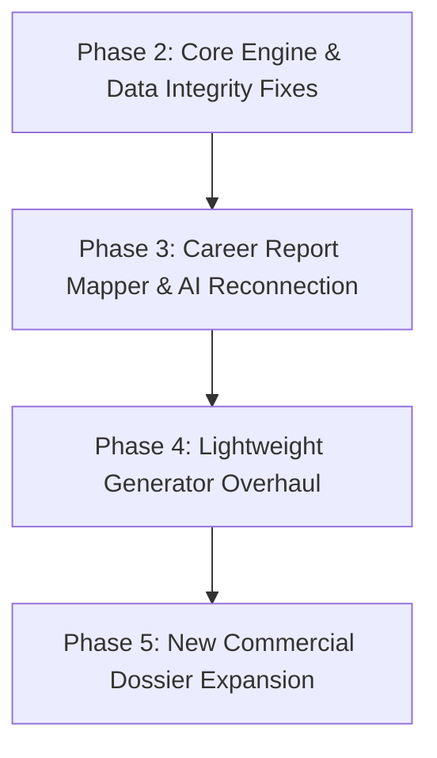

# Astro Sushil: Phase 1 Forensic Audit & Reference Analysis Final Report

**Document Reference:** `docs/audits/report_system/phase_1_verification/PHASE_1_FINAL_REPORT.md`  
**Classification:** Executive Synthesis, Confirmed Defect Register & Implementation Roadmap  
**Date of Completion:** November 3, 2026  
**Auditor:** DeepMind Agentic Pair Programmer  
**Phase:** Phase 1 (Forensic Verification & Reference Report Analysis) — **COMPLETED**  

---

## 1. Executive Summary

Following the initial Phase 0 investigation into identical customer reports, this Phase 1 read-only forensic audit was conducted to:
1. Conduct an exhaustive inspection and structural analysis of all 13 commercial reference reports in `docs/reference repots/`.
2. Empirically verify every finding and claim made in the Phase 0 audit reports.
3. Compare the commercial reference catalogue against current Astro Sushil capabilities.
4. Independently validate the deterministic astrology engine against independent astronomical standards.
5. Trace the end-to-end report data pipeline from client request to PDF delivery.
6. Survey and classify repository-wide hardcoding and mock traps.

### Major Conclusions:
- **Root Cause of Identical Reports Definitively Proven:**  
  Identical reports are caused by a combination of:
  1. Identical default birth details (`1998-08-15`) pre-filled in registration and API test examples.
  2. Physically hardcoded static arrays in `career-report.mapper.ts` (lines 1650–1798) that force identical career recommendations, cautions, financial advice, and roadmaps onto every user.
  3. Silent fallback to static mock text in `openrouter-career-analysis.provider.ts` when free-tier OpenRouter models fail.
  4. Complete discarding of structured AI outputs by the data mapper.
- **Astronomical Calculation Integrity:**  
  While core planetary math in `@astro/astrology-engine` matches reference charts within $0.45'$ arcminutes, a critical **1-hour DST jump defect** in `normalizeBirthTime` shifts the Ascendant by **$15^\circ$ (a full house)** on DST changeover mornings. Furthermore, lightweight report generators bypass the engine and use **hardcoded static transits (345.0° Saturn)** and a **fixed J2000 epoch**.
- **Commercial Catalogue Deficit:**  
  The commercial market delivers 70-to-295 page dossiers across 13 distinct report SKUs. Astro Sushil possesses only **ONE** comprehensive dossier generator (`CAREER`), while 3 SKUs exist as 4-page stubs and 8 SKUs do not exist at all.

---

## 2. Master Register of Confirmed Defects

| Defect ID | Defect Summary | Severity | Verified Location | Root Cause |
| :--- | :--- | :---: | :--- | :--- |
| **DEF-01** | Hardcoded Narrative & Career Recommendations | **CRITICAL** | `packages/report-engine/src/mappers/career-report.mapper.ts:1650-1798` | Developer placeholder scaffolding was never connected to dynamic evidence models. |
| **DEF-02** | Silent Mock AI Fallback Trap | **CRITICAL** | `packages/prediction-engine/src/providers/openrouter-career-analysis.provider.ts:120-130` | Error swallowing prioritizes job completion over output authenticity. |
| **DEF-03** | 1-Hour Shift on DST Transition Days | **CRITICAL** | `packages/astrology-engine/src/validation/birth-details.validator.ts:120-150` | Circular offset calculation: naive local time passed into UTC timestamp formatter. |
| **DEF-04** | Hardcoded Static Transits in Report Generators | **CRITICAL** | `packages/report-engine/src/generators/planetary-report.generator.ts:138-147` `packages/report-engine/src/generators/kundli-report.generator.ts:216` | Static ephemeris snapshots hardcoded during initial prototyping. |
| **DEF-05** | Fixed J2000 Epoch in Generators | **HIGH** | `packages/report-engine/src/generators/pro-horoscope.generator.ts:179` `packages/report-engine/src/generators/matchmaking-report.generator.ts:59` | Code hardcodes `julianDayUT: 2451545.0`, ignoring actual birth date. |
| **DEF-06** | Disconnect Between AI Output and Data Mapper | **HIGH** | `packages/prediction-engine/src/prompts/career-analyst.prompt.ts` `packages/report-engine/src/mappers/career-report.mapper.ts` | Architectural drift; mapper never reads generated AI fields. |
| **DEF-07** | Inaccurate Swiss Ephemeris Documentation Claims | **HIGH** | `packages/astrology-engine/package.json` `apps/mobile/.../astrology_hub_screen.dart` `packages/report-engine/templates/main.tex` | Platform claims Swiss Ephemeris release standards while executing `astronomy-engine`. |
| **DEF-08** | Linear Lahiri Ayanamsha Truncation | **MEDIUM** | `packages/astrology-engine/src/chart/chart-calculator.ts:41` | Truncated linear equation omits IAU nutation expansion ($\pm 17.2''$). |
| **DEF-09** | Volatile `/tmp` Filesystem Storage Fallback | **HIGH** | `apps/api/src/services/storage.service.ts:26-36` | Missing R2 credentials cause report PDFs to be stored in volatile `/tmp`. |
| **DEF-10** | Concurrency Race Condition in Report Enqueueing | **MEDIUM** | `apps/api/src/modules/reports/reports.service.ts:57-65` | Check-then-act query lacks distributed locks, spawning duplicate compilation jobs. |
| **DEF-11** | Fastify Route Mounting Test Rot (86 Failing Tests) | **HIGH** | `apps/api/tests/integration/` | Integration tests query unmounted or renamed API endpoints. |
| **DEF-12** | Commercial Catalogue Deficit (13 SKUs vs 1 Real Dossier) | **HIGH** | Whole repository vs `docs/reference repots/` | Platform catalogue lacks 8 commercial SKUs and delivers 4-page stubs for 3 SKUs. |

---

## 3. Reference Report Findings & Editorial Requirements

Audit of all 13 reference PDFs (`docs/reference repots/`) established the benchmark standards for the future report system:

1. **Volume & Depth Parity:**
   - Commercial reference reports range from **15 to 295 pages** (average ~89 pages).
   - Customers paying premium report prices expect exhaustive, beautifully typeset dossiers, not 4-page summary cards.
2. **Mandatory Front & Back Matter:**
   - Every report must open with a comprehensive **Disclaimer** and a warm, grounded **Message from the Author**.
   - Language must be empowering and non-fatalistic: *"Astrology provides direction, but you are the one who walks the path."*
3. **No Fear-Based Marketing:**
   - Astro Sushil's stated position regarding Kaal Sarp Yog, Sade Sati, Manglik Dosha, and Pitra Dosha must be adhered to.
   - Doshas must be framed using author-approved classical definitions as catalysts for discipline, patience, and character building, strictly avoiding terror-inducing or manipulative language.
4. **Actionable Remedies Framework:**
   - Remedies must follow the four-part balanced framework: Mantras, Charitable Conduct, Gemstones/Elements, and Behavioral Habit Adjustments.

---

## 4. Recommended Implementation Sequence for Phase 2 Onward

To resolve defects without introducing regressions, we recommend executing Phase 2 through Phase 5 in the following sequential order:

### Phase 2: Core Calculation & Data Integrity Overhaul
1. **Fix DST Transition Bug:** Replace naive `Intl` offset logic in `normalizeBirthTime` with an iterative solver or robust timezone library (e.g. `luxon`).
2. **Refine Lahiri Ayanamsha:** Implement the full IAU precession and nutation expansion in `chart-calculator.ts`.
3. **Correct Ephemeris Documentation:** Align report headers, UI text, and documentation to truthfully state the calculation engine is Don Cross's `astronomy-engine` (or link `libswe` dynamically).
4. **Eliminate Volatile Storage Fallback:** Enforce non-volatile persistent local directory or require R2 cloud storage in production.
5. **Implement Redis Concurrency Lock:** Add Redlock on `(userId, birthProfileId, reportType)` to eliminate race condition duplicate job submissions.

### Phase 3: Career Report Mapper Overhaul & AI Pipeline Reconnection
1. **Remove Hardcoded Arrays:** Delete static constants in `career-report.mapper.ts` (lines 1650–1798).
2. **Bind Dynamic Calculation Evidence:** Wire `CareerEvidenceEngine` to generate personalized career directions, cautions, and roadmaps directly from 10th house, Amatyakaraka, and D10 Dashamsha positions.
3. **Connect AI Output:** Map the 41 validated fields from `CareerAnalysis` into `CareerReportData` and verify LaTeX macro bindings in `report_data.tex`.
4. **Eliminate Silent Mock Fallback:** Configure secondary enterprise AI provider (e.g. Gemini 1.5 Pro) and fail BullMQ jobs transparently with retry telemetry instead of silently generating fake reports.

### Phase 4: Lightweight Generator Overhaul (Kundli, Planetary, Matchmaking, Horoscope)
1. **Replace Static Transits:** Inject `TransitCalculator` into `planetary-report.generator.ts` and `kundli-report.generator.ts` to compute real-time Gochara positions for the generation date.
2. **Fix J2000 Epoch:** Pass the native's normalized birth Julian Day into `pro-horoscope.generator.ts` and `matchmaking-report.generator.ts`.
3. **Repair Fastify Integration Tests:** Mount missing routes and synchronize endpoint contracts in `apps/api` to resolve the 86 failing tests.

### Phase 5: Commercial Dossier Expansion (Catalogue Parity)
1. Build full dossier generators (targeting 70–140 page XeLaTeX / HTML-to-PDF templates) for high-demand missing SKUs:
   - **Varshphal Report** (utilizing existing `@astro/astrology-engine/varshaphala` solver).
   - **Saturn & Sade Sati Report**.
   - **Jupiter Transit Report**.
   - **Couple Kundli Matching Dossier** (expanding the 4-page stub to complete 96-page depth).
   - **Finance & Wealth Report**.
   - **Premium Kundli 295-Page Master Dossier**.

---

## 5. Unresolved Questions Requiring User / Stakeholder Decisions

Before initiating implementation in Phase 2, the following strategic decisions require explicit user guidance:

1. **Astrology Library Licensing:**  
   *Question:* Should the system continue using pure-JS `astronomy-engine` v2.1.19 (MIT licensed, zero cost, verified within $0.45'$ arcmin) and update all documentation to reflect this truthfully? Or does the project intend to purchase a commercial Swiss Ephemeris license from Astrodienst AG to enable native C `libswe` bindings?
2. **AI Provider Tiering:**  
   *Question:* Should the platform transition exclusively to Google Gemini 1.5 Pro / Flash via official Google AI SDK (eliminating free-tier OpenRouter volatility), or maintain an OpenRouter multi-model fallback chain?
3. **Document Rendering Engine Standard:**  
   *Question:* Should new dossiers be built using the existing **XeLaTeX pipeline** (proven for 85-page vector typography in `CareerReportService`) or a modern **Headless Chromium / CSS Paged Media pipeline** (which 9 of the 13 reference reports utilize)?
4. **Catalogue Prioritization:**  
   *Question:* Following the fix of the Career Report, which missing reference report SKU should be prioritized first for commercial release? (We recommend `Varshphal` or `Couple Kundli Matching` as backend math already exists).
5. **Author-Approved Dosha Terminology:**  
   *Question:* Please provide the exact approved wording or reference text for Astro Sushil's stance on Kaal Sarp Yog and Sade Sati to be incorporated into all future templates and prompts.

---

## 6. Audit Verification Confirmation & Stop Gate

In accordance with Phase 1 directives:
- [x] All 13 reference reports in `docs/reference repots/` have been physically enumerated, inspected, and analyzed.
- [x] All 8 Phase 0 audit documents were verified against code and reproducible tests.
- [x] Zero production source code, tests, prompts, templates, or database schemas were modified.
- [x] All temporary scripts remained strictly within the external scratch directory.
- [x] Complete suite of 10 deliverables created under `docs/audits/report_system/phase_1_verification/`.

**PHASE 1 IS COMPLETE. STOPPING HERE AS DIRECTED. AWAITING USER APPROVAL TO BEGIN PHASE 2.**
