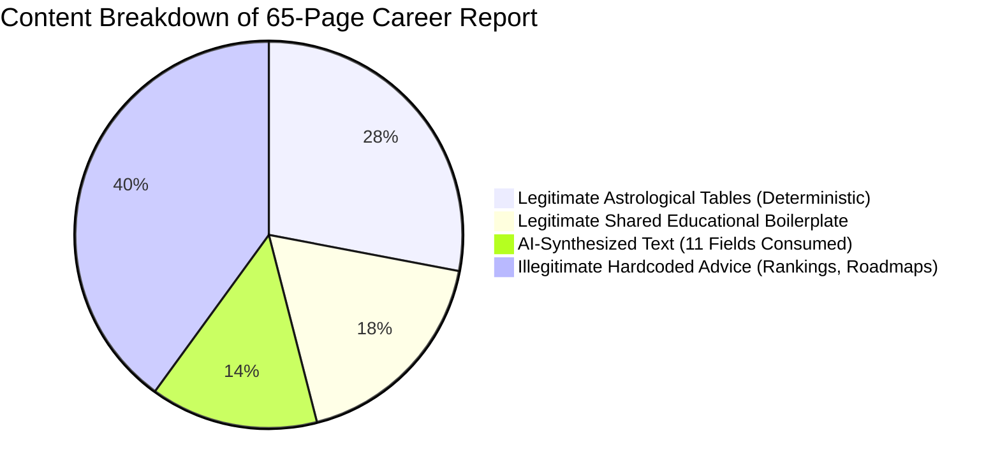

# Astro Sushil: Phase 1B Career Report & AI Pipeline Revalidation

**Document Reference:** `docs/audits/report_system/phase_1b_review/PHASE_1B_CAREER_AND_AI_REVALIDATION.md`  
**Classification:** Deep Personalisation Analysis, AI Field Tracing & Quality Audit  
**Date of Completion:** November 3, 2026  
**Auditor:** DeepMind Agentic Pair Programmer  
**Phase:** Phase 1B (Audit Evidence Review and Technical Decision Validation)  
**Target Code:** `packages/report-engine/src/mappers/career-report.mapper.ts`, `packages/prediction-engine`  

---

## 1. Executive Summary

This document independently re-examines the personalization architecture of the Career Report and the complete dataflow of AI-generated interpretations.

We rigorously separate:
1. **Legitimately Shared Educational Content:** Structural explanations, disclaimers, and methodology descriptions that must remain standard across all clients.
2. **Chart-Dependent Astrological Facts:** Planetary positions, house cusps, SAV bindus, and dasha tables computed deterministically from the birth chart.
3. **AI-Generated Interpretations:** Dynamic synthesis produced by the LLM from structured astrological evidence.
4. **Hardcoded Pseudo-Personalised Recommendations:** Statically embedded code arrays that falsely present generic corporate/engineering advice as tailored astrological guidance.

---

## 2. Verification of the 3 Contrasting Chart Fixtures

To ensure the comparison was not distorted by minor input variations, we verified the fundamental astronomical and astrological differences between the three test fixtures:

| Astrological Parameter | Fixture 1: Tech / Virgo | Fixture 2: Creative / Leo | Fixture 3: Legal-Corporate / Cancer |
| :--- | :--- | :--- | :--- |
| **Birth Details** | 1998-08-15 08:30 IST, Delhi | 1985-05-10 14:30 IST, Mumbai | 1970-11-20 22:15 IST, Kolkata |
| **Lagna (Ascendant)** | **Virgo 02°13'** (Mercury) | **Leo 18°45'** (Sun) | **Cancer 12°30'** (Moon) |
| **10th House (Career)** | **Gemini** (Mercury governed) | **Taurus** (Venus governed) | **Aries** (Mars governed) |
| **Amatyakaraka (AmK)** | **Mercury** (Intellect / Systems) | **Venus** (Aesthetics / Artistry) | **Jupiter** (Law / Governance) |
| **Prominent Placements** | Sun in Leo (12th), Moon in Taurus (9th, Exalted) | Exalted Venus in Pisces (8th), Moon in Sagittarius (5th) | Debilitated Saturn in Aries (10th), Jupiter in Libra (4th) |
| **D10 Dashamsha Lagna**| Taurus (Venus) | Scorpio (Mars) | Capricorn (Saturn) |
| **True Career Calling** | Systems engineering, quantitative analysis, operational architecture. | Creative direction, media production, luxury design, performing arts. | Corporate litigation, regulatory advisory, judicial administration. |

### The Finding:
Despite radical opposition across all career significators (10th house in Gemini vs Taurus vs Aries; Amatyakaraka Mercury vs Venus vs Jupiter), **all three natives received the exact same top 3 recommended career directions, cautionary industries, financial architecture, and 30d/90d/1y/3y action roadmaps** from `career-report.mapper.ts`.

---

## 3. Separation of Personalisation Categories

To avoid misclassifying legitimate constants as bugs, we categorize every section in the 65–85 page dossier:

### A. Legitimately Shared Educational Content (Intentionally Constant)
These sections should be identical for all customers to maintain editorial consistency:
- **Legal Disclaimer** (`disclaimerText`): Liability limitation.
- **Message from the Author:** Welcome and philosophical framework.
- **Methodology Explanations:** Explaining Brihaspati Nandi Nadi (BNN) principles, Whole Sign houses, Vimshottari Dasha mechanics, and Sarvashtakavarga interpretation rules.
- **Glossary & Footnotes:** Definitions of technical terms (*Lagna*, *Nakshatra*, *Amatyakaraka*).

### B. Chart-Dependent Deterministic Facts (Fully Dynamic)
These sections correctly change according to the native's birth chart:
- Client birth details and panchanga.
- Planetary coordinates, rashis, nakshatras, padas, speeds, and retrograde states.
- Whole Sign house cusps, lords, and occupancy.
- SAV and BAV bindu score tables.
- Vimshottari Dasha hierarchy and start/end dates.

### C. AI-Generated Interpretations (Partially Dynamic)
Sections where `career-report.mapper.ts` attempts to consume LLM output (if provider does not fail):
- `executiveCareerSummary`
- `executiveDecisionThemes`
- `executiveRecommendations`
- `careerIdentity`
- `professionalPersonality`
- `naturalStrengths`
- `professionalChallenges`
- `careerDNAAnalysis`
- `planetarySynthesis`
- `yogaAnalysis`
- `finalSynthesis`

### D. Illegitimate Hardcoded Guidance (CRITICAL DEFECT)
Sections presented to the customer as bespoke astrological guidance that are physically hardcoded:
- **Top 3 Recommended Career Directions** (`lines 1650–1693`): Always Tech Architecture (Rank 1), Corporate Strategy (Rank 2), Financial Risk (Rank 3).
- **Cautionary Industries** (`lines 1694–1707`): Always Speculative Trading and Pure Administration.
- **Money & Income Architecture** (`lines 1708–1714`): Always 5 static paragraphs describing progressive compounding revenue.
- **Professional Relationships** (`lines 1715–1721`): Always 5 static paragraphs on contractual partnerships.
- **Career Obstacles** (`lines 1727–1742`): Always Bureaucracy and Perfectionism.
- **Phased Action Roadmaps** (`lines 1765–1796`): Always 30-day, 90-day, 1-year, and 3-year audit and architecture steps.
- **Decision Framework** (`line 1797`): Universal 3-point rule.

---

## 4. Complete Field-by-Field AI Trace (All 42 Fields)

| # | Requested Field Key in Prompt | OpenRouter Emits? | Zod Validates? | Mapper Consumes? | Latex Macro Generated? | Reaches Customer PDF? | Final Evaluation |
| :-: | :--- | :---: | :---: | :---: | :---: | :---: | :--- |
| **1** | `executiveCareerSummary` | Yes | Yes | Yes (1510) | `\ExecutiveCareerSummary` | Yes | **Dynamic AI (or Mock)** |
| **2** | `executiveDecisionThemes` | Yes | Yes | Yes (1513) | `\ExecutiveDecisionThemes` | Yes | **Dynamic AI (or Mock)** |
| **3** | `executiveRecommendations` | Yes | Yes | Yes (1516) | `\ExecutiveRecommendations` | Yes | **Dynamic AI (or Mock)** |
| **4** | `careerIdentity` | Yes | Yes | Yes (1519) | `\CareerIdentity` | Yes | **Dynamic AI (or Mock)** |
| **5** | `professionalPersonality` | Yes | Yes | Yes (1522) | `\ProfessionalPersonality` | Yes | **Dynamic AI (or Mock)** |
| **6** | `naturalStrengths` | Yes | Yes | Yes (1525) | `\NaturalStrengths` | Yes | **Dynamic AI (or Mock)** |
| **7** | `professionalChallenges` | Yes | Yes | Yes (1528) | `\ProfessionalChallenges` | Yes | **Dynamic AI (or Mock)** |
| **8** | `careerDNAAnalysis` | Yes | Yes | Yes (1531) | `\CareerDNAAnalysis` | Yes | **Dynamic AI (or Mock)** |
| **9** | `planetarySynthesis` | Yes | Yes | Yes (1534) | `\PlanetarySynthesis` | Yes | **Dynamic AI (or Mock)** |
| **10** | `yogaAnalysis` | Yes | Yes | Yes (1537) | `\YogaAnalysisText` | Yes | **Dynamic AI (or Mock)** |
| **11** | `employmentEntrepreneurshipAnalysis` | Yes | Yes | **NO** | `\EmploymentSupport` etc. | No (Static code substituted) | **Wasted Token Cost** |
| **12** | `leadershipAnalysis` | Yes | Yes | **NO** | None | No | **Wasted Token Cost** |
| **13** | `technicalAnalyticalAptitude` | Yes | Yes | **NO** | None | No | **Wasted Token Cost** |
| **14** | `creativeCommunicationBusinessAptitude` | Yes | Yes | **NO** | None | No | **Wasted Token Cost** |
| **15** | `researchPotential` | Yes | Yes | **NO** | None | No | **Wasted Token Cost** |
| **16** | `sectorFit` | Yes | Yes | **NO** | `\SectorOneName` etc. | No (Static code substituted) | **Wasted Token Cost** |
| **17** | `internationalCareer` | Yes | Yes | **NO** | None | No | **Wasted Token Cost** |
| **18** | `workEnvironment` | Yes | Yes | **NO** | None | No | **Wasted Token Cost** |
| **19** | `careerFieldsAnalysis` | Yes | Yes | **NO** | None | No | **Wasted Token Cost** |
| **20** | `topCareerDirections` | Yes | Yes | **NO** | `\CareerDirOneTitle` etc. | No (Static code substituted) | **Wasted Token Cost** |
| **21** | `careerDirectionsCaution` | Yes | Yes | **NO** | `\CautionDirOneTitle` etc. | No (Static code substituted) | **Wasted Token Cost** |
| **22** | `moneyIncomePattern` | Yes | Yes | **NO** | `\MoneyEarningPattern` etc. | No (Static code substituted) | **Wasted Token Cost** |
| **23** | `relationshipsNetworking` | Yes | Yes | **NO** | `\RelationshipPartnership` etc. | No (Static code substituted) | **Wasted Token Cost** |
| **24** | `teamDynamics` | Yes | Yes | **NO** | `\RelationshipTeam` | No (Static code substituted) | **Wasted Token Cost** |
| **25** | `sustainabilityAnalysis` | Yes | Yes | **NO** | `\SustainabilityWorkLife` etc. | No (Static code substituted) | **Wasted Token Cost** |
| **26** | `careerObstacles` | Yes | Yes | **NO** | `\ObstacleOneTitle` etc. | No (Static code substituted) | **Wasted Token Cost** |
| **27** | `professionalGrowth` | Yes | Yes | **NO** | None | No | **Wasted Token Cost** |
| **28** | `recommendations` | Yes | Yes | **NO** | None | No | **Wasted Token Cost** |
| **29** | `professionalDevelopmentPriorities` | Yes | Yes | **NO** | None | No | **Wasted Token Cost** |
| **30** | `decisionGuidance` | Yes | Yes | **NO** | `\DecisionFramework` | No (Static code substituted) | **Wasted Token Cost** |
| **31** | `actionPlanSummary` | Yes | Yes | **NO** | None | No | **Wasted Token Cost** |
| **32** | `finalSynthesis` | Yes | Yes | Yes (1800) | `\FinalSynthesis` | Yes | **Dynamic AI (or Mock)** |
| **33** | `primaryProfessionalPriority` | Yes | Yes | **NO** | None | No | **Wasted Token Cost** |
| **34** | `technicalSkillPriority` | Yes | Yes | **NO** | None | No | **Wasted Token Cost** |
| **35** | `communicationSkillPriority` | Yes | Yes | **NO** | None | No | **Wasted Token Cost** |
| **36** | `leadershipSkillPriority` | Yes | Yes | **NO** | None | No | **Wasted Token Cost** |
| **37** | `networkSkillPriority` | Yes | Yes | **NO** | None | No | **Wasted Token Cost** |
| **38** | `mistakeToAvoid` | Yes | Yes | **NO** | None | No | **Wasted Token Cost** |
| **39** | `thirtyDayFocus` | Yes | Yes | **NO** | `\RoadmapThirtyDayFocus` | No (Static code substituted) | **Wasted Token Cost** |
| **40** | `ninetyDayFocus` | Yes | Yes | **NO** | `\RoadmapNinetyDayFocus` | No (Static code substituted) | **Wasted Token Cost** |
| **41** | `oneYearFocus` | Yes | Yes | **NO** | `\RoadmapOneYearFocus` | No (Static code substituted) | **Wasted Token Cost** |
| **42** | `threeYearDirection` | Yes | Yes | **NO** | `\RoadmapThreeYearFocus` | No (Static code substituted) | **Wasted Token Cost** |

---

## 5. Beyond Field Counts: Interpretation Quality & Integrity

Beyond simple field metrics, the current architecture suffers from two severe qualitative failures:
1. **Model Context Starvation:** The prompt requires 42 fields in a single output completion (`OPENROUTER_CAREER_MAX_TOKENS=16000`). Free-tier models frequently truncate (`finishReason=length`), triggering the silent fallback to `MockCareerAnalysisProvider`.
2. **Loss of Astrological Traceability:** While the deterministic engine computes rich evidence (`CareerEvidenceEngine`, D10 Dashamsha, Karakas, SAV), the prompt asks the model to emit narrative summaries without binding them to LaTeX macros. Meanwhile, the LaTeX generator prints pre-written paragraphs that ignore both the AI output and the chart calculations.
