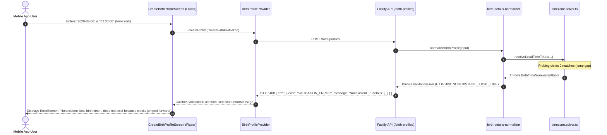
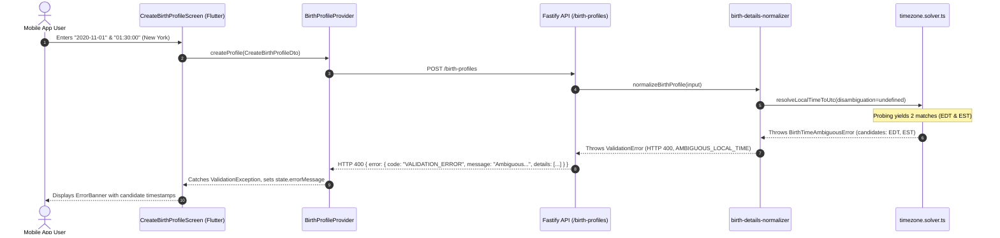

# PHASE 2A.1: API & MOBILE END-TO-END BEHAVIOR REVIEW

**Review Date:** 2026-11-03  
**Review Type:** Full Stack Dataflow & UX Trace  
**Audited Subsystems:** `@astro/astrology-engine` $\rightarrow$ `apps/api` $\rightarrow$ `apps/mobile`  

---

## 1. End-to-End Error Propagation Trace

### A. Nonexistent Local Time (Spring-Forward Gap)


#### User Actionability for Nonexistent Time:
- **Clarity:** The user is clearly notified that the clock time did not exist in physical reality.
- **Actionability:** The user can adjust their birth time to the confirmed hospital record (e.g. 01:59 or 03:01) and resubmit. The form input remains populated.

---

### B. Ambiguous Local Time (Autumn Fall-Back Window)


---

## 2. Two Critical Architecture Gaps Uncovered in Review

### Critical Gap 1: Missing Flutter Disambiguation Selector
- **Finding:** While the backend accepts `disambiguation: 'earlier' | 'later'` and returns clear candidates, the Flutter `CreateBirthProfileScreen` currently lacks a UI control (radio button, segmented switch, or modal dialog) allowing the user to select `'earlier'` or `'later'`.
- **User Impact:** A user born during an ambiguous fall-back hour in a DST jurisdiction will see the error banner explaining the ambiguity, but has no UI mechanism on the screen to submit their choice without modifying the minute/second to leave the ambiguous window.
- **Remediation for Phase 2B / Mobile:**
  1. Add optional `final String? disambiguation;` to `CreateBirthProfileDto`.
  2. When an `AMBIGUOUS_LOCAL_TIME` error response is received, render a conditional selection tile:
     - `○ Daylight Saving Time (First Pass, earlier UTC)`
     - `○ Standard Time (Second Pass, later UTC)`
  3. Include the selected value in the resubmitted DTO.

---

### Critical Gap 2: Profile Persistence & Retrieval Re-Normalization Flaw
- **Finding:** In PostgreSQL, the `BirthProfile` model persists only raw inputs (`dateOfBirth`, `timeOfBirth`, `timezone`, `latitude`, `longitude`), and does NOT have a column to store `disambiguation` (or the resolved `utcDateTime`).
- **Failure Flow:**
  1. If a client submits `disambiguation: 'earlier'`, `createProfile` succeeds and writes the record to PostgreSQL.
  2. Later, when the user opens the mobile app, `getUserProfiles()` or `getProfileById()` queries PostgreSQL and invokes:
     ```typescript
     normalizedDetails: normalizeBirthProfile({
       id: p.id,
       name: p.name,
       dateOfBirth: p.dateOfBirth,
       timeOfBirth: p.timeOfBirth,
       latitude: p.latitude,
       longitude: p.longitude,
       timezone: p.timezone,
       // disambiguation is not stored in DB, so it is undefined!
     })
     ```
  3. `normalizeBirthProfile` re-encounters the ambiguous time without `disambiguation` and **throws a 400 `ValidationError`**, crashing the user's profile listing!
  4. Similarly, background PDF report generation in `reports.service.ts` will fail to compile reports for ambiguous profiles.

- **Recommended Database Architecture Fix for Phase 2B:**
  1. Add `disambiguation String?` and `utcDateTime DateTime?` columns to the `BirthProfile` table in `schema.prisma`.
  2. Store the resolved UTC timestamp and disambiguation choice at creation time.
  3. When fetching or calculating charts, consume the persisted `utcDateTime` or `disambiguation` instead of performing unparameterized re-normalization.
