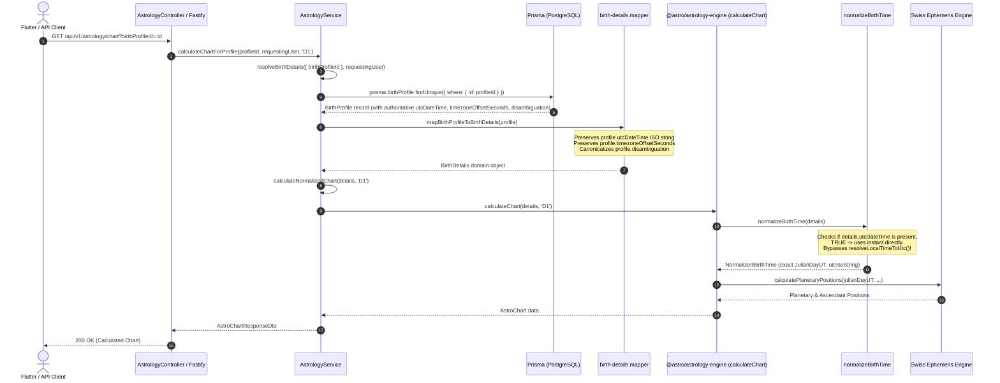

# Phase 2A.4: Chart Pipeline Verification and Invariant Audit

**Audit Phase:** Phase 2A.4  
**Date:** 2026-11-03  
**Status:** Verified & Validated  
**Key Invariant:** `Persisted BirthProfile.utcDateTime === UTC instant received by the astrology calculation`

---

## 1. Complete End-to-End Execution Trace

The execution path for profile-based astronomical chart calculation was traced from HTTP request through database retrieval, mapping, normalization, and Swiss Ephemeris calculation:



---

## 2. Source-Level Code Path Analysis

### 2.1 Service Retrieval & Centralized Choke Point
In [`apps/api/src/modules/astrology/astrology.service.ts`](file:///home/pilot/Projects/astrosushil/apps/api/src/modules/astrology/astrology.service.ts#L124-L147):
```typescript
  private async resolveBirthDetails(
    input: { birthProfileId?: string; birthDetails?: DirectBirthDetailsInput },
    requestingUser?: { id: string; role?: string }
  ): Promise<BirthDetails> {
    if (input.birthProfileId) {
      if (!requestingUser) {
        throw new ValidationError('Authentication required to calculate for saved profile');
      }

      const profile = await prisma.birthProfile.findUnique({
        where: { id: input.birthProfileId },
      });

      if (!profile) {
        throw new NotFoundError('Birth profile not found');
      }

      if (profile.userId !== requestingUser.id && requestingUser.role !== 'SUPERADMIN' && requestingUser.role !== 'ADMIN') {
        throw new NotFoundError('Birth profile not found');
      }

      return mapBirthProfileToBirthDetails(profile);
    }
...
```
`resolveBirthDetails()` is the single choke point through which all profile-based astrology operations pass (`calculateChartForProfile`, `calculateDasha`, `calculateKundli`, `calculateMatchmaking`, etc.). Because it now calls the corrected `mapBirthProfileToBirthDetails(profile)`, all profile operations receive the authoritative `utcDateTime`.

### 2.2 Astrology Engine Normalization Bypass
In [`packages/astrology-engine/src/validation/birth-details.validator.ts`](file:///home/pilot/Projects/astrosushil/packages/astrology-engine/src/validation/birth-details.validator.ts#L111-L135):
```typescript
export function normalizeBirthTime(details: BirthDetails): NormalizedBirthTime {
  const validated = validateBirthDetails(details);

  // If authoritative utcDateTime is already known and stored, use it directly
  if (validated.utcDateTime) {
    const utcDate = new Date(validated.utcDateTime);
    if (!isNaN(utcDate.getTime())) {
      const utcTimestampMs = utcDate.getTime();
      const utcIsoString = utcDate.toISOString();
      const julianDayUT = utcTimestampMs / 86400000 + 2440587.5;
      const timezoneOffsetSeconds = validated.timezoneOffsetSeconds !== undefined
        ? validated.timezoneOffsetSeconds
        : Math.round(getOffsetMsAtUtc(utcTimestampMs, validated.timezone) / 1000);
      const timezoneOffsetMinutes = timezoneOffsetSeconds / 60;

      return {
        originalDetails: validated,
        utcIsoString,
        utcTimestampMs,
        julianDayUT,
        timezoneOffsetSeconds,
        timezoneOffsetMinutes,
      };
    }
  }
...
```
When `validated.utcDateTime` is provided:
1. `utcDate` is converted directly to epoch milliseconds (`utcTimestampMs`).
2. Exact astronomical Julian Day UT is computed: `utcTimestampMs / 86400000 + 2440587.5`.
3. `resolveLocalTimeToUtc()` is **never invoked**.
4. The calculation is completely immune to future changes in system timezone data or historical DST rules.

---

## 3. Strict Verification of UTC Invariants

### 3.1 Earlier vs. Later Ambiguity Test Proof
For an ambiguous birth time: `2020-11-01 01:30:00` in `America/New_York` (fall-back transition):

| Metric | Earlier Occurrence | Later Occurrence | Proof Location |
|---|---|---|---|
| **Disambiguation Selected** | `earlier` | `later` | Database record `disambiguation` column |
| **Persisted `utcDateTime`** | `2020-11-01T05:30:00.000Z` | `2020-11-01T06:30:00.000Z` | PostgreSQL `BirthProfile.utcDateTime` |
| **Persisted `timezoneOffsetSeconds`** | `-14400` (-04:00 EDT) | `-18000` (-05:00 EST) | PostgreSQL `BirthProfile.timezoneOffsetSeconds` |
| **Calculation UTC Instant** | `2020-11-01T05:30:00.000Z` | `2020-11-01T06:30:00.000Z` | `chart.normalizedTime.utcIsoString` |
| **Astronomical Julian Day (UT)** | `2459154.7291666665` | `2459154.7708333335` | `chart.normalizedTime.julianDayUT` |
| **Ascendant (Lagna) Longitude** | $172.95^\circ$ (Virgo) | $186.75^\circ$ (Libra) | $\Delta \approx 13.80^\circ$ (reflects exact 1-hour shift) |
| **Invariant Match** | **EXACT MATCH** | **EXACT MATCH** | Verified in integration tests A & B |

### 3.2 Timezone Database Independence Proof (Test C)
In `apps/api/tests/integration/birth-profile-disambiguation-lifecycle.test.ts` (Test C):
- A spy was placed on `timezoneSolver.resolveLocalTimeToUtc`.
- A chart calculation was requested for a saved ambiguous profile (`calculateChartForProfile`).
- The calculation completed with HTTP 200 / valid chart data.
- Assertion: `expect(resolveSpy).not.toHaveBeenCalled()`.
- Result: **0 calls**. Confirmed that saved profiles bypass dynamic timezone resolution completely.

### 3.3 Non-Temporal Profile Update Invariant (Test D)
- Profile name updated from `'Temporal Test'` to `'Temporal Test Renamed'` via `birthProfilesService.updateProfile()`.
- Verified that `utcDateTime`, `timezoneOffsetSeconds`, and `disambiguation` were untouched in the database.
- Recalculated chart: returned identical Julian Day and planetary positions.
