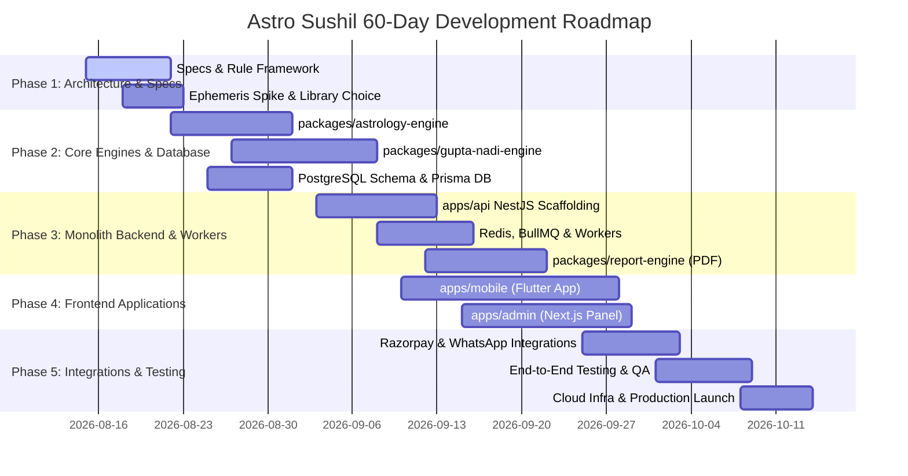

# 60-Day Development Roadmap & Work Breakdown - Astro Sushil

This document outlines the 60-day execution plan for developing and deploying the **Astro Sushil** platform with a team of two developers.

---

## 1. Project Timeline & Phase Breakdown

---

## 2. Detailed Sprints & Deliverables

### Days 1–7: Phase 1 — Specification, Architecture & Ephemeris Spike
- Finalize client rules and requirements (`docs/client-questions.md`).
- Conduct ephemeris library spike (verify Swiss Ephemeris vs Astronomy Engine licenses and accuracy).
- Establish monorepo repository structure and package boundary standards.

### Days 8–20: Phase 2 — Core Engine Package Development
- Build `packages/astrology-engine` (Planetary positions, Ascendant, Vargas, Vimshottari Dashas).
- Build `packages/gupta-nadi-engine` (Directional combination matrix, BNN rule matchers, transit overlays).
- Create PostgreSQL database schemas with Prisma ORM.
- Write 100+ unit tests against verified reference birth charts.

### Days 21–35: Phase 3 — Backend API & Background Workers
- Build `apps/api` NestJS modular application core (Auth, User Profiles, Astrology controllers).
- Integrate Redis + BullMQ asynchronous queue system.
- Build `packages/report-engine` (HTML/CSS Handlebars templates, Puppeteer PDF rendering).
- Integrate LLM Explanation service layer (OpenAI/Anthropic API integration for prose generation).

### Days 30–48: Phase 4 — Client Applications (Flutter Mobile & Next.js Admin)
- **Flutter App**: Auth screens, birth data entry, North/South Indian Kundli chart rendering, basic free utilities, report purchasing UI.
- **Next.js Admin Panel**: Admin authentication, dashboard analytics, user list, order queue monitoring, BNN rule viewer/editor.

### Days 45–55: Phase 5 — External Integrations & E2E Testing
- Integrate Razorpay SDK & backend webhook signature verification.
- Integrate Meta WhatsApp Business API for automated PDF delivery.
- Integrate Firebase Cloud Messaging (FCM) for mobile push notifications.
- Execute full E2E test suites (Payment -> Job Queue -> PDF Generation -> WhatsApp Delivery).

### Days 56–60: Phase 6 — Infrastructure Hardening, QA & Production Launch
- Dockerize all services and build CI/CD pipelines (GitHub Actions).
- Deploy PostgreSQL, Redis, NestJS API, Workers, and Next.js Admin to Cloud infrastructure.
- Complete security audit, rate-limiting verification, and load testing.
- Launch Astro Sushil MVP to Production.

---

## 3. Team Member Division of Responsibilities

### Developer 1 (Primary Lead Developer)
**Primary Focus**: System Architecture, Calculation Engines, Backend Infrastructure, Core Business Logic.

**Responsibilities**:
- Project architecture oversight & monorepo structure.
- Implementation of `packages/astrology-engine` and calculation accuracy validation.
- Implementation of `packages/gupta-nadi-engine` (BNN rule engine architecture & priority resolution).
- Backend API foundation (`apps/api`), NestJS module architecture, and database design.
- Async queue infrastructure (Redis, BullMQ, Background Workers).
- Cloud deployment, Dockerization, CI/CD pipelines, and infrastructure setup.
- Pull request code review and security audits.

### Developer 2 (Second Developer)
**Primary Focus**: Mobile UI (Flutter), Admin Web UI (Next.js), Integrations, Rule Encoding & QA.

**Responsibilities**:
- Development of `apps/mobile` (Flutter app UI, Kundli graphic rendering, state management, state flows).
- Development of `apps/admin` (Next.js admin portal, dashboards, tables, rule configuration views).
- Mobile & Admin API integration with backend endpoints.
- Encoding individual BNN rules into structured JSON format under Developer 1 supervision.
- Unit and integration testing for UI components and API endpoints.
- Documentation updates and Quality Assurance (QA) testing.
