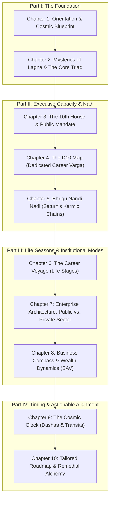

# Career Report Narrative Architecture: The Consultation Monograph

**Document ID:** `CAREER_REPORT_NARRATIVE_ARCHITECTURE`  
**Phase:** Phase 1 Deliverable B  
**Status:** COMPLETE & AUTHORIZED FOR EDITORIAL REBUILD  
**Target:** Career Intelligence Report (Pilot Monograph)  
**Reference Benchmark:** `Career Report(3).pdf` (138 pages, Astro Arun Pandit)

---

## 1. Editorial Vision & Thematic Arc

A premier career consultation monograph cannot be structured as an isolated database dump of houses 1 through 12 and planets 1 through 9. Instead, it must follow an **empowering, deconstructive narrative arc**—taking the reader on a logical journey from foundational self-awareness to executive execution, long-term cycles, and grounded practical remedies.

---

## 2. Complete Chapter Breakdown & Synthesis Strategy

### Chapter 1: Orientation, Methodology & Cosmic Blueprint
- **Editorial Intent:** Ground the client, remove fatalistic anxiety, introduce the navigational philosophy of Vedic astrology, and explain how to study the consultation monograph.
- **Key Themes:**
  - Welcome and consultative purpose.
  - Ethical disclaimer and non-fatalistic principles (*Purushartha* vs *Prarabdha*).
  - The three-read study guide (initial reading for clarity, second reading for temporal reflection, third reading for strategic planning).
  - Verified birth chart register: astronomical timestamps, geodetic coordinates, ayanamsa, and full-page D1 Rashi and D10 Dashamsha vector charts.
- **Transition to Next Chapter:** *"With the cosmic coordinates established and the foundational charts mapped, we now enter your birth chart's inner sanctum to decode the primary compass of your professional identity: your Ascendant."*

### Chapter 2: Mysteries of Lagna & The Core Triad
- **Editorial Intent:** Analyze the client’s core psychological constitution, professional demeanor, and fundamental life drivers.
- **Key Themes:**
  - **The Ascendant (Lagna):** Core temperament, physical vitality, executive demeanor, and public brand.
  - **The Lagna Lord (Lagnesh):** Where personal willpower and drive are naturally invested (house, sign, dignity, nakshatra).
  - **The Core Astrological Triad:** Synthesizing Lagna (physical identity), Moon (cognitive fortitude and emotional processing), and Sun (internal sovereignty and soul purpose).
  - Supporting planets occupying or aspecting the 1st house.
- **Transition to Next Chapter:** *"Understanding your inherent constitutional nature is the prerequisite to career mastery. Now, we direct our attention to the highest point in your sky: the 10th house of career, authority, and public legacy."*

### Chapter 3: The 10th House: Karmic Zenith & Professional Mandate
- **Editorial Intent:** Deconstruct the client's direct career house, authority relationships, and executive capacity.
- **Key Themes:**
  - The 10th House (*Karma Bhava*): Ruling sign, elemental quality, and governing domain.
  - The 10th Lord (*Karmesh*): Placement, dignity, and where vocational agency flows (e.g., in the 2nd house linking career directly to wealth, speech, and value creation).
  - Empty vs. Occupied 10th House: Explaining why an empty house provides broad adaptability rather than weakness.
  - Aspectual Geometry (*Drishti*): Benefic and malefic rays reaching the 10th house (e.g., Jupiter's protective aspect vs. Saturn's structuring gaze).
- **Transition to Next Chapter:** *"While the natal birth chart reveals your macro-life potential, classical Vedic astrology provides a microscopic lens dedicated exclusively to career execution: the Dashamsha (D10) divisional chart."*

### Chapter 4: The D10 Map: Navigating Professional Heights
- **Editorial Intent:** Provide a fine-grained analysis of the dedicated professional divisional chart (Dashamsha / D10).
- **Key Themes:**
  - D10 Ascendant (*Swabhava* at work): How the client presents themselves in corporate or institutional settings.
  - D10 10th House & 10th Lord: Ultimate pinnacle of achievement and institutional recognition.
  - D10 6th House (Daily work routines, problem-solving, handling subordinates) and 7th House (Corporate partnerships, client contracts, negotiations).
  - High-impact D10 planetary placements (e.g., Sun and Saturn dynamics in D10).
  - D1 $\leftrightarrow$ D10 Synthesis: Reconciling potential tensions between foundational desires (D1) and institutional execution (D10).
- **Transition to Next Chapter:** *"Having mapped the structural hierarchies of the D10, we now examine the ancient system of Bhrigu Nandi Nadi to observe how the great taskmaster, Saturn, orchestrates your career progression."*

### Chapter 5: Bhrigu Nandi Nadi: Saturn's Karmic Progression
- **Editorial Intent:** Uncover career progression patterns and life lessons using the classical Nadi technique of planetary degree sequences.
- **Key Themes:**
  - Saturn as *Karma Karaka*: Shani's role as the supreme governor of labor, duty, and endurance.
  - Natal Saturn Placement: Sign, house, dignity (e.g., Swati nakshatra, Libra exaltation in 12th house).
  - Planetary Degree Chains: The sequential order of planets ahead of Saturn in the zodiac wheel (Saturn moving toward Sun, Mercury, or Mars).
  - Karmic Maturation: How early career delays convert into unshakeable domain authority after Saturn's maturity.
- **Transition to Next Chapter:** *"Karmic progression unfolds through tangible life seasons. In our next chapter, we chart the complete voyage of your career across each major phase of your professional life."*

### Chapter 6: The Career Voyage: Life Seasons & Milestones
- **Editorial Intent:** Present a longitudinal life-stage narrative tracing the client's professional arc from beginnings to legacy.
- **Key Themes:**
  - **Setting Sail (Early Education & Beginnings):** 5th house intelligence, learning style, and academic orientation.
  - **Climbing the Mast (First Earnings & Early Career):** 12th/2nd house activations, entry into the workforce, and early mentor support.
  - **Stormy Seas (Navigating Setbacks & Politics):** 6th and 8th house pressure points, handling demanding leadership, burnout prevention.
  - **Changing Course (Strategic Pivots & Transitions):** 8th house transformations, switching sectors or business models.
  - **Anchoring Down (Long-Term Stability & Legacy):** 3rd and 9th house self-effort, mentorship of younger peers, and enduring reputation.
- **Transition to Next Chapter:** *"With the stages of your voyage clear, we now evaluate the institutional arena best suited for your skills: government service, corporate leadership, or independent enterprise."*

### Chapter 7: Enterprise Architecture: Government vs. Private Sector
- **Editorial Intent:** Resolve the fundamental dilemma between civil/state authority and private corporate enterprise.
- **Key Themes:**
  - The Sun as Sovereign Karaka: Capacity for government favor, policy leadership, and civil authority.
  - Saturn as Bureaucratic Karaka: Systemic public administration and organizational service.
  - The Sun-Saturn Dynamic: Harmony or tension between executive autonomy and institutional protocol.
  - Rajya Seva Yogas: Verification of classical administrative alignments (Budha-Aditya, Gajakesari, Kendra-Trikona yogas).
  - Optimal Arena Determination: Clear assessment of where the client's natural abilities face least resistance and highest reward.
- **Transition to Next Chapter:** *"If independence and commerce beckon, your chart holds a specific business compass that governs partnerships, market timing, and capital accumulation."*

### Chapter 8: Business Compass & Wealth Dynamics (SAV Analysis)
- **Editorial Intent:** Analyze commercial acumen, business partnership dynamics, and quantitative work-to-wealth ratios.
- **Key Themes:**
  - **The Business Compass:** The triad of Sun (leadership), Mercury (commercial logic), and Venus (client appeal/value).
  - **The 7th House Axis:** Joint ventures, contract negotiation, dealing with foreign partners, and Rahu's influence.
  - **Sarvashtakavarga (SAV) Work-to-Reward Ratio:**
    - 6th House vs. 7th House SAV: Employment stability vs. entrepreneurial risk.
    - 11th House vs. 10th House SAV: Work-to-reward proportionality (whether gains naturally exceed effort).
  - Cash flow sustainability, debt avoidance, and long-term asset accumulation.
- **Transition to Next Chapter:** *"Strategic potential requires divine timing. In the Cosmic Clock, we analyze the planetary periods and active transits that govern your immediate and upcoming career horizons."*

### Chapter 9: The Cosmic Clock: Dasha Cycles & Transits
- **Editorial Intent:** Time specific professional opportunities, transitions, and consolidation phases.
- **Key Themes:**
  - **Active Vimshottari Mahadasha & Antardasha:** The current planetary boss overseeing career themes.
  - **The Present Hour (Active Transits):**
    - Saturn's current transit (Kantak Shani / Ashtama Shani / Sade Sati impact).
    - Jupiter's transit through wealth and career houses.
    - The Rahu-Ketu nodal axis shifting professional priorities.
  - **Future Horizons (Upcoming 3-Year Transit Windows):** Upcoming shifts, preparation requirements, and opportunity windows.
- **Transition to Next Chapter:** *"Understanding the cosmic forecast empowers us to take deliberate action. In our final chapter, we synthesize your entire chart into an actionable strategic roadmap supported by classical Vedic remedies."*

### Chapter 10: Tailored Roadmap & Remedial Alchemy
- **Editorial Intent:** Provide a clear, actionable career blueprint and ethical Vedic remedies to strengthen supportive planetary energies.
- **Key Themes:**
  - **Soul Mandate & Operational Drive:** Jaimini Atmakaraka (soul purpose) and Amatyakaraka (career execution).
  - **Top 3–5 Recommended Vocational Sectors:** Specifically identified industries matching chart signatures.
  - **30-Day, 90-Day, 1-Year, and 3-Year Strategic Action Milestones.**
  - **Ethical Vedic Remedies:**
    - Gemstone guidance (e.g. Emerald/Panna for 11th lord Mercury) with wearing protocols and disclaimer.
    - Rudraksha combinations (e.g. 6, 7, 8, 10, 11, 14 Mukhi beads) for workplace stability and stress reduction.
    - Mantra chanting: Sanskrit text, pronunciation, transliteration, and daily discipline.
    - Astro-Vastu: Directional workspace optimization (North, North-West, South-East, West).
    - Lifestyle alchemy and selfless service (Seva/charity) aligned with planetary energies.
  - Concluding Consultation Blessing & Closing Perspective.

---

## 3. Cross-Chapter Synthesis & Continuity Rules

To ensure the 10 chapters read as one cohesive monograph rather than 10 disconnected essays:

1. **Persistent Client Anchors:** Every chapter references the client's core archetype (e.g., *Scorpio Ascendant governed by Mars in 11th with Moon in Virgo*).
2. **Reconciliation Over Contradiction:** When the D1 chart indicates one tendency (e.g. Scorpio's intense, guarded nature) and the D10 indicates another (e.g. Libra's diplomatic, client-facing poise), the narrative explicitly synthesizes them:
   > *"While your natal Lagna gives you deep strategic reserve and penetrating analysis behind closed doors, your D10 Dashamsha in Libra equips you with an elegant, diplomatic front-of-house demeanor when representing organizations."*
3. **No Redundant Placements:** Once a placement (e.g., exalted Saturn in 12th) is thoroughly deconstructed in Chapter 5, subsequent chapters reference its established meaning rather than re-explaining it from scratch.
4. **Natural Editorial Transitions:** Each chapter begins with a thematic reflection and ends with a forward-looking transition sentence connecting the current topic to the next.

