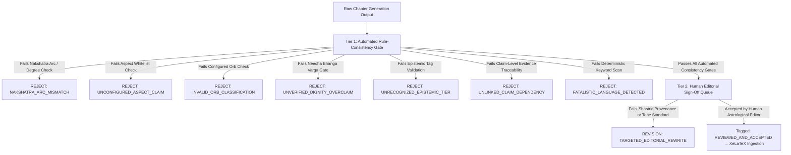

# Astro Sushil Content-Quality & Editorial Validation Rubric

**Document ID:** `CONTENT_QUALITY_RUBRIC`  
**Phase:** Phase 1G Deliverable (Final Schema Closure)  
**Status:** REVISED & FINALIZED (PHASE 1G FINAL)  
**Applicability:** Automated Post-Generation Verification Gate & Human Editorial Sign-Off  
**Governing Standard:** Two-Tier Quality Gateway Architecture with Comprehensive Claim-Level Provenance
**Validator Engine:** [`CHAPTER_CONTENT_SCHEMA.ts`](file:///home/pilot/Projects/astrosushil/docs/editorial_rebuild/CHAPTER_CONTENT_SCHEMA.ts) | Executable: [`scripts/validate-sample-monograph.ts`](file:///home/pilot/Projects/astrosushil/scripts/validate-sample-monograph.ts)

---

## 1. Quality Philosophy: Algorithmic Rule Consistency & Human Editorial Governance

A fundamental tenet of the Astro Sushil platform is epistemic integrity:
1. **Automated checks establish consistency with configured system rules, NOT universal astrological truth.**  
   Astrology encompasses diverse historical traditions, conflicting house systems, differing ayanamsas, and varying commentaries on planetary strengths. An automated test suite verifies that the generated output strictly obeys our configured calculation parameters (e.g. Swiss Ephemeris Lahiri sidereal longitudes, Whole Sign house boundaries, documented aspect whitelists, and configured orb thresholds). It cannot and does not claim to prove "absolute classical authenticity" or "universal astrological dogma."
2. **Human editorial review is irreplaceable.**  
   Automated parsers can flag missing fields, mathematical discrepancies, and prohibited fatalistic tokens. However, only qualified human astrological editors can evaluate traditional-source citations, assess nuanced modern vocational metaphors, ensure authentic consultative empathy, and verify that interpretations reflect genuine epistemic humility.

Under this standard, every generated consultation monograph must successfully clear the **Two-Tier Quality Gateway**:



---

## 2. The 9 Core Evaluation Criteria

### Criterion 1: Mathematical Coordinate & Nakshatra Arc Consistency (CRITICAL GATE)
- **Rule:** Every cited Nakshatra and Pada must match the deterministic mathematical position generated by the calculation engine ($13^\circ 20'$ per Nakshatra, $3^\circ 20'$ per Pada under Lahiri Sidereal reckoning).
- **Prohibited:**
  - Assigning degrees $00^\circ 00' - 03^\circ 20'$ Scorpio to anything other than Vishakha Pada 4.
  - Assigning degrees $03^\circ 20' - 16^\circ 40'$ Scorpio to anything other than Anuradha (Padas 1–4).
  - Assigning degrees $16^\circ 40' - 30^\circ 00'$ Scorpio to anything other than Jyeshtha (Padas 1–4).
- **Automated Check:** Verified mathematically against `@astro/astrology-engine`.

### Criterion 2: Configured Aspectual Geometry Whitelist (CRITICAL GATE)
- **Rule:** Texts may only reference planetary aspects matching the configured system rules documented in [`INTERPRETIVE_CONVENTIONS.md`](file:///home/pilot/Projects/astrosushil/docs/editorial_rebuild/INTERPRETIVE_CONVENTIONS.md):
  - Standard 7th aspect for all physical planets.
  - Special full aspects: Mars (4th, 7th, 8th), Jupiter (5th, 7th, 9th), Saturn (3rd, 7th, 10th).
  - Configured trinal aspects for Rahu/Ketu (5th, 7th, 9th).
- **Prohibited:**
  - Inventing non-existent aspects (e.g. Saturn casting an "11th aspect" or "backward sight").
  - Conflating an aspect on a **house** with an aspect on that house's **lord** (e.g. asserting Saturn aspects the 10th house when it actually aspects the 10th lord Sun in the 2nd house).
- **Automated Check:** Whitelist cross-reference against pre-calculated `verifiedAspectWhitelist`.

### Criterion 3: Configured Orb Discipline (CRITICAL GATE)
- **Rule:** Two planets residing in the same 30° zodiacal sign must adhere to Astro Sushil's **configured editorial convention**:
  - $\le 5^\circ 00'$: Close degreewise conjunction (`CLOSE_CONJUNCTION`).
  - $5^\circ 00' - 10^\circ 00'$: Moderate degreewise conjunction (`MODERATE_CONJUNCTION`).
  - $> 10^\circ 00'$ (up to $29^\circ 59'$): **Wide sign-based co-occupancy (`WIDE_SIGN_COOCCUPANCY`)**.
- **Prohibited:**
  - Describing D10 Sun (00° 05' Aries) and Saturn (19° 39' Aries), separated by 19° 34', as a "tight conjunction" or "combust fusion".
  - Claiming that these numerical orb boundaries are universal astrological laws rather than Astro Sushil's configured editorial standard.
- **Automated Check:** Angular separation calculation; flags conjunction language if separation $> 10^\circ$.

### Criterion 4: Dignity Qualification & Neecha Bhanga Scrutiny (CRITICAL GATE)
- **Rule:**
  - Distinguish between a planet being in its **exaltation sign** (*Uchcha Rashi*) versus its **exact deep exaltation degree** (*Paramochcha Bhaga*).
  - **No Unverified Neecha Bhanga in Vargas:** Definitive claims of Neecha Bhanga inside divisional charts (D10, etc.) are strictly prohibited. The calculation engine evaluates Neecha Bhanga exclusively for D1 Rashi, and divisional chart applicability remains historically contested across classical traditions.
- **Automated Check:** Regex scan for `Neecha Bhanga` in varga chapters. Triggers immediate rejection if asserted as an established fact in D10.

### Criterion 5: Canonical Epistemic Taxonomy & Strict 1:1 Tier Matching (CRITICAL GATE)
- **Rule:** Every analytical assertion must bear an epistemic tag matching one of the seven canonical tiers:
  1. `CALCULATED_FACT`
  2. `TRADITIONAL_SHASTRA`
  3. `NADI_PROGRESSION`
  4. `MODERN_VOCATIONAL_EXTRAPOLATION`
  5. `INTERPRETIVE_SYNTHESIS`
  6. `INTERPRETIVE_CONVENTION`
  7. `DISPUTED_OR_UNVERIFIED`
- **Strengthened Phase 1F Validator Invariant:** The claim's declared `epistemicTier` must **strictly match** the `canonicalTier` of the referenced evidence record in `EVIDENCE_ID_REGISTRY.md`. Cross-tier drift (e.g., tagging a shastric citation as `CALCULATED_FACT` or tagging an extrapolation as `INTERPRETIVE_SYNTHESIS` without a registered synthesis record) is strictly barred and triggers `TIER_MISMATCH`.
- **Prohibited:** Unrecognized tags, improvised variants (e.g. `[Epistemic: FACT]`, `[Epistemic: ASTRONOMICAL]`), unclassified claims, or tier drift.
- **Automated Check:** `validateAnalyticalClaim()` checks exact membership in `VALID_EPISTEMIC_TIERS` and verifies `claim.epistemicTier === regRecord.canonicalTier`.

### Criterion 6: Anti-Fatalism & Contextual Non-Determinism (CRITICAL GATE)
- **Rule:** Astrological placements represent psychological inclinations, environmental timings, and symbolic archetypes, never immutable destinies or guaranteed outcomes.
- **Prohibited Phrases & Contextual Guarantees:**
  - Direct guarantees: `"ensures"`, `"guarantees"`, `"destined to"`, `"immune to"`, `"career peaks when"`, `"will certainly attract"`.
  - Contextual guarantees: `"ensuring authority is grounded"`, `"acts as an enduring buffer"`, `"serves as an explicit risk indicator"`.
  - Empirical overclaims: Stating that a placement establishes an "actual legal or contractual liability" in real-world commerce.
- **Approved Consultative Phrasing:**
  - `"traditionally indicates"`, `"tends to foster"`, `"strongly supports"`, `"creates favorable conditions for"`, `"is most effectively realized when"`, `"highlights the practical importance of"`, `"encouraging you to ground authority in demonstrated competence"`.
- **Automated Check:** Lexical regex scanner and contextual phrase parser.

### Criterion 7: Natural Human-Readable Prose & Monograph Dignity
- **Requirement:** The text must read as an eloquent, dignified consultation monograph authored by an expert Vedic scholar.
- **Defects:** Bullet-heavy staccato lists masquerading as prose; sterile software jargon; mechanical repetition.
- **Standard:** Flowing, multi-paragraph narrative with varied sentence structures (12–28 words average) and clear logical transitions.

### Criterion 8: Complete Claim-Level Traceability & Heuristic Lexical Divergence Check (CRITICAL GATE)
- **Requirement:** 100% of analytical claims must trace to active, atomic `evidenceId` entries in [`EVIDENCE_ID_REGISTRY.md`](file:///home/pilot/Projects/astrosushil/docs/editorial_rebuild/EVIDENCE_ID_REGISTRY.md). Compound IDs bundling facts with extrapolations are prohibited.
- **Strengthened Validator Invariants:**
  1. **Existence:** Referenced `evidenceId` must exist in active evidence registry. Missing IDs trigger `NONEXISTENT_EVIDENCE_ID`.
  2. **Non-Empty Dependencies:** Every claim must declare `evidenceDependencies.length >= 1`. Empty arrays trigger `EMPTY_EVIDENCE_DEPENDENCIES`.
  3. **Mandatory Shastric Citation:** Claims categorized as `TRADITIONAL_SHASTRA` must include both `classicalSourceReference.source` (valid enum) and a non-empty `chapterAndVerse`. Omission triggers `MISSING_TEXTUAL_PROVENANCE`.
  4. **Disputed Claims Exclusion:** Claims with `DISPUTED_OR_UNVERIFIED` cannot be asserted as accepted claims in customer-facing content. Violation triggers `DISPUTED_CLAIM_PROHIBITED`.
  5. **Heuristic Lexical Divergence Check:** Paragraph `renderedText` must substantively reflect the constituent claims (concept overlap ratio $\ge 0.25$). Grossly drifting or placeholder prose triggers `RENDERED_TEXT_DIVERGENCE`.
     > [!IMPORTANT]
     > **METHODOLOGICAL LIMITATION & SCOPE OF LEXICAL OVERLAP:**  
     > The 25% lexical-overlap threshold is a shallow heuristic divergence guard designed solely to catch gross topic drift or unbacked placeholder text. **It does not establish semantic equivalence**, **it does not prove that every rendered sentence is supported**, and **it cannot replace human editorial review**. It must NEVER be described as "semantic validation".
  6. **Zero Unvalidated Free-Text:** Practical strategies, developmental cautions, key takeaways, and section transitions must all be structured typed objects (`StructuredParagraph`, `StructuredKeyTakeaway`, `StructuredRemedialItem`) backed by analytical claims.
- **Automated Check:** Verified via `validateAnalyticalClaim()`, `validateStructuredParagraph()`, and `validateThematicSection()`.

### Criterion 9: Empathy Without Fabricated Intimacy
- **Requirement:** Respectful, direct second-person address ("You", "Your chart").
- **Prohibited:**
  - Impersonating Sushil Kumar by claiming he personally meditated on, prayed over, or met the client, without explicit written human authorization.
- **Automated Check:** Scan for unauthorized first-person claims (`"I saw your face"`, `"When I meditated on your chart"`, `"Sushil Kumar personally evaluated"`).

### Criterion 10: Structured Customer-Facing Remedial Content (CRITICAL GATE)
- **Requirement:** Every customer-facing remedial recommendation must be a fully typed `StructuredRemedialItem`:
  - `specificRecommendation`: Must be a `StructuredParagraph` with valid, claim-linked assertions. Unrestricted free-text is barred.
  - `practicalProtocol`: Must consist of typed `RemedialProtocolStep` items, where each step has `instructionText` and a claim-linked `claim`.
  - `ethicalDisclaimer`: Must be a structured paragraph linked to standard ethical disclosure claims.
  - `title`: Must not contain fatalistic assertions or unbacked claims (`"guaranteed"`, `"curative"`, `"miracle"`, `"permanent protection"`).
- **Automated Check:** Verified via `validateStructuredRemedialItem()`. Triggers `UNSUPPORTED_REMEDY_PROSE` or `UNSUPPORTED_ASSERTION_IN_TITLE`.

### Criterion 11: Epigraph Provenance & Translation Integrity (CRITICAL GATE)
- **Requirement:** Every chapter epigraph must be a fully typed `ChapterEpigraph`:
  - `classicalSourceReference`: Must specify a named classical source (`source`) and specific `chapterAndVerse` location.
  - `transliterationIast`: Must provide standard IAST romanization.
  - `editorialTranslation`: Must be an `EditorialTranslation` object specifying `translationType` ('AUTHENTICATED_LITERAL_TRANSLATION', 'EDITORIAL_METAPHRIC_TRANSLATION', or 'SCHOLARLY_PARAPHRASE') linked to a valid `AnalyticalClaim`.
  - Unverified translations cannot masquerade as authenticated classical quotations.
- **Automated Check:** Verified via `validateChapterEpigraph()`. Triggers `UNVERIFIED_EPIGRAPH_TRANSLATION` or `MISSING_TEXTUAL_PROVENANCE`.

---

## 3. Two-Tier Scoring & Verification Thresholds

| Gateway Tier | Evaluation Focus | Tool / Method | Threshold Requirement | Failure Consequence |
| :--- | :--- | :--- | :--- | :--- |
| **Tier 1 (Automated)** | Nakshatra Arc & Degree Bounds | Deterministic Engine Verifier | 100% Match with Configured Parameters | Immediate Execution Halt |
| **Tier 1 (Automated)** | Parashari Aspect Whitelist | Whitelist Cross-Referencer | Zero Unlisted Aspect Claims | Immediate Execution Halt |
| **Tier 1 (Automated)** | Configured Orb Discipline | Separation Distance Calculator | Zero Misclassified Orbs | Immediate Execution Halt |
| **Tier 1 (Automated)** | Varga Neecha Bhanga Guard | Shastric Condition Validator | Zero Definitive Neecha Bhanga Claims in Vargas | Immediate Execution Halt |
| **Tier 1 (Automated)** | Canonical Epistemic Tags & Tier Match | `validateAnalyticalClaim` | 100% Canonical Tags; Strict 1:1 Registry Tier Match | Immediate Execution Halt |
| **Tier 1 (Automated)** | Classical Shastric Provenance | `validateAnalyticalClaim` | Mandatory `source` + `chapterAndVerse` for `TRADITIONAL_SHASTRA` | Immediate Execution Halt |
| **Tier 1 (Automated)** | Customer Disputed Claims Guard | `validateAnalyticalClaim` | Zero `DISPUTED_OR_UNVERIFIED` in Customer Copy | Immediate Execution Halt |
| **Tier 1 (Automated)** | Heuristic Lexical Divergence Guard | `validateStructuredParagraph` | Concept Overlap Ratio $\ge 0.25$ (Non-Semantic Divergence Filter) | Immediate Execution Halt |
| **Tier 1 (Automated)** | Remedial Content Provenance | `validateStructuredRemedialItem` | 100% Claim-Linked Recommendations, Protocols & Disclaimers | Immediate Execution Halt |
| **Tier 1 (Automated)** | Epigraph Provenance & Translation Guard | `validateChapterEpigraph` | Verified Classical Source, Specific Location & Translation Claim | Immediate Execution Halt |
| **Tier 1 (Automated)** | Anti-Fatalism Vocabulary | Regex & Phrase Parser | Zero Prohibited Fatalistic Tokens | Rejection & Re-generation |
| **Tier 1 (Automated)** | Atomic Evidence Registry Traceability | Registry Cross-Referencer | 100% Atomic Evidence IDs Registered & Valid | Immediate Execution Halt |
| **Tier 2 (Human)** | Shastric Textual Provenance | Astrological Editor Review | Verified Classical Context | Targeted Section Revision |
| **Tier 2 (Human)** | Consultative Voice & Ethics | Editorial Reviewer Sign-Off | Alignment with Consultation Standards | Revision Required |
| **Tier 2 (Human)** | Vocational Relevance & Depth | Subject-Matter Expert Inspection | Meaningful Real-World Guidance | Revision Required |

---

## 4. Human Editorial Sign-Off Schema & Example Template (Non-Executed)

> [!IMPORTANT]
> **CRITICAL GOVERNANCE DIRECTIVE:**
> The following JSON structure represents the formal data contract and **non-executed example template** for Tier 2 human editorial review. It does **NOT** constitute an executed sign-off or imply that human review has occurred for sample monographs. All sample chapters in this repository currently carry the status `PENDING_HUMAN_REVIEW`. Customer-facing release to XeLaTeX compilation is strictly blocked until an authorized human astrological editor evaluates the monograph and issues a digitally signed approval record.

```json
{
  "editorialSignOffSchemaExample": {
    "reportId": "CR-PUNEET-2026-EXAMPLE",
    "chapterId": "ch04_d10_dashamsha_map",
    "humanReviewStatus": "PENDING_HUMAN_REVIEW",
    "reviewedBy": null,
    "reviewedAt": null,
    "verificationChecklist": {
      "configuredRuleConsistencyConfirmed": false,
      "shastricTextualCitationsVerified": false,
      "fatalisticLanguageAbsent": false,
      "configuredOrbDistinctionMaintained": false,
      "vargaNeechaBhangaOverclaimExcluded": false,
      "atomicClaimLevelTraceabilityEnforced": false,
      "canonicalEpistemicTiersEnforced": false,
      "consultativeEmpathyStandardMet": false
    },
    "reviewerNotes": "PENDING INSPECTION: Sample monograph must be reviewed by senior human astrological editor prior to production authorization."
  }
}
```
