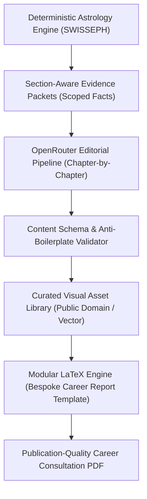

# Forensic Audit: Editorial & Content Generation System

**Document ID:** `EDITORIAL_REBUILD_AUDIT`  
**Date:** November 17, 2026  
**Status:** COMPLETE (Phase 0 Audit Deliverable)  
**Target:** Astro Sushil Report Generation Ecosystem (Career Report Pilot Focus)  
**Reference Benchmark:** `Career Report(3).pdf` (Astro Arun Pandit, 138 pages)

---

## 1. Executive Summary

This forensic audit investigates the architectural, editorial, and technical root causes behind the quality deficits in Astro Sushil's existing Career Report PDF.

While Phases 2A through 2E successfully established mathematical calculation determinism, strict type safety, zero-defect compilation, and a unified 14-page visual design system prototype, the core customer-facing editorial experience remains deeply flawed. The current 68-page report reads like an internal software engineering diagnostic register rather than a warm, authoritative, premium Vedic astrological consultation.

### Summary Comparison: Existing vs. Reference Benchmark

| Dimension | Existing Astro Sushil Career Report | Benchmark Reference (`Career Report(3).pdf`) | Target Architecture |
| :--- | :--- | :--- | :--- |
| **Document Purpose** | Technical calculation audit & diagnostic dump | Personal, empowering executive consultation | Premium, illustrated consultation monograph |
| **Editorial Tone** | Dry, clinical, repetitive software jargon | Warm, accessible, insightful, inspirational | Authoritative, empathetic, clear, traditional |
| **Narrative Depth** | 40–120 words per box; rigidly isolated | Multi-paragraph cohesive prose with life stages | Developed multi-paragraph thematic narratives |
| **Visual Assets** | 0 image assets; bare TikZ wireframes | 21 full-page art spreads; elegant vector icons | Curated public-domain/vector art library |
| **Page Density** | 55.9% of pages under 60% vertical body utilization | Natural, balanced page flow with framed borders | Fluid editorial pagination; zero artificial fillers |
| **Customer Framing** | "PASSED: 100% Consistent", "SAV Mean 28.08" | "Embarking Your Career Quest", "The Voyage" | Evidence-grounded Vedic career wisdom |
| **Authorship** | Unapproved placeholder / generic machine text | Clear, dignified author voice and philosophy | Astro Sushil editorial voice (approved framing) |

---

## 2. Root Cause Analysis: Why Current Sections Are Short, Generic, and Fragmented

### Root Cause 1: The Monolithic Single-Prompt LLM Generation Anti-Pattern
In `packages/prediction-engine/src/providers/openrouter-career-analysis.provider.ts` and `career-analyst.prompt.ts`, the system attempts to generate the entire report's interpretive content across **158 distinct fields** in a single HTTP request to OpenRouter.

```text
1 System Prompt + 1 Massive Input Payload (All 12 Houses + 9 Planets + Balas + Yogas + Dashas)
   ↳ OpenRouter Single-Shot API Call
      ↳ Expects JSON with 32 macro fields + 72 house fields + 54 planet fields = 158 fields!
```

To prevent HTTP timeouts (`timeoutMs: 30000`) and avoid model context token truncation (`max_tokens: 12000–16000`), the engineering system placed draconian length constraints on the LLM:
- Macro fields: `80-120 words`.
- House fields: `40-70 words` across 6 fragmented sub-keys (`houseMeaning`, `careerRelevance`, `supportingEvidence`, `constructiveExpression`, `potentialChallenge`, `practicalInterpretation`).
- Planet fields: `40-70 words` across 6 fragmented sub-keys.
- Action priorities: `1-2 sentences`.

**Consequence:** The model is structurally prohibited from writing multi-paragraph narrative essays, storytelling, or nuanced astrological synthesis.

### Root Cause 2: Truncation Panic Shrinking Content Further
When any OpenRouter model approaches output token limits (`finishReason === 'length'`), the retry handler in `openrouter-career-analysis.provider.ts` triggers this explicit instruction:
```typescript
correctionPrompt = 'Your previous output was truncated because it exceeded max token limits. Please be more concise (40-60 words per field) and output strictly valid compact JSON without extra explanations.';
```
The model is actively trained and prompted to be *more generic, shorter, and less detailed* on subsequent attempts.

### Root Cause 3: Rigid Modular Box LaTeX Architecture
The LaTeX template `packages/report-engine/templates/main.tex` forces content into rigid two-column `tcolorbox` layouts:
```latex
\TwoCol{%
  \begin{insightbox}\SunCareerSignificance\end{insightbox}
  \begin{goldbox}\SunConstructiveExpression\end{goldbox}
}{%
  \begin{unavailablebox}\SunPotentialChallenge\end{unavailablebox}
  \begin{insightbox}\SunPracticalCareerInterpretation\end{insightbox}
}
```
Each box holds only 40–70 words. Visually, these boxes divide the page into four tiny detached tiles. Once those tiles are drawn, an unconditional `\clearpage` is issued, leaving 40–50% of the lower page blank.

### Root Cause 4: Over-Engineered Software Engineering Terminology
The customer-facing report was burdened with internal software verification artifacts:
- Verification status pills (`\RenderVerifiedStatus`, `\StatusPill{VERIFIED}`).
- Audit assertions (`PASSED: 100% Consistent`).
- Mathematical formula descriptions (`SAV bindus represents mathematical mean benchmark 337 / 12 = 28.08`).
- Calculation parameters (`Geocentric Topocentric-Corrected`, `Calculation Timestamp UTC`).
- Database tracking tokens (`CR-DES-009`, `PROTOTYPED_IN_PHASE_2E_B`).

A customer seeking career guidance does not care about JSON schema validation flags; they care about their professional trajectory, optimal work environments, leadership style, timing windows, and practical remedies.

### Root Cause 5: Unconditional Page Breaking on Divisional Charts (Vargas)
In `main.tex`, the `\VargaSectionPage` macro is invoked 16 times in succession for charts D1 through D60. Each invocation prints:
1. One TikZ diamond chart (`\RenderNorthIndianKundli`).
2. Two sentences of "Divisional Chart Purpose".
3. Two sentences of "Divisional Career Relevance".
4. Two sentences of "Deterministic Synthesis".
5. An unconditional `\clearpage`.

This directly produced the defect identified by the user: *"Kundli followed by two generic sentences and an unnecessary page break."*

### Root Cause 6: Total Absence of Visual and Illustration Assets
As discovered in `packages/report-engine`, there is not a single `.png`, `.jpg`, or `.svg` asset in the entire package. While the benchmark reference contains 21 evocative chapter-opening art spreads, decorative borders, and celestial icons, Astro Sushil has relied 100% on bare TikZ vector lines.

---

## 3. Analysis of the Reference Benchmark (`Career Report(3).pdf`)

An exhaustive analysis of the 138-page reference report reveals why it is successful with users:

### A. Thematic Chapter Structure (The Hero's Journey)
Rather than listing 12 houses and 9 planets in dry catalog order, the reference organizes career analysis into an evocative, human-centered narrative:
1. **Orientation & Welcome:** Welcomes the client, introduces Vedic astrology as a navigational roadmap, and sets an empowering, non-fatalistic expectation.
2. **Foundational Blueprint (Mysteries of Lagna):** Core identity, Lagna lord placement, 10th house mandate, 6th house work routine, 7th house partnerships, 11th house gains, 2nd house wealth.
3. **Dedicated Career Chart (The D10 Map):** Professional persona in D10, 10th lord strength, routine, and institutional collaborations.
4. **Nadi Progression (Bhrigu Nandi Nadi):** Career karaka Saturn, planetary chains, and degree-based career progression.
5. **The Career Voyage (Life Phases):** Early education and student foundations, first earnings, career ascent and promotions, stormy seas and obstacles, job changes and career pivots, and retirement/legacy.
6. **Government vs. Private Sector Dynamics:** Sun/Saturn authority signatures, 6th/10th house governance, and Rajya Seva yogas.
7. **Entrepreneurial Potential:** Business compass (Sun, Mercury, Venus), partnership currents, and Ashtakavarga work-to-reward ratio.
8. **The Cosmic Clock (Timing & Transits):** Active Vimshottari dasha, major transits of Saturn, Jupiter, Rahu, and Ketu.
9. **Remedial Guidance:** Gemstones (Emerald/Panna), Rudraksha recommendations, mantra chanting, Astro-Vastu directional alignments, lifestyle adjustments, and selfless service (Seva).
10. **Actionable Roadmap:** Atmakaraka/Amatyakaraka soul direction, top 3-5 industry fits, and practical execution steps.

### B. Language & Rhetoric
- **Direct Second-Person Engagement:** "You are a Scorpio rising and your Lagna lord Mars is sitting in the 11th house. That means your energy lights up your friendships, dreams and social circles."
- **Deconstructive Explanations:** Explains *why* a placement produces a tendency before giving advice.
- **Bullet-Point Flourishes:** High-density paragraphs followed by elegant bulleted summaries introduced with decorative unicode marks (`✦`, `❖`, `✤`, `➤`, `✶`).
- **Balanced Realism:** Clearly addresses challenges (fear of failure, power struggles, workplace politics) alongside strengths.

---

## 4. Remediation Blueprint

To achieve publication-quality consultation reports without compromising calculation integrity or violating architectural constraints:



1. **Deconstruct the Monolithic LLM Request:** Break report generation into 8–10 independent chapter batches. Each batch receives only its relevant, verified chart evidence packet and generates rich, multi-paragraph prose.
2. **Implement Dynamic OpenRouter Model Discovery:** Query `https://openrouter.ai/api/v1/models` at runtime to detect active free models and route requests cleanly without hardcoded failure.
3. **Eradicate Software Jargon from Customer PDFs:** Confine verification logs, SHA-256 hashes, and diagnostic data to the Technical Appendix or backend audit trail.
4. **Build a Curated, Non-AI Illustration Library:** Establish a verified repository of high-resolution public-domain astronomical plates, Indian cosmic artwork, and SVG icons.
5. **Re-architect LaTeX Templates:** Eliminate `\TwoCol` box cages for long narrative chapters; introduce flowing editorial columns, chapter splash pages, and elegant framed borders modeled after the benchmark.

