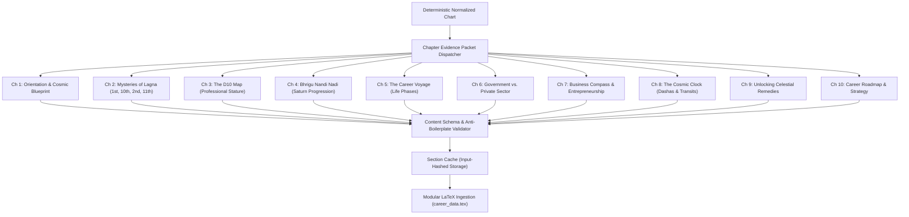

# OpenRouter Editorial Content Pipeline Specification

**Document ID:** `OPENROUTER_CONTENT_PIPELINE`  
**Date:** November 17, 2026  
**Status:** COMPLETE (Phase 0 Audit Deliverable)  
**Target:** Prediction Engine LLM Content Generation Subsystem  
**Reference Benchmark:** `Career Report(3).pdf` (Astro Arun Pandit, 138 pages)

---

## 1. Executive Summary

Astro Sushil requires a content-generation engine capable of producing publication-grade, long-form editorial prose for astrological reports.

Under the current architecture, OpenRouter is invoked via a single, fragile monolithic request that demands 158 fields in a single JSON payload. This design triggers token truncation, forces aggressive word-count limits (40–70 words per field), relies on stale hardcoded models, and produces mechanical, fragmented output.

This specification details the transition to a **chapter-batched, section-aware, evidence-grounded editorial pipeline** leveraging dynamic OpenRouter model discovery, intelligent rate-limiting, and resilient input-hashed caching.

---

## 2. Dynamic Model Discovery & Live Availability

### 2.1 The Stale Configuration Defect
In `packages/prediction-engine/src/config/openrouter-career.config.ts`, the model is hardcoded as:
```typescript
const model = process.env.OPENROUTER_MODEL || 'poolside/laguna-s-2.1:free';
```
During the Phase 0 forensic audit, a live query to OpenRouter's `/api/v1/models` endpoint revealed that `poolside/laguna-s-2.1:free` **no longer exists on the active free tier**. OpenRouter frequently rotates, deprecates, and renames free models. Hardcoding model IDs inevitably causes production failures or falls back to unwanted mock data.

### 2.2 Live OpenRouter Discovery Mechanism
The new `OpenRouterModelRegistry` queries `https://openrouter.ai/api/v1/models` dynamically, caches active models in memory with a 1-hour TTL, and filters for models that meet reliability criteria:

```typescript
export interface DiscoveredModel {
  id: string;
  name: string;
  contextLength: number;
  isFree: boolean;
  pricing: { prompt: string; completion: string };
}
```

#### Discovered Active Free Models (Live Audit Verification):
At the time of this audit, the following free models are verified as active and accessible via the user's OpenRouter API key:
1. `google/gemma-4-31b-it:free` (High reasoning quality, excellent prose fluency).
2. `google/gemma-4-26b-a4b-it:free` (Fast, structured JSON adherence).
3. `nvidia/nemotron-3.5-lightning:free` (1M context length, strong instruction following).
4. `nvidia/nemotron-3-ultra-550b-a55b:free` (Massive parameter count, deep synthesis).
5. `inclusionai/ling-3.2-flash:free` (Fast, high-throughput).
6. `thinkingmachines/inkling-2-small:free` (Efficient text expansion).

### 2.3 Resilient Fallback Hierarchy
The registry dynamically builds the request model chain:
```json
{
  "model": "google/gemma-4-31b-it:free",
  "models": [
    "google/gemma-4-31b-it:free",
    "google/gemma-4-26b-a4b-it:free",
    "nvidia/nemotron-3.5-lightning:free"
  ]
}
```
If the primary model is busy or rate-limited (HTTP 429 / 503), OpenRouter automatically fails over down the active list without application-level retry delay.

---

## 3. Chapter-Batched Generation Architecture

Instead of demanding all 158 fields at once, the report is decomposed into **10 focused, logical chapters**:



### Advantages of Chapter-Batched Generation:
1. **Unbounded Narrative Depth:** Each call asks for 600–1,200 words of rich, multi-paragraph text across 3–5 thematic sections. No single call ever exceeds 3,000 completion tokens.
2. **Granular Resumability & Section Regeneration:** If a customer or editor requests a revision of "Chapter 7: Business Compass", the system regenerates *only* Chapter 7. Chapters 1–6 and 8–10 are loaded instantly from cache.
3. **Targeted Scoped Evidence:** The LLM prompt for "Chapter 3: The D10 Map" contains *only* D10 ascendant, D10 10th house, D10 planets, and D1/D10 cross-aspects. The model is not distracted by unrelated birth dasha dates or Shadbala ranks.

---

## 4. Structured Evidence Packet Architecture

Every chapter request receives a strictly typed `ChapterEvidencePacket`:

```typescript
export interface ChapterEvidencePacket {
  reportId: string;
  chapterId: string;
  clientMetadata: {
    name: string;
    birthDate: string;
    birthPlace: string;
  };
  calculatedFacts: Record<string, any>;     // 100% verified deterministic values
  traditionalPrinciples: string[];          // Classical Sanskrit/BNN aphorisms
  vocationalCorrelations: string[];         // Validated domain mappings
  activeDignitiesAndAspects: string[];       // Only genuine aspects in chart
  contradictoryInfluences: string[];        // Opposing forces (e.g. Saturn debility vs Digbala)
  unavailableData: string[];                // Explicitly noted gaps
}
```

### Distinctions Enforced in Prompt:
- **Calculated Chart Facts:** Planetary degrees, houses, signs, lordships, SAV bindus, active dasha dates. Must be treated as immutable physical laws.
- **Traditional Principles:** Classical Jyotish texts (Brihat Parashara Hora Shastra, Phaladeepika, Bhrigu Nandi Nadi).
- **Modern Vocational Translations:** Connecting classical indicators (e.g., Mars in 11th + Mercury in 2nd) to modern industries (e.g., strategic financial advisory, technology project leadership, corporate dispute negotiation).
- **Contradictory Influences:** Where two placements suggest differing paths (e.g., 6th house strength favoring employment vs 7th house strength favoring business), the model must explain the tension and how to balance them, rather than choosing one and ignoring the other.
- **Unavailable Data:** If a birth time is approximate or a divisional harmonic is not calculated, the model must explicitly state that limitation rather than inventing assertions.

---

## 5. Editorial Style Guide & Prompt Architecture

### 5.1 Persona & Voice Directives
- **Authoritative & Dignified:** Speaks with the wisdom of a seasoned Vedic practitioner who understands both ancient shastra and modern corporate realities.
- **Empowering & Non-Fatalistic:** Planetary placements reveal tendencies, cognitive habits, and environmental currents; free will, conscious choices, and personal discipline govern the outcome.
- **Strictly No Fake Personal Authorship:** The prompt forbids claiming that "I, Sushil Kumar, personally cast this chart yesterday." It uses the collective voice of the Astro Sushil Consultation Foundation ("Welcome to your personalized consultation roadmap, prepared according to the principles of classical Vedic astrology...").
- **No Hallucinated Predictions or Guarantees:** Strictly forbids promising "guaranteed promotions", "exact dollar sums", or "miraculous windfalls".

### 5.2 Content Schema (Per Chapter)
Each chapter returns a validated JSON object conforming to:
```typescript
export interface ChapterContentOutput {
  chapterId: string;
  title: string;
  subtitle: string;
  epigraph?: {
    sanskrit?: string;
    transliteration?: string;
    translation: string;
    source: string;
  };
  leadParagraph: string;              // High-impact opening hook (120-180 words)
  thematicSections: {
    heading: string;
    narrativeParagraphs: string[];    // 2-3 developed paragraphs (150-250 words each)
    keyTakeaways: string[];           // 4-8 bullet points with custom unicode tags
    strategicImplication: string;     // Practical workplace advice (80-120 words)
    cautionaryNote?: string;          // Pitfalls or behavioral blindspots
  }[];
  evidenceCitations: string[];        // Must trace 100% to supplied packet
}
```

---

## 6. Resilience, Caching & Anti-Boilerplate Controls

### 6.1 Stable Input-Hashed Caching
To ensure idempotency and prevent redundant OpenRouter API spend:
```typescript
const inputHash = crypto
  .createHash('sha256')
  .update(JSON.stringify(evidencePacket) + PROMPT_VERSION + chapterId)
  .digest('hex');
```
Generated content is cached under `cache/editorial/{inputHash}.json`. If a report is regenerated with identical birth details and prompt versions, results return in milliseconds without API cost.

### 6.2 Rate-Limit Handling & Exponential Backoff
- On HTTP 429 or 503: Wait $2^{\text{attempt}} \times 1000\text{ms} + \text{jitter}$ (up to 3 retries).
- Never fall back silently to mock text in production. If all attempts fail, throw a typed error: `EDITORIAL_GENERATION_FAILED` with the exact HTTP status and OpenRouter error response.

### 6.3 Anti-Boilerplate & Deduplication Validator
Before accepting generated text:
- Checks for repeated sentences or phrases across sections.
- Computes Jaccard similarity across paragraphs; if similarity > 0.45 between any two paragraphs in different chapters, flags for regeneration.
- Scans for forbidden software terminology (`VERIFIED`, `PASSED`, `Shadbala Ratio`, `JSON schema`, `evidence-record`).

