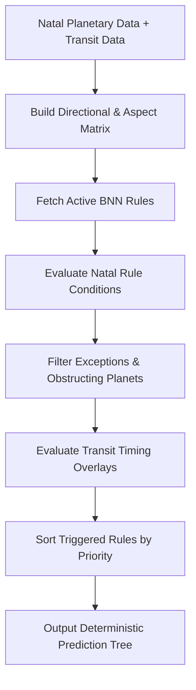

# Gupta Nadi Engine Technical Specification - Astro Sushil

This document specifies the architecture, inputs, outputs, rule representation structure, evaluation pipeline, and testing methodology for `packages/gupta-nadi-engine`.

> **IMPORTANT**: This engine strictly implements the client's proprietary **Brihaspati Nandi Nadi (BNN)** methodology. No formulas or astrological rules are invented in this specification. All rule sets and exact formula parameters must be provided by the client (`[CLIENT CONFIRMATION REQUIRED]`).

---

## 1. Purpose & Core Philosophy

The Gupta Nadi Engine evaluates planetary relationships, transit overlays, and combinations (yogas) based on Brihaspati Nandi Nadi (BNN) principles. 

Key principles:
1. **100% Deterministic**: Given the exact same chart data and transit timing, the engine must produce identical rule matches and prediction codes every single time.
2. **Auditable & Traceable**: Every prediction snippet must directly link to the specific Rule ID and planetary conditions that triggered it.
3. **No AI Inference**: The engine never uses LLMs or probabilistic heuristics to determine astrological rules or outcomes.

---

## 2. Input Data Requirements

The Gupta Nadi Engine consumes output from `packages/astrology-engine` and current transit parameters:

### 2.1 Natal Astrological Data
- **Planetary Vector**: Positions (sign, degree, house, retrograde status) for Sun, Moon, Mars, Mercury, Jupiter, Venus, Saturn, Rahu, Ketu.
- **Lagna (Ascendant)**: Sign and exact degree.
- **Planetary Directional Alignment**: Planetary distribution across direction vectors (East, South, West, North corresponding to Fire, Earth, Air, Water signs).
- **Planetary Friendship & Aspect Matrix**: Mutual relationships and directional combinations (1-5-9 trines, 2-12 adjacent, 3-11 sextiles, 7th opposite).

### 2.2 Transit Data (Gochar)
- Current or target date planetary longitudes, signs, and retrograde statuses (specifically Saturn, Jupiter, Rahu, Ketu).

---

## 3. Rule Representation Format

Rules are stored in structured JSON/TypeScript schemas. Each rule follows a standard declarative format:

```json
{
  "ruleId": "BNN-CAR-001",
  "domain": "CAREER",
  "title": "Saturn-Saturn Transit & Saturn-Jupiter Alignment",
  "priority": 100,
  "conditions": {
    "natalCombination": [
      {
        "planet": "Saturn",
        "aspectsOrTrines": ["Jupiter"],
        "maxOrbDegrees": 30.0
      }
    ],
    "transitCondition": {
      "transitPlanet": "Jupiter",
      "targetPlanet": "Saturn",
      "aspectType": "TRINE_1_5_9"
    }
  },
  "exceptions": [
    {
      "planet": "Rahu",
      "relationship": "INTERSECTING_ORB",
      "effect": "DELAY_OR_OBSTACLE"
    }
  ],
  "expectedResult": {
    "code": "CAREER_PROMOTION_FAVORABLE",
    "category": "CAREER",
    "timingWindowMonths": 12,
    "severity": "POSITIVE"
  },
  "referenceExample": "Chart Ref #BNN-REF-104 (Jupiter transit over Natal Saturn in 5th sign)"
}
```

### Rule Specification Schema Template
For encoding individual rules provided by the client:

- **Rule ID**: Unique alphanumeric code (e.g. `BNN-MAR-012`)
- **Domain**: Domain category (`CAREER`, `MARRIAGE`, `PROGENY`, `FINANCE`, `HEALTH`, `GENERAL`)
- **Conditions**: Required planetary placements, directional alignments (1-5-9, 2-12, 3-11, 7), sign elemental matches, and retrograde states.
- **Exceptions**: Neutralizing or modifying conditions (e.g. Rahu/Ketu intervention, combust states).
- **Priority**: Integer score resolving rule precedence when multiple rules trigger.
- **Expected Result**: Structured prediction code, impact polarity, and timing windows.
- **Reference Example**: Client-verified reference chart ID demonstrating the rule.

---

## 4. Evaluation Pipeline



1. **Matrix Construction**: Map planets into directional trines (East/South/West/North) and calculate angular separations.
2. **Natal Evaluation**: Match natal planetary alignments against rule criteria.
3. **Exception Handling**: Check if blocking planets (e.g. Rahu/Ketu interpositions) invalidate or modify the rule output.
4. **Transit Overlay**: Check current transit positions (e.g. Jupiter transiting natal Saturn or Saturn transiting natal Karma planet).
5. **Conflict & Priority Resolution**: When opposing rules trigger, sort by priority weight and client-defined precedence logic (`[CLIENT CONFIRMATION REQUIRED: Priority sorting rules]`).
6. **Output Generation**: Produce a structured JSON payload containing triggered Rule IDs, raw prediction statements, and timing windows.

---

## 5. Timing of Events (Gochar / Transits)

In BNN methodology, transits activate natal combinations:
- **Jupiter Transits**: Expand and activate events (brings results within 1-year transit windows).
- **Saturn Transits**: Impose karmic duty, structure, or delay (2.5-year transit windows).
- **Rahu/Ketu Transits**: Bring sudden shifts or karmic disruptions (1.5-year transit windows).

---

## 6. Output & Explainability

The output of the Nadi engine is a deterministic JSON document containing:
- List of triggered `RuleID`s.
- Structured prediction outputs (e.g. `MARRIAGE_TIMING_ACTIVE`, `CAREER_CHANGE_FAVORABLE`).
- Exact planetary evidence (e.g. "Saturn in East trine with Jupiter in 5th sign").
- Timing indicators.

> **Note**: The output contains NO AI-generated prose. It is fed into `packages/report-engine` and the LLM explanation layer for natural language conversion.

---

## 7. Reference Examples & Client Confirmations Required

| Parameter / Rule | Status | Action Required |
| :--- | :--- | :--- |
| **Complete BNN Rulebook** | `[CLIENT CONFIRMATION REQUIRED]` | Client must provide complete rule document / formula list |
| **Directional Orbs** | `[CLIENT CONFIRMATION REQUIRED]` | Confirm degree orb for trine/directional combinations |
| **Retrograde Planet Direction** | `[CLIENT CONFIRMATION REQUIRED]` | Confirm whether retrograde planets count from previous sign |
| **Rule Precedence Matrix** | `[CLIENT CONFIRMATION REQUIRED]` | Confirm resolution logic when positive and negative rules conflict |
| **Reference Charts** | `[CLIENT CONFIRMATION REQUIRED]` | Client to provide 10-20 benchmark charts with expected predictions |

---

## 8. Testing & Validation Methodology

1. **Unit Testing**: Test individual rule conditions in isolation using mock chart matrices.
2. **Fixture-Based Integration Testing**: Run the engine against client-supplied reference charts and verify 100% exact match of triggered Rule IDs.
3. **Regression Prevention**: Automated test suite executed on every pull request to ensure rule definitions remain strictly intact.
