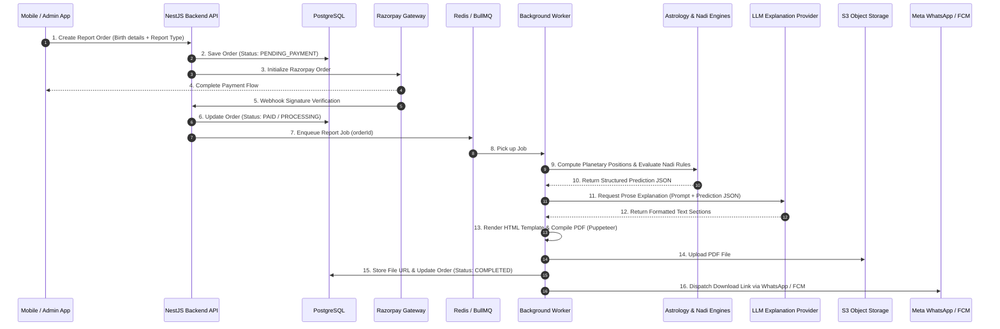

# Report Generation Pipeline Specification - Astro Sushil

This document specifies the end-to-end report generation architecture, data pipeline, template engine, asynchronous queue management, and LLM explanation layer for `packages/report-engine`.

---

## 1. Core Architecture Principle

The report generation pipeline enforces a strict, unidirectional processing flow:

```
[Astrology Engine Calculations]
               │
               ▼
[Gupta Nadi & Rule Evaluation]
               │
               ▼
[Deterministic Prediction JSON]
               │
               ▼
[LLM Natural Language Explanation]
               │
               ▼
[PDF Layout & Compilation]
               │
               ▼
[Object Storage & Notification]
```

> **CRITICAL DIRECTIVE**: The data pipeline is **Calculations → Deterministic Result → LLM Explanation → PDF Report**. The system MUST NEVER follow **LLM → Astrology Prediction**. The LLM is strictly an explanation and natural language formatting engine.

---

## 2. Report Types & Categories

### 2.1 Standard Paid Reports
1. **Marriage & Compatibility Report**
   - Ashtakoota / Dashakoota matching matrix.
   - Manglik Dosha evaluation & remedies.
   - 7th House & Venus/Jupiter planetary analysis.
   - Timing of marriage via Nadi transit overlays.

2. **Career & Financial Success Report**
   - D-10 Dasamsa chart analysis.
   - 10th House lord, Karma planet (Saturn) interactions.
   - Favorable vocational domains & timing of promotions/job changes.
   - Financial stability cycles (2nd & 11th House analysis).

3. **Childbirth & Family Expansion Report**
   - D-7 Saptamsa chart analysis.
   - 5th House, Jupiter, and progeny combinations.
   - Favorable time windows for childbirth/conception.

4. **Gupta Nadi Flagship Dossier**
   - Deep-dive BNN rule analysis across all major life domains.
   - Complete directional aspect matrix.
   - Key lifetime transit timeline (Saturn & Jupiter cycles).

5. **Future Custom Reports**
   - Architecture supports pluggable report definitions for Health, Education, Vastu Deep-Dive, and Annual Yearbooks.

---

## 3. End-to-End Processing Workflow



---

## 4. Asynchronous Queue & Status Management

Report generation is performed asynchronously via BullMQ background workers to prevent blocking backend HTTP workers.

### 4.1 Report Order Status Lifecycle
1. `PENDING_PAYMENT`: Order initialized, awaiting payment confirmation.
2. `PAID`: Payment verified successfully; job queued.
3. `CALCULATING`: Astrological math and Nadi rules currently evaluating.
4. `GENERATING_PROSE`: LLM actively formatting structured output into text.
5. `COMPILING_PDF`: HTML rendering and PDF conversion in progress.
6. `COMPLETED`: PDF uploaded to Object Storage; download URL active.
7. `FAILED`: Processing error encountered; queued for auto-retry or admin alert.

---

## 5. LLM Explanation Layer Specifications

### 5.1 LLM Role & Constraints
- **Role**: Translate technical astrological codes (e.g. `CAREER_PROMOTION_FAVORABLE`, `RULE_BNN_CAR_001`) into warm, compassionate, professional, and clear natural language.
- **Constraints**:
  - Temperature set to low (`0.2` - `0.3`) to prevent creative deviation.
  - Strict system prompt instructing the model to rely *only* on the provided JSON data.
  - Explicitly forbidden from inferring new predictions or adding uncalculated astrological placements.

### 5.2 Example Prompt Structure
```json
{
  "systemPrompt": "You are a professional astrological report writer for Astro Sushil. Translate the structured astrological prediction data below into a clear, compassionate, and readable section for a client's career report. Do NOT add any planetary positions, timing, or predictions not explicitly present in the input JSON.",
  "inputData": {
    "userFirstName": "Rahul",
    "domain": "CAREER",
    "triggeredRules": [
      {
        "ruleId": "BNN-CAR-001",
        "description": "Saturn and Jupiter in East directional trine",
        "prediction": "Favorable period for career advancement and increased responsibility.",
        "timing": "Next 12 months"
      }
    ]
  }
}
```

---

## 6. PDF Rendering & Storage Engine

1. **Templating Engine**: HTML5 / Handlebars / React PDF templates styled with custom CSS.
2. **PDF Compiler**: Headless Chrome (Puppeteer) converts responsive HTML layouts into high-resolution, print-ready PDF files.
3. **Branding Elements**: Premium typography, Astro Sushil cover pages, clean chart graphic embeds, and page numbering.
4. **Storage**: PDF files uploaded to S3-compatible Object Storage with presigned download URLs (expiring or secure public depending on client setting).

---

## 7. Delivery & Notifications

Upon completion, `packages/report-engine` triggers multi-channel delivery:
- **In-App Download**: Available in Flutter app under "My Reports".
- **WhatsApp Direct Delivery**: Media message sent via Meta WhatsApp Business API containing the PDF document.
- **Push Notification**: FCM alert sent to the user's mobile device.
