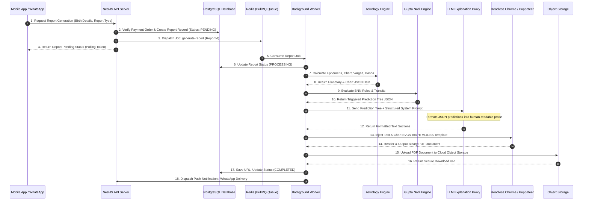

# Report Engine & PDF Generation Architecture - Astro Sushil

This specification defines the asynchronous report generation pipeline for `packages/report-engine`.

---

## 1. Architectural Philosophy

```
+-----------------------------------------------------------------------------------+
|                            MANDATORY REPORT PIPELINE                              |
|                                                                                   |
|  [ Astrological Math ] --> [ Gupta Nadi Rules ] --> [ Deterministic Prediction ]  |
|                                                                |                  |
|                                                                v                  |
|  [ Object Storage ] <-- [ PDF Generation ] <-- [ LLM Text Explanation Layer ]     |
+-----------------------------------------------------------------------------------+
```

> **CRITICAL RULE**: The pipeline flow MUST ALWAYS BE `Calculation -> Deterministic Prediction Output -> LLM Natural Language Formatting -> PDF Compilation`. Under no circumstances shall an LLM generate predictions or perform astrological calculations directly.

---

## 2. Supported Report Types

1. **Marriage & Compatibility Report**
   - Synastry chart overlays, Ashtakoota / Dashakoota points, Manglik Dosha evaluation, relationship longevity, planetary harmony, timing of marriage.
2. **Career & Professional Success Report**
   - D-10 Dasamsa analysis, Saturn Karma Karaka evaluation, favorable industry domains, career growth periods, job change timing.
3. **Childbirth & Family Expansion Report**
   - D-7 Saptamsa analysis, Jupiter transit timing, favorable time windows for conception/progeny.
4. **Gupta Nadi Flagship Dossier**
   - Deep BNN multi-domain breakdown covering career, finance, marriage, health, transits, and yearly remedies.
5. **Future Modular Report Types**
   - Designed to support pluggable template plugins (e.g. Health & Longevity Report, Financial Prosperity Report, Annual Solar Return / Varshaphal Report).

---

## 3. End-to-End Report Generation Lifecycle



---

## 4. Detailed Stage Specifications

### Stage 1: Asynchronous Queueing
- Job queues are managed via BullMQ on Redis.
- Concurrency and retry parameters:
  - Max Retries: 3 attempts with exponential backoff.
  - Job Timeout: 120 seconds.

### Stage 2: Astrological Computation & Rule Evaluation
- Compute natal planetary coordinates, houses, Vargas, and Vimshottari dasha periods.
- Run `packages/gupta-nadi-engine` to match relevant BNN rules for the requested report domain.

### Stage 3: LLM Explanation Formatting
- Construct a strict prompt containing:
  - System Instructions: "Act as a compassionate, professional Vedic Astrologer. Translate the provided prediction rules into fluent prose. Do not invent any predictions not present in the input JSON."
  - User Payload: Structured prediction JSON node tree.
- Format sections (Introduction, Strengths, Timeline, Challenges, Summary).

### Stage 4: Document Compilation (PDF Generation)
- Combine:
  - User birth details header.
  - High-resolution SVG renderings of D-1 and D-9 charts.
  - Planetary position table.
  - LLM-generated narrative prose.
  - Disclaimer footer.
- Render via Puppeteer (Headless Chrome) using styled HTML/CSS templates.

### Stage 5: Storage & Notification Delivery
- Save PDF to Cloud Object Storage (S3 / Cloudflare R2).
- Update database record state to `COMPLETED` with download expiry metadata.
- Trigger push notification via FCM or send WhatsApp PDF message payload via Meta API.
