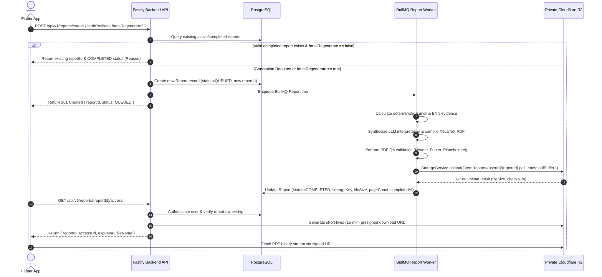

# Astro Sushil: Report Storage, Private Cloudflare R2 & Lifecycle Architecture

## 1. Overview & Provider Choice
- **Object Storage Provider**: **Cloudflare R2** (S3 V4 Compatible REST API).
- **Backend Abstraction**: `StorageService` (`apps/api/src/services/storage.service.ts`).
- **Access Protocol**: Pure backend-mediated private access via short-lived S3 V4 presigned URLs.
- **Client Security**: Neither Flutter mobile app nor Admin Next.js portal store or receive R2/S3 secret keys or bucket access credentials.

---

## 2. Bucket Security & Storage Key Format
- **Bucket Visibility**: 100% **Private**. Public bucket reads/listing are disabled.
- **Storage Key Standard**:
  ```
  reports/{userId}/{reportId}.pdf
  ```
- **Example Key**: `reports/usr_8f3c123/rpt_9a8b7c6d-5e4f-3a2b-1c0d-ef9876543210.pdf`
- **Versioning Strategy**: Every report generation and explicit user/admin regeneration creates a brand new unique `reportId` and corresponding key, preserving historical reports without overwriting previous PDFs.

---

## 3. Database vs Object Storage Model

```
                    ┌────────────────────────┐
                    │  PostgreSQL (Prisma)   │
                    │                        │
                    │  id (UUID)             │
                    │  userId                │
                    │  birthProfileId        │
                    │  reportType            │
                    │  status (COMPLETED)    │
                    │  storageKey            │
                    │  reportVersion         │
                    │  calculationVersion    │
                    │  fileSize              │
                    │  pageCount             │
                    │  createdAt / completedAt│
                    └───────────┬────────────┘
                                │
                                │  storageKey
                                ▼
                    ┌────────────────────────┐
                    │ Private Cloudflare R2  │
                    │   Object Storage       │
                    │                        │
                    │   PDF Binary Stream    │
                    └────────────────────────┘
```

---

## 4. End-to-End Report Generation Lifecycle



---

## 5. Security & Ownership Matrix

| Requester | Endpoint | Action | Result |
| :--- | :--- | :--- | :--- |
| **Owner (User A)** | `GET /api/v1/reports/{userA_reportId}/access` | Get signed URL | `200 OK` + Signed URL |
| **User B** | `GET /api/v1/reports/{userA_reportId}/access` | Attempt access | `403 Forbidden` / `404 Not Found` |
| **Unauthenticated** | `GET /api/v1/reports/{userA_reportId}/access` | Attempt access | `401 Unauthorized` |
| **Admin** | `GET /api/v1/reports/{userA_reportId}/access` | Audit / inspect report | `200 OK` + Signed URL |
| **Owner / Admin** | `DELETE /api/v1/reports/{reportId}` | Delete report | `200 OK` (Deletes R2 binary + DB row) |

---

## 6. Durability, Retention & Maintenance Strategy
1. **Durability**: Cloudflare R2 stores objects redundantly across multiple storage nodes with 99.999999999% (11 9s) annual durability.
2. **PostgreSQL + R2 Sync**: PostgreSQL backups store full relational metadata and `storageKey`. Database restores automatically point to persistent R2 storage keys.
3. **Orphaned Object Maintenance**: `StorageService.cleanupOrphanedObjects(validKeysSet)` scans storage keys against active database records and removes unreferenced binary objects older than a 24-hour grace period.
4. **Account Deletion**: User account deletion purges associated birth profiles, report metadata, and executes `storageService.delete(storageKey)` for all user PDFs.
