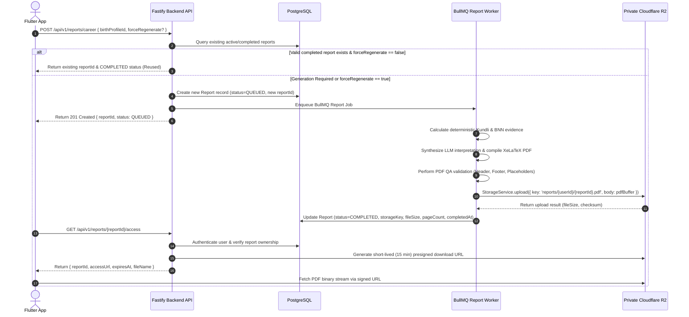

# Astro Sushil: Report Storage, Private Object Storage & Lifecycle Architecture

> **Update (website integration, 2026-11-24).** The storage layer is no longer tied to Cloudflare
> R2. `StorageService` talks to any S3-compatible store chosen by environment: the website's
> existing **AWS S3** bucket (owner decision for the website integration), Cloudflare R2, or local
> disk outside production. Selection: `STORAGE_PROVIDER=aws|r2|local`; when unset, R2 if its
> credentials are present (existing deployments are unchanged), otherwise AWS S3 if
> `AWS_STORAGE_BUCKET_NAME`, `AWS_S3_REGION_NAME`, `AWS_ACCESS_KEY_ID` and `AWS_SECRET_ACCESS_KEY`
> are all set, otherwise local disk. Wherever this document says "R2", read "the configured object
> store". The same service now also stores admin uploads, with two visibilities (`public` under
> `assets/`, `private` under `private/`); see `docs/integration/modules/uploads.md`.
>
> What this means for reports on the AWS bucket:
> - Report PDFs are uploaded **without any ACL** (private) and are still read only through
>   15-minute presigned URLs after the ownership check. Key format is unchanged.
> - The website bucket is not private as a whole: it serves public images under `assets/` through
>   per-object `public-read` ACLs, and holds website files directly under `reports/` (cover
>   backgrounds such as `reports/CAREER-REPORT.webp`). Section 2's "bucket 100% private" therefore
>   holds per object, not per bucket, on AWS.
> - `cleanupOrphanedObjects` only ever considers keys shaped `reports/<owner>/<file>`, so those
>   website files are never candidates for deletion.

## 1. Overview & Provider Choice
- **Object Storage Provider**: S3-compatible, chosen by environment: **AWS S3** (website bucket) or **Cloudflare R2** (S3 V4 REST API in both cases).
- **Backend Abstraction**: `StorageService` (`apps/api/src/services/storage.service.ts`), with the signer and HTTP client in `apps/api/src/services/storage/`.
- **Access Protocol**: Pure backend-mediated private access via short-lived S3 V4 presigned URLs.
- **Client Security**: Neither Flutter mobile app nor Admin Next.js portal store or receive R2/S3 secret keys or bucket access credentials.

---

## 2. Bucket Security & Storage Key Format
- **Object Visibility**: report PDFs are 100% **Private** (no public ACL is ever attached; on R2 the whole bucket is private).
- **Storage Key Standard**:
  ```
  reports/{userId}/{reportId}.pdf
  ```
- **Example Key**: `reports/usr_8f3c123/rpt_9a8b7c6d-5e4f-3a2b-1c0d-ef9876543210.pdf`
- **Versioning Strategy**: Every report generation and explicit user/admin regeneration creates a brand new unique `reportId` and corresponding key, preserving historical reports without overwriting previous PDFs.

---

## 3. Database vs Object Storage Model

```
                    ┌────────────────────────┐
                    │  PostgreSQL (Prisma)   │
                    │                        │
                    │  id (UUID)             │
                    │  userId                │
                    │  birthProfileId        │
                    │  reportType            │
                    │  status (COMPLETED)    │
                    │  storageKey            │
                    │  reportVersion         │
                    │  calculationVersion    │
                    │  fileSize              │
                    │  pageCount             │
                    │  createdAt / completedAt│
                    └───────────┬────────────┘
                                │
                                │  storageKey
                                ▼
                    ┌────────────────────────┐
                    │ Private Cloudflare R2  │
                    │   Object Storage       │
                    │                        │
                    │   PDF Binary Stream    │
                    └────────────────────────┘
```

---

## 4. End-to-End Report Generation Lifecycle



---

## 5. Security & Ownership Matrix

| Requester | Endpoint | Action | Result |
| :--- | :--- | :--- | :--- |
| **Owner (User A)** | `GET /api/v1/reports/{userA_reportId}/access` | Get signed URL | `200 OK` + Signed URL |
| **User B** | `GET /api/v1/reports/{userA_reportId}/access` | Attempt access | `403 Forbidden` / `404 Not Found` |
| **Unauthenticated** | `GET /api/v1/reports/{userA_reportId}/access` | Attempt access | `401 Unauthorized` |
| **Admin** | `GET /api/v1/reports/{userA_reportId}/access` | Audit / inspect report | `200 OK` + Signed URL |
| **Owner / Admin** | `DELETE /api/v1/reports/{reportId}` | Delete report | `200 OK` (Deletes R2 binary + DB row) |

---

## 6. Durability, Retention & Maintenance Strategy
1. **Durability**: Cloudflare R2 stores objects redundantly across multiple storage nodes with 99.999999999% (11 9s) annual durability.
2. **PostgreSQL + R2 Sync**: PostgreSQL backups store full relational metadata and `storageKey`. Database restores automatically point to persistent R2 storage keys.
3. **Orphaned Object Maintenance**: `StorageService.cleanupOrphanedObjects(validKeysSet)` scans storage keys against active database records and removes unreferenced binary objects older than a 24-hour grace period.
4. **Account Deletion**: User account deletion purges associated birth profiles, report metadata, and executes `storageService.delete(storageKey)` for all user PDFs.
